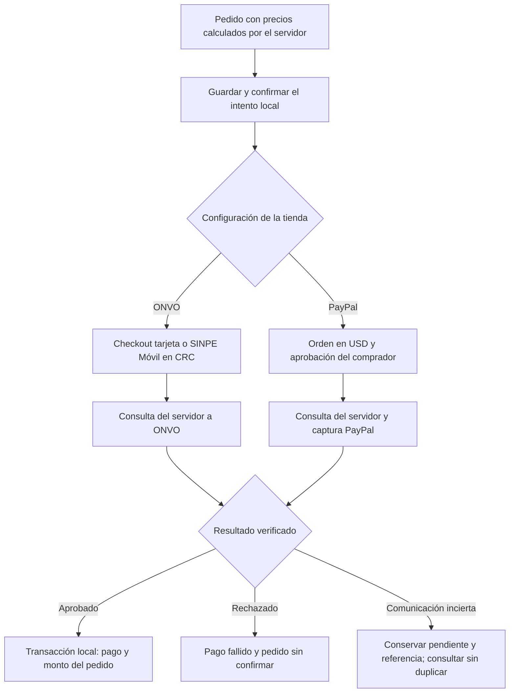

# ArchivumParfums-Hexagonal

Plataforma multi-inquilino donde perfumerías de nicho agendan citas de prueba de olores, reciben pedidos bajo pedido, venden decants por mililitro y cobran en línea. Es el proyecto integrador del curso ISW-621 Programación en Ambiente Web II (Universidad Técnica Nacional, sede San Carlos, 2026). La tienda piloto es ArchivumParfums.

La estructura, la arquitectura y la forma de trabajo siguen el proyecto guía del curso, [SodaYa-Hexagonal](https://github.com/BryanChavesSalas/SodaYa-Hexagonal).

[](https://github.com/JAguilar4k/ArchivumParfums-Hexagonal/actions/workflows/ci.yml)

## Contenido del repositorio

| Ruta | Contenido |
| --- | --- |
| [`docs/especificacion.md`](docs/especificacion.md) | Roles, glosario, reglas de negocio (R1–R56), estados, modelo de datos y API. |
| [`docs/plan.md`](docs/plan.md) | Módulos, etiquetas, forma de trabajo y cortes. |
| [`CLAUDE.md`](CLAUDE.md) | Instrucciones del proyecto para los asistentes de IA. |
| [`.github/`](.github/) | Plantillas de issue y de pull request, integración continua ([`ci.yml`](.github/workflows/ci.yml)) y Dependabot ([`dependabot.yml`](.github/dependabot.yml)). |
| [`archivum-api-hexagonal/`](archivum-api-hexagonal/) | API REST en Laravel 13 sobre PostgreSQL 18. |
| `archivum-web/` | Cliente web en Vue 3 con TypeScript. Llega con [M16](https://github.com/JAguilar4k/ArchivumParfums-Hexagonal/milestone/16). |
| [`docs/architecture.md`](docs/architecture.md) | Estructura, capas, contextos, regla de dependencias y recorrido de una petición. |
| [`docs/database.md`](docs/database.md) | Roles, migraciones y convenciones de la base de datos. |
| [`docs/data-model.md`](docs/data-model.md) | Modelo de datos en tercera forma normal. |
| [`docs/ubiquitous-language.md`](docs/ubiquitous-language.md) | Glosario del negocio, estados y convenciones de nombres. |
| [`docs/patterns.md`](docs/patterns.md) | Patrones de diseño usados, previstos y descartados. |
| [`docs/investigacion-1.md`](docs/investigacion-1.md) | Informe comparativo de ONVO, PayPal, Tilopay y GreenPay, con fuentes y costos. |
| [`docs/payment-gateways.md`](docs/payment-gateways.md) | Investigación técnica, cálculos y evidencia del módulo de pagos. |
| [`docs/demostracion-onvo.md`](docs/demostracion-onvo.md) | Demostración paso a paso de ONVO: tarjeta, SINPE Móvil, consulta y reembolso. |
| [`docs/demostracion-paypal.md`](docs/demostracion-paypal.md) | Demostración paso a paso de PayPal: cuentas sandbox, conversión y captura. |
| [`docs/adr/`](docs/adr/) | Registro de las decisiones de arquitectura. |

## Arquitectura

`archivum-api-hexagonal` combina arquitectura hexagonal con diseño guiado por el dominio. El código del producto vive en `archivum-api-hexagonal/src/`, bajo el namespace `Src\`, organizado por contexto y módulo y, dentro de cada módulo, en tres capas:

```
Infrastructure  ──▶  Application  ──▶  Domain
```

El dominio no depende de Laravel y una prueba de arquitectura lo verifica en cada cambio. Los pagos, la IA, Google Calendar y WhatsApp quedan detrás de puertos: cambiar de proveedor toca un solo adaptador.

Cada tienda ve solo sus datos gracias a dos barreras: el puerto `BusinessContext` indica a qué tienda pertenece la operación y cada repositorio filtra por ella, y PostgreSQL 18 aplica seguridad a nivel de fila en toda tabla con `business_id`. La aplicación se conecta con `archivum_app`, un rol que no es dueño de las tablas; las migraciones corren con `archivum_owner`.

El cliente previsto, `archivum-web`, será una SPA que consuma solo la API, con tipos generados desde el contrato `openapi/v1.json`. Su implementación corresponde a M16; actualmente se utiliza un cliente HTTP como Postman.

## Estado

Avance 1 está en curso. `main` integra la base de Laravel y PostgreSQL, las pruebas y CI, las cuentas y sesiones del personal, el aislamiento por tienda, el perfil y logo de la tienda, el catálogo de perfumes y presentaciones, las fotos, la vitrina pública y el contrato OpenAPI. Los servicios y horarios de M08, la disponibilidad y las citas de M09 y el despliegue público ([#21](https://github.com/JAguilar4k/ArchivumParfums-Hexagonal/issues/21)) siguen pendientes de integración. El alcance completo del corte aún no está terminado. El trabajo está planificado en 29 milestones, uno por módulo, en el [tablero del proyecto](https://github.com/users/JAguilar4k/projects/4).

| Corte | Fecha | Qué se entrega | Estado |
| --- | --- | --- | --- |
| Avance 1 | 21/10/2026 | Issues `avance-1`: proyecto base, arquitectura, calidad, despliegue, multi-inquilino, catálogo, vitrina, horarios y citas (M01 a M09). | En curso |
| Investigación 1 | 28/10/2026 | Issues `investigacion-1`: botellas, pedidos y cobro con ONVO y PayPal, más el informe de pasarelas (M10 a M12). | Sandbox ONVO y PayPal verificados; seguimiento en `feature/pagos` pendiente de revisión y #76 a cargo del equipo de citas. |
| Avance 2 | 18/11/2026 | Issues `avance-2`: pagos por webhook, cuentas y roles, seguridad, IA, cliente web y agenda del personal (M12 a M17). | Pendiente |
| Investigación 2 | 25/11/2026 | Issues `investigacion-2`: auditoría cruzada (M14). | Pendiente |
| Entrega final | 07/12/2026 | Issues `entrega-final`: paquetes, lista de espera, colas, avisos, agenda en vivo, proveedores y observabilidad, y los hallazgos de la auditoría corregidos. | Pendiente |

Módulos cerrados:

| Módulo | Entrega |
| --- | --- |
| [M05 · Multi-inquilino y acceso del personal](https://github.com/JAguilar4k/ArchivumParfums-Hexagonal/milestone/5) | Tiendas y su personal, alta de tiendas y dueños por consola, perfil y ajustes de la tienda, ingreso y cierre de sesión con Sanctum, tienda de la sesión del personal o del slug de la URL, grupos de rutas por rol y aislamiento entre tiendas con dos barreras, la segunda con seguridad a nivel de fila. |

Al cerrar un módulo se agrega su fila a esta tabla con lo que quedó listo.

## Puesta en marcha

Se necesitan PHP 8.4, Composer 2 y PostgreSQL 18 en ejecución. Los comandos se ejecutan en `archivum-api-hexagonal/`:

```bash
git clone https://github.com/JAguilar4k/ArchivumParfums-Hexagonal.git
cd ArchivumParfums-Hexagonal/archivum-api-hexagonal
composer install
```

El instalador prepara `.env`, clave, roles, bases, migraciones y datos ficticios. Si solicita completar la contraseña de PostgreSQL en una terminal interactiva, ejecuta `php artisan archivum:install`. Si ya existen los roles, configura sus contraseñas actuales en `.env`. Revisa `DB_HOST`, `DB_PORT` y configura `APP_URL` con la dirección real de la API antes de iniciar el servidor; `http://localhost:8000` es solo un ejemplo local.

```bash
php artisan config:clear
php artisan storage:link
composer run dev
```

Deja esa terminal abierta. En Postman, envía `GET /api/v1` sobre la dirección del servidor; debe responder 200 con el nombre de la API. La documentación está en `/docs/api` y su JSON en `/docs/api.json` durante desarrollo local. La API se prueba mediante solicitudes HTTP; el cliente Vue todavía está pendiente.

La [colección y el entorno de Postman](archivum-api-hexagonal/tests/Postman/README.md) están incluidos en el repositorio como material de pruebas HTTP. Importa ambos JSON y ajusta `base_url` a la dirección real de la API. Puedes elegir otro host o puerto mediante `php artisan serve --host=localhost --port=8080 --no-reload`; configura también `APP_URL` y `base_url` con ese mismo origen, como explica el README de la API.

Abre otra terminal en la carpeta de la API para verificar el proyecto:

```bash
composer validate --strict
composer lint
composer analyse
composer test
composer audit --locked
```

Pest utiliza la base exclusiva `archivum_hexagonal_testing`; sus pruebas recrean tablas en esa base. Evita que variables `DB_DATABASE` o `DB_URL` heredadas de la terminal apunten a una base con datos que deban conservarse. Si cambias un endpoint, regenera y revisa el contrato:

```bash
composer openapi
git diff -- openapi/v1.json
```

Los comandos, la configuración en PowerShell, la separación de roles, las migraciones, el recorrido de Postman y la resolución de problemas se detallan en [el README de la API](archivum-api-hexagonal/README.md).

## Investigación 1: ejecutar los cobros

El [informe comparativo](docs/investigacion-1.md) y la [investigación técnica](docs/payment-gateways.md) se entregan por separado. La rama del corte es `feature/pagos`, según su enunciado. Para esta entrega el servidor confirma consultando al proveedor; los webhooks se incorporan en Avance 2. Las citas de prueba siguen siendo gratis: se cobran los pedidos del negocio.

Los recorridos completos se encuentran en la [demostración de ONVO](docs/demostracion-onvo.md) y la [demostración de PayPal](docs/demostracion-paypal.md). Cada guía permite empezar desde la instalación local, obtener tokens, crear un producto ficticio con precio conocido y seguir las peticiones hasta comprobar el pedido; también identifica los archivos y métodos donde se configura o modifica el comportamiento. La [evidencia del 25 y 26/10/2026](docs/evidencia-investigacion-1/README.md) registra ONVO aprobado, rechazado, SINPE y reembolso, además de PayPal aprobado con tarjeta ficticia y capturado por USD 15,00.

Las [instrucciones de Postman de Investigación 1](archivum-api-hexagonal/tests/Postman/README.md#investigación-1-archivos-y-nombres-del-recorrido) permiten trabajar sin cuenta con peticiones manuales y pausas de navegador, como en Avance 1. También se prepararon colecciones separadas de ONVO y PayPal, con entornos y comprobaciones de nombres breves, para importar opcionalmente con sesión. Las colecciones no se importaron en el cliente Lightweight; sus scripts se validaron por separado.

Primero completa la puesta en marcha de la API y ejecuta las migraciones como `archivum_owner` y `php artisan db:seed`. Los sembradores agregan botellas ficticias en ambas tiendas y conservan sus ml al repetirse. El [README de la API](archivum-api-hexagonal/README.md) explica cómo obtener tokens de las cuentas ficticias; se usarán el dueño `duena@archivumparfums.test` y la cliente `mariana@clientes.test`, con la contraseña local `ARCHIVUM_DEMO_PASSWORD`.

### Cuentas y entorno de prueba

Crea una cuenta de prueba de [ONVO](https://docs.onvopay.com/authentication) y una aplicación de [PayPal Developer sandbox](https://developer.paypal.com/sandbox-testing/overview), con comprador y vendedor ficticios. Copia sus credenciales únicamente a `archivum-api-hexagonal/.env`. El archivo [`.env.example`](archivum-api-hexagonal/.env.example) declara todas las variables vacías para secretos; `.env` permanece fuera de Git.

| Variable | Uso |
| --- | --- |
| `ONVO_SECRET_KEY` | Llave secreta de prueba, con prefijo `onvo_test_`; obligatoria al usar ONVO. |
| `ONVO_PUBLISHABLE_KEY` | Reservada para una integración del navegador; el checkout hospedado actual no la necesita. |
| `PAYPAL_CLIENT_ID`, `PAYPAL_CLIENT_SECRET` | Credenciales de la aplicación **sandbox** vendedora. El host REST queda fijado al sandbox en `config/payments.php`. |
| `PAYMENTS_RETURN_URL`, `PAYMENTS_CANCEL_URL` | URLs propias de regreso, por ejemplo la dirección local de `/api/v1`. Solo sirven para navegación; no cambian el estado del pago. |
| `ONVO_WEBHOOK_SECRET`, `PAYPAL_WEBHOOK_ID` | Preparación del puerto de verificación de Avance 2. Para este corte pueden quedar vacíos; no hay endpoint de webhook habilitado. |

Después de editar `.env`, ejecuta `php artisan config:clear`. No copies tokens OAuth, contraseñas de cuentas ni secretos a capturas, al informe o a GitHub. Los adaptadores rechazan una configuración fuera de los ambientes de prueba admitidos.

### Cambiar de pasarela y repetir el flujo

En Postman define `base_url`, `owner_token`, `customer_token`, `order_id` y `payment_id`. Usa `Authorization: Bearer ...` y `Content-Type: application/json`. Los UUID de productos se obtienen de la vitrina, no se inventan.

1. Como dueño, envía `PATCH /api/v1/panel/tienda` con `{"ajustes":{"pasarela_por_defecto":"onvo"}}`. Para PayPal usa `{"ajustes":{"pasarela_por_defecto":"paypal","tipo_cambio_usd":500}}`; 500 es solo un tipo ilustrativo que debe sustituirse por el elegido para la demostración. Cambia únicamente configuración de la tienda, sin editar controladores.
2. Consulta `GET /api/v1/tiendas/archivumparfums/perfumes`, abre el detalle de un perfume y toma una presentación activa con precio. El detalle también expone `decants` cuando existe una botella abierta con ml disponibles.
3. Como cliente, crea el pedido con `POST /api/v1/tiendas/archivumparfums/pedidos`, por ejemplo `{"lineas":[{"presentacion_id":"UUID_DE_LA_PRESENTACION","cantidad":1}]}`. Para un decant usa `{"lineas":[{"botella_id":"UUID_DE_LA_BOTELLA","ml":5}]}`. Conserva `data.id` como `order_id`.
4. Envía `POST /api/v1/cuenta/pedidos/{{order_id}}/pagos` con `{"medio":"tarjeta"}`. En ONVO también se admite `{"medio":"sinpe_movil"}`. El servidor calcula depósito o total desde el pedido; ignora montos, propósito y estados enviados por el navegador. Guarda `data.id` como `payment_id` y abre `data.url_pago`.
5. Completa el checkout externo de prueba. ONVO recibe el monto CRC multiplicado por 100; PayPal recibe USD como texto decimal de dos cifras. En PayPal debe obtenerse la aprobación del comprador y después la captura; `APPROVED` por sí solo sigue pendiente. La opción de tarjeta/checkout como invitado debe estar habilitada en la cuenta sandbox y verificarse antes de la presentación.
6. Consulta `GET /api/v1/cuenta/pagos/{{payment_id}}`. La API pregunta al proveedor y, con los datos coincidentes, registra el resultado y actualiza el pedido en la misma transacción. Consulta también `GET /api/v1/cuenta/pedidos/{{order_id}}`: una aprobación acredita el monto; un rechazo conserva el pedido sin confirmar.
7. Repite desde un **pedido nuevo** al cambiar de proveedor: un pago ya iniciado conserva la pasarela que lo creó. El saldo solo puede iniciarse cuando el pedido esté listo. La recepción de botellas del módulo de compras sigue correspondiendo a #177.

Un doble clic devuelve el intento pendiente existente. Ante un resultado de red incierto se responde **202**, `consulta_pendiente: true` y `Retry-After: 30`; se conserva el intento y no se vuelve a enviar el POST de cobro. Si no llegó ninguna referencia remota, hace falta conciliar ese intento con el proveedor antes de permitir otro: el sistema mantiene el bloqueo y no supone que fue rechazado.

Si un cobro se confirma después de cancelar o vencer el pedido, se conserva ese estado, se registra el dinero recibido y se genera su devolución completa; los ml liberados no se reservan otra vez. ONVO solo habilita otro intento tras verificar que el checkout rechazado quedó cerrado, para que una pestaña anterior no pueda cobrar además de la nueva.

### Datos ficticios y reembolsos

En [ONVO Testing](https://docs.onvopay.com/payments/testing), la tarjeta `4242424242424242` aprueba, `4000000000000002` se rechaza y `4000000000000119` simula error del procesador. Usa fecha futura y CVC ficticio en el checkout de prueba. SINPE Móvil aprobado usa el número de prueba `+50688888888`; `+50688889521` simula una transferencia que nunca llega. No transfieras dinero desde una cuenta bancaria real. Las identificaciones y los datos del comprador deben ser ficticios. Consulta la guía oficial por si cambia un dato de simulación.

En PayPal usa la cuenta personal sandbox compradora y la aplicación vendedora; las tarjetas de prueba se generan en su [herramienta oficial](https://developer.paypal.com/tools/sandbox/card-testing/). No uses las credenciales del vendedor para aprobar su propia compra. La ejecución del 26/10 seleccionó Visa ficticia terminada en 5083 y confirmó una captura de USD 15,00; su evidencia externa está enlazada arriba.

Para devolver un pedido pagado que todavía admite cancelación, como cliente envía `POST /api/v1/cuenta/pedidos/{{order_id}}/cancelacion`. El sistema registra los reembolsos pendientes y libera sus ml reservados. Como dueño, envía `POST /api/v1/panel/pedidos/{{order_id}}/reembolsos` sin monto: procesa lo calculado en el servidor. ONVO envía y consulta la devolución; repetir la operación consulta una referencia existente y no devuelve dos veces el importe. El monto solo se descuenta de `pagado` al confirmarse. PayPal conserva el registro pendiente: el enunciado permite documentar su devolución en este corte, cuyo flujo REST está en el expediente técnico.

### Flujo y comprobación



En la carpeta de la API, ejecuta `composer lint`, `composer analyse`, `composer test`, `composer openapi` y `composer audit --locked`. Todas las pruebas usan HTTP simulado y la suite bloquea peticiones no simuladas. Las pruebas de últimos ml y doble cobro ejecutan dos procesos contra PostgreSQL, fuera de la transacción del test.

La presentación dura cinco minutos: ONVO aprobado y rechazado, SINPE Móvil, PayPal aprobado, cambio de configuración, pruebas verdes y una decisión del informe. Las cuentas y los escenarios externos ya se verificaron el 25 y 26/10/2026; falta el ensayo del equipo y la revisión humana del seguimiento. El #76 depende de #62 y #67, junto con horarios/citas #51–#61, que se dejaron al equipo. No se declara ese issue terminado, ni se crea `v-investigacion1` sobre una entrega incompleta.

## Forma de trabajo

- **Planificación:** cada requisito es un issue dentro de un milestone, uno por módulo, con seguimiento en el [tablero del proyecto](https://github.com/users/JAguilar4k/projects/4).
- **Ramas:** cada issue se trabaja en su propia rama, creada desde el issue con *Create a branch*. Sale de `main` y lleva el número y el título del issue (`23-reservar-una-cita-de-prueba`).
- **Commits:** [Conventional Commits](https://www.conventionalcommits.org/es/v1.0.0/), uno por cambio lógico, con la referencia al issue en el pie (`Refs: #23`).
- **Pull requests:** uno por issue, enlazado con `Closes #N`. Todo cambio entra a `main` por pull request, con la integración continua en verde y la aprobación de otra persona del equipo. Se fusiona con merge commit para conservar los commits atómicos.
- **Etiquetas de los issues:** la del corte en que se entrega (`avance-1`, `investigacion-1`, `avance-2`, `investigacion-2` o `entrega-final`), más las de área que correspondan (`arquitectura`, `base-de-datos`, `documentation`). Los extras llevan `extra` y los hallazgos de la auditoría cruzada, `auditoria`.
- **Etiquetas de git:** cada entrega se marca sobre `main` con `v-avance1`, `v-avance2` y `v-final`, de modo que se puede comparar lo que agregó cada corte:

  ```bash
  git diff v-avance1 v-avance2 --stat
  ```

## Idioma

El código, la base de datos y los comentarios están en inglés. Las rutas, los atributos JSON y los mensajes al usuario están en español. La convención completa está en [docs/ubiquitous-language.md](docs/ubiquitous-language.md).

## Uso de IA

El enunciado permite usar asistentes de IA con una condición: cada integrante debe entender lo que se entrega y poder modificarlo en vivo. Declararlo no baja la nota; ocultarlo tiene consecuencias. Esta tabla declara qué partes se generaron con asistencia y qué verificó el equipo, y cómo.

| Parte | Asistente | Qué generó la IA | Qué verificó el equipo |
| --- | --- | --- | --- |
| Reconstrucción de bloqueos (#256, seguimiento de #249) | Codex | Restauración de `ScheduleBlock::reconstitute()` y pruebas de conservación de datos e invariantes, sin framework ni base de datos. | Regresión antes y después del arreglo, pruebas unitarias, Pint y Larastan registrados en el PR; revisión humana pendiente. |
| Investigación 1: botellas, pedidos, pagos e informe (#68–#93, excepto #76) | Codex | Dominio, adaptadores HTTP directos de ONVO y PayPal, persistencia con RLS y restricciones, endpoints, pruebas de concurrencia, contrato OpenAPI y documentos separados de investigación y comparación. Guías independientes, colecciones Postman con nombres descriptivos breves y evidencia sandbox sanitizada. Se usaron las reglas confirmadas por Julián en esta conversación. | Verificación automática con PostgreSQL 18 y `archivum_app`, HTTP simulado, Pint, Larastan y auditoría; resultados por PR. Codex verificó ONVO y PayPal con HTTP y navegador reales en sandbox el 25 y 26/10, sin fondos reales. Las colecciones no se ejecutaron completas en Postman nativo. Revisión humana y ensayo del equipo pendientes; #76 queda al equipo de citas. |
| Ejecución y pruebas HTTP (#252) | Codex | Actualización de ambos README con comandos, rutas integradas, configuración portable y alcance actual; colección y entorno ficticio de Postman en `tests/Postman`; arranque sin recargador y documentación sin sesiones web, con regresión. | Instalación aislada, Pint, Larastan, Pest, auditoría y comparación del contrato ejecutados automáticamente; recorrido representativo enviado desde la interfaz de Postman. Comprobación de la colección, imágenes y portabilidad registrada en el PR de #252. Julián autorizó la excepción a la revisión previa para integrar esta preparación. |
| README, `.gitignore` y plantillas de `.github/` (commit inicial) | Claude Code | Redacción adaptada del proyecto guía. | Los revisó el PM, Julián Aguilar Salas. |
| Etiquetas, milestones e issues | Claude Code | Redacción de los 29 milestones y los 196 issues a partir de la especificación, el plan y el enunciado, con el estilo descriptivo del proyecto guía, y su creación con `gh`. El tablero KanbanBoard lo creó Julián. | El PM, Julián Aguilar Salas, revisó la redacción de los issues, los milestones y sus formatos para que sigan estándares y buenas prácticas, y aprobó su creación el 10/10/2026. |
| `docs/especificacion.md`, `docs/plan.md` y `CLAUDE.md` | Claude Code | La redacción de la especificación, el plan y las instrucciones del proyecto (commit inicial), bajo la supervisión del PM, a partir del enunciado, de los requisitos de usuario recogidos en la entrevista con el cliente y de los requerimientos que especificó el PM; y la regla de `CLAUDE.md` de seguir el proyecto guía en cada parte ([#199](https://github.com/JAguilar4k/ArchivumParfums-Hexagonal/pull/199)). | El PM, Julián Aguilar Salas, revisó y aprobó todo el contenido, y revisó y fusionó #199. |
| Proyecto base y configuración de la API: Laravel 13 sobre la rama de Nelson (#1), PostgreSQL 18 (#2), roles (#3), zona horaria (#5), español (#6), estructura hexagonal (#7), `/api/v1` (#8), Pint (#11), Larastan (#12), integración continua (#15) e instalación con `composer install` (#215) | Claude Code | El código, la configuración, las pruebas de Pest y los commits de los pull requests #200 a #209 y #216, sobre el commit de Nelson. | Pest, Pint, Larastan y `composer audit` pasan en la integración continua de #206, que contiene los anteriores, y de #208, #209 y #216. sanlealc-code revisó y aprobó #207 (#1). Julián fusionó #200 a #206 sin revisión de otra persona, antes de que la regla de `main` la exigiera (#16). #208, #209 y #216: revisión pendiente. |
| Documentación: `docs/database.md` (#4), `docs/ubiquitous-language.md` (#9), `docs/architecture.md`, `docs/adr/` y `docs/patterns.md` (#10), README de la API (#18) y esta sección (#19) | Claude Code | La redacción, adaptada del proyecto guía y de la especificación, y la prueba de reversibilidad de las migraciones (#4). | Revisión de otra persona del equipo: pendiente. Los pasos de instalación los debe seguir alguien que no los escribió (#18). |
| Identificador de las solicitudes (#45, PR #218) | Claude Code; Codex (declaración) | Claude Code generó el middleware `X-Request-Id`, la configuración CORS y las pruebas HTTP con la forma del repo guía; Codex agregó esta declaración. | Revisión humana pendiente. |
| Acceso inicial de la API (#232) | Codex | Redirección a `/api/v1`, prueba HTTP y documentación de las direcciones locales. Integración con el identificador de solicitud y las respuestas RFC 9457, y actualización del estado de M01 y M02. | 46 pruebas HTTP con 214 aserciones y Pint ejecutados automáticamente; aprobación de sanlealc-code en el PR #233. |
| Errores HTTP de la API (#46) | Codex | Preservación de estados HTTP originales en RFC 9457 y regresiones automáticas. | Pendiente de revisión humana del equipo. |
| Dominio de tiendas y personal (#25) | Claude Code (commits con coautoría) | Reorganización de agregados y pruebas, ajustes de objetos de valor, identificadores y documentación según los commits del PR #217. La asistencia de la implementación inicial de Nelson queda por precisar. | Revisión humana del equipo pendiente. |
| Validación de los objetos de valor de #25 | Codex | Corrección del final estricto del slug y de la lista de tamaños de decant enteros positivos, con pruebas de regresión para caracteres finales y tipos o índices inválidos. | 94 pruebas y 193 aserciones, Pint y Larastan ejecutados automáticamente; una prueba de casos de uso se omite porque esta rama todavía no tiene casos de uso. Revisión humana del equipo pendiente. |
| Esquema de tiendas, cuentas, personal y clientes (#26) | Claude Code; Codex | Claude Code generó las migraciones de `businesses`, `users`, `members` y `customers` con la forma del repo guía y sus pruebas de esquema. Codex agregó la preservación de estados HTTP con sus regresiones y una migración que convertía las cuentas existentes a UUID; esa conversión se retiró el 19/10, por decisión de Julián, y `users` volvió a crearse en su propia migración, como en la guía. | Pruebas, Pint y Larastan automáticos en el PR #220. Revisión humana del equipo pendiente. |
| Cuentas y errores HTTP (#27) | Codex | Rechazo de entradas bcrypt incompatibles, estados HTTP y regresiones automáticas del adaptador, sin agregar el ingreso. También generó una migración que convertía las cuentas existentes a UUID y la compatibilidad con nombres de cuenta heredados de hasta 255 caracteres; las dos se retiraron el 19/10, por decisión de Julián, cuando `users` volvió a crearse con `name` de 120 caracteres, como en la guía. | Pendiente de revisión humana del equipo. |
| Compatibilidad del dominio con #25 | Codex | Contratos opcionales con null, validación estricta y persistencia de MemberId conforme al guía, conservando las funciones del issue de esta rama. | Verificación automatizada en el PR; revisión humana pendiente. |
| Alta de tiendas y dueños por consola (#27) | Claude Code | Los casos de uso `RegisterBusiness`, `RegisterAccount` y `AddMember`, sus adaptadores, el comando `archivum:create-business`, los datos de demostración y sus pruebas, en los commits con coautoría. El 19/10 los alineó con el repo guía: pruebas de cada adaptador contra PostgreSQL y del rollback de `RegisterBusiness`, sembradores por área con identificadores fijos, fábricas de miembros y clientes, nombres de `AccountAlreadyOnStaffException` y `AccountsOwnerAccounts`, textos del comando y del sembrador desde `lang/es` y la sección de `docs/architecture.md`. | Pest, Pint y Larastan automáticos en el PR. Revisión humana del equipo pendiente. |
| Autenticación, cuentas y perfiles (#28), compatibilidad con #25 | Codex | Correcciones de migración UUID, entradas bcrypt incompatibles, perfiles sin lugar de cita, estados HTTP, contratos opcionales con null, validación estricta y persistencia de MemberId conforme al guía; contrato 401 `credenciales-invalidas` de inicio de sesión y sus regresiones automáticas. Las correcciones de la migración UUID se retiraron el 19/10, por decisión de Julián, cuando `users` volvió a crearse en su propia migración, como en la guía. | Contrato 401 y compatibilidad verificados automáticamente en la integración; revisión humana pendiente. |
| Ingreso con correo y contraseña (#28) | Claude Code | Los casos de uso `StartSession` y `GetCurrentAccount`, los adaptadores `SanctumTokenIssuer` y `BusinessesStaffMemberships`, las rutas `POST /api/v1/sesiones` y `GET /api/v1/cuenta`, la búsqueda de cuentas, miembros y tiendas por identidad y sus pruebas, en los commits con coautoría. El 19/10 los alineó con el repo guía: llave `bigint` de Sanctum en `personal_access_tokens` sin modelo de token propio, sufijos de Laravel en el Form Request y los Resources, rutas agrupadas, nombre del dispositivo en cada sesión, nombre del campo contraseña en los mensajes de validación, prueba del adaptador de tokens, ayudante compartido de ingreso para las pruebas, filas del glosario, ejemplos del README y la sección de `docs/architecture.md`. | Pruebas, Pint y Larastan automáticos en el PR #222. Revisión humana del equipo pendiente. |
| Compatibilidad de cuentas (#27) | Codex | Nombres heredados hasta 255 caracteres sin truncamiento y regresiones del dominio y la persistencia. Se retiró el 19/10, por decisión de Julián, cuando `users` volvió a crearse con `name` de 120 caracteres, como en la guía. | Verificación automatizada en el PR; revisión humana pendiente. |
| Correcciones heredadas de cuentas, perfiles y API (#29) | Codex | Migración UUID sin pérdida de datos, rechazo bcrypt, perfiles sin lugar de cita, estados HTTP y regresiones automáticas. La migración UUID se retiró el 19/10, por decisión de Julián, cuando `users` volvió a crearse en su propia migración, como en la guía. | Pendiente de revisión humana del equipo. |
| Contrato de autenticación (#28) | Codex | Alineación con SodaYa: credenciales incorrectas 401 `credenciales-invalidas`, validación 422 y regresiones. | Verificación automatizada en el PR; revisión humana pendiente. |
| Cierre de la sesión (#29) | Claude Code | El caso de uso `EndSession`, el puerto `TokenRevoker` con su adaptador `SanctumTokenRevoker`, la ruta `DELETE /api/v1/sesiones/actual` y sus pruebas, en los commits con coautoría. El 19/10 los alineó con el repo guía: el adaptador sobre el modelo de token de Sanctum, la ruta dentro del grupo de `sesiones`, la prueba del adaptador en su propio archivo, el ayudante compartido de ingreso con el nombre del dispositivo, la fila del glosario, el ejemplo del README y el párrafo de `docs/architecture.md`. | Pruebas, Pint y Larastan automáticos en el PR #223. Revisión humana del equipo pendiente. |
| Correcciones heredadas de cuentas, perfiles y API (#30) | Codex | Migración UUID sin pérdida de datos, rechazo bcrypt, perfiles sin lugar de cita, estados HTTP y regresiones automáticas. La migración UUID se retiró el 19/10, por decisión de Julián, cuando `users` volvió a crearse en su propia migración, como en la guía. | Pendiente de revisión humana del equipo. |
| Tienda de la sesión del personal y de la URL (#30) | Claude Code | El middleware `business` (`ScopeRequestToBusiness`), los adaptadores `StaffBusinessContext`, `RouteBusinessContext` y `UnresolvedBusinessContext` del puerto `BusinessContext`, el caso de uso `FindBusinessBySlug` con la búsqueda por slug del repositorio y sus pruebas, en los commits con coautoría. El 19/10 los alineó con el repo guía: `AuthorizationException` para un cliente en el panel, las pruebas de aislamiento en `tests/Feature/Tenancy` y las del middleware en `tests/Feature/Shared`, con el enlace por defecto del puerto y una sola transacción por petición, el ayudante compartido de ingreso, la búsqueda por slug probada contra PostgreSQL, la fila 403 de la tabla de errores y el párrafo de `docs/architecture.md`. | Pruebas, Pint y Larastan automáticos en el PR #224. Revisión humana del equipo pendiente. |
| Correcciones heredadas de cuentas, perfiles y API (#31) | Codex | Migración UUID sin pérdida de datos, rechazo bcrypt, perfiles sin lugar de cita, estados HTTP y regresiones automáticas. La migración UUID se retiró el 19/10, por decisión de Julián, cuando `users` volvió a crearse en su propia migración, como en la guía. | Pendiente de revisión humana del equipo. |
| Aislamiento entre tiendas (#31) | Claude Code | La ayuda de pruebas `TwoBusinesses`, la suite `tests/Feature/Tenancy/StaffIsolationTest.php` con su ruta de ejemplo, el comentario de la búsqueda de miembros sin tienda, la casilla de la plantilla de pull request y el párrafo del README sobre la demostración en vivo, en los commits con coautoría. El 19/10 los alineó con el repo guía: las dos tiendas de las pruebas se crean con las fábricas y no con los sembradores, el trait `ScopesQueriesToBusiness` fija la tienda de las consultas de una prueba, la ruta de ejemplo vive bajo `api/v1/pruebas` y `docs/architecture.md` nombra la suite. | Pruebas, Pint y Larastan automáticos en el PR #225. Revisión humana del equipo pendiente. |
| Correcciones heredadas de cuentas, perfiles y API (#32) | Codex | Migración UUID sin pérdida de datos, rechazo bcrypt, perfiles sin lugar de cita, estados HTTP y regresiones automáticas. La migración UUID se retiró el 19/10, por decisión de Julián, cuando `users` volvió a crearse en su propia migración, como en la guía. | Pendiente de revisión humana del equipo. |
| Seguridad a nivel de fila entre tiendas (#32) | Claude Code | Las funciones `SECURITY DEFINER` `fn_member_business`, `fn_customer_businesses` y `fn_customer_resource_business`, la migración que habilita y fuerza las políticas `<tabla>_business_isolation` y `<tabla>_definer_read` en `members` y `customers`, el adaptador `CustomerBusinessContext` con el middleware `business:account`, las pruebas `RowLevelSecurityTest`, `BusinessKeysTest`, `AccountBusinessFunctionsTest` y `CustomerIsolationTest`, la sección de `docs/database.md` y el ADR 0011, en los commits con coautoría. El 19/10 los alineó con el repo guía: el puerto de lectura `Memberships` con su adaptador `PostgresMemberships` fuera del repositorio de miembros, el puerto `CustomerBusinesses` en `Application/Contracts`, las pruebas con las fábricas y el trait `ScopesQueriesToBusiness`, las pruebas de `CustomerBusinessContext` y de `business:account` en el middleware, las filas de las políticas y la receta de `docs/database.md`, el párrafo del README de la API, la fila de `business:account` en `docs/architecture.md` y el estado del ADR 0005. | Pruebas, Pint y Larastan automáticos en el PR #227, y `RowLevelSecurityTest` probado quitando una política: sin la de `customers`, falla. Revisión humana del equipo pendiente. |
| Correcciones heredadas de cuentas, perfiles y API (#34) | Codex | Migración UUID sin pérdida de datos, rechazo bcrypt, perfiles sin lugar de cita, estados HTTP y regresiones automáticas. La migración UUID se retiró el 19/10, por decisión de Julián, cuando `users` volvió a crearse en su propia migración, como en la guía. | Pendiente de revisión humana del equipo. |
| Grupos de rutas por rol (#34) | Claude Code | El middleware `role` (`RequireAccountRole`) con el caso de uso `FindAccountRole`, los grupos de rutas de los dueños y de los clientes, la prueba `RoleGroupsTest` y el párrafo del README de la API, en los commits con coautoría. El 19/10 los alineó con el repo guía: `AuthorizationException` del framework para una cuenta fuera del grupo, con la prueba `RequireAccountRoleTest`; el estado exacto que recibe el rol permitido en cada endpoint y el tipo `no-autenticado` sin token, como `StaffPermissionsTest`; las dos tiendas de la prueba con las fábricas y una codueña en `TwoBusinesses`; las rutas de ejemplo bajo `api/v1/pruebas`, y la fila 403 de la tabla de errores de `docs/architecture.md`. | Pruebas, Pint y Larastan automáticos en el PR #228. Revisión humana del equipo pendiente. |
| Correcciones de API, cuentas, migraciones y perfil de tienda (#33) | Codex | Conservación de estados HTTP, transición de cuentas a UUID sin pérdida de datos, validación de contraseñas incompatibles, lectura del lugar de cita opcional y actualización concurrente del perfil, con sus pruebas automatizadas de regresión. La transición a UUID se retiró el 19/10, por decisión de Julián, cuando `users` volvió a crearse en su propia migración, como en la guía. Sincronización con `main` y #34; documentación del middleware de roles y del bloqueo de la fila de la tienda. | Integración verificada con PHP 8.4 y PostgreSQL 18 temporal: 510 pruebas, 1694 aserciones, Pint y Larastan nivel 8. Revisión humana del equipo pendiente. |
| Perfil y ajustes de la tienda (#33) | Claude Code | Los ajustes de reserva, lista de espera, pago y recordatorios de `BusinessSettings`, el método `revise` de `Business`, los casos de uso `GetBusinessProfile` y `UpdateBusinessProfile`, las rutas `GET` y `PATCH /api/v1/panel/tienda` con su Form Request y su Resource, la sección del README de la API y sus pruebas, en los commits con coautoría. El 20/10 los alineó con el repo guía: el sufijo de Laravel en `UpdateBusinessProfileRequest` y `BusinessProfileResource`; los ajustes del comando con claves en `snake_case`, asignados uno por uno en el caso de uso; la cota del horizonte de reserva frente a la anticipación en las reglas del Form Request; el caso de los endpoints de la tienda de la sesión en `StaffIsolationTest` y la revisión de que exista una ruta del panel; las filas del glosario, el rol en singular del README de la API y la sección Estado. | Pruebas, Pint y Larastan automáticos en el PR #229. Revisión humana del equipo pendiente. |
| Configuración y secretos (#14) | Claude Code; Codex | Configuración del producto, ejemplo de variables y pruebas de arquitectura para leer el entorno solo desde `config/`. Codex incorporó el perfil actualizado de #33 y `main`, contrastó la configuración con el guía y corrigió la documentación de las verificaciones del entorno. | Verificación local con PHP 8.4 y PostgreSQL 18 temporal: 32 pruebas y 116 aserciones de instalación, datos de demostración y configuración, incluidas las 9 comprobaciones del entorno; revisión humana del equipo pendiente. |
| Instalación repetible y arranque local en Windows (#215) | Codex | Corrección del comando de desarrollo, conservación de credenciales existentes, carga de datos transaccional, diagnóstico SQL sin credenciales y pruebas de regresión. | La regresión del diagnóstico pasó con 4 pruebas y 20 aserciones sin base de datos; Pint ejecutado automáticamente. Validación integral y revisión humana pendientes. |
| Actualización de dependencias (#17, PR #230) | Claude Code; Codex (declaración) | Claude Code adaptó la configuración de Dependabot del repo guía para Composer y GitHub Actions y agregó su enlace al README; Codex agregó esta declaración. | Revisión humana pendiente. |
| Corrección de seguridad de PHPUnit (#17, PR #255) | Codex | Actualización del lock a Pest 5.3.4 y PHPUnit 13.4.5, con tres dependencias necesarias, para resolver `GHSA-9vw2-f4vp-x7gf`; sin cambiar los requisitos de `composer.json`. | Compatibilidad y auditoría comprobadas; resultados de pruebas y análisis registrados en el PR. Revisión humana de esta actualización pendiente. |
| Correcciones de migraciones, autenticación, respuestas HTTP, concurrencia del perfil, fixtures por tienda, instalación y acceso inicial (#13, #26, #28, #33, #46, #215 y #232) | Codex | Inspección del código, correcciones y pruebas de regresión; documentación del arranque y de las verificaciones automáticas en los PR correspondientes. | Revisión humana pendiente. Las ejecuciones automáticas se registran por PR y no equivalen a una aprobación del equipo. |
| Integración del instalador con las cuentas de demostración (#27, #215) | Codex | Siembra automática solo cuando no hay cuentas; conserva los datos editados al repetir la instalación y mantiene la carga manual de los datos de demostración. | La regresión existente de `InstallCommandTest` comprueba que una segunda instalación conserva los datos; revisión humana pendiente. |
| Contrato de autenticación (#28) | Codex | Alineación con SodaYa: credenciales incorrectas 401 `credenciales-invalidas`, validación 422 y regresiones. | Verificación automatizada en el PR; revisión humana pendiente. |
| Pruebas con Pest (#13) | Claude Code | Las ayudas de `tests/Pest.php` y `tests/Support/` para iniciar sesión como el dueño, el colaborador o el cliente de una tienda y para ejecutar operaciones en procesos paralelos con su propia conexión, los datasets de roles, las pruebas de arquitectura que exigen nombrar cada regla R1–R56 en una prueba o en la lista de pendientes y que mantienen `tests/Unit` sin Laravel, la sección "Pruebas" del README de la API y su integración con las ramas de #28, en los commits con coautoría. | Pint, Larastan y Pest automáticos en el PR #226. Revisión humana del equipo pendiente. |
| Pruebas y correcciones heredadas (#13) | Codex | Fixtures acotados a la tienda con RLS, migración UUID sin pérdida de datos, rechazo bcrypt, perfiles sin lugar de cita, estados HTTP y regresiones automáticas. La migración UUID se retiró el 19/10, por decisión de Julián, cuando `users` volvió a crearse en su propia migración, como en la guía. | Pendiente de revisión humana del equipo. |
| Matriz de roles (#13) | Codex | Corrección del cambio de usuario autenticado a visitante en el helper de pruebas y regresiones para los tres roles autenticados. | Verificación automatizada; revisión humana pendiente. |
| Pruebas de concurrencia (#13) | Codex | Barrera de inicio que espera a todos los procesos, limpieza de recursos y regresiones de solapamiento real y fallo de una operación. | Cinco pruebas y trece aserciones automáticas pasan en PostgreSQL 18; revisión humana pendiente. |
| Roles y abilities de los tokens (#102) | Claude Code | El enum `Ability` con el mapa de rol a abilities de la sección 9, el puerto `TokenIssuer` con las abilities al emitir, `StartSession` que las calcula con el rol de la cuenta, el registro de los middleware `abilities` y `ability` de Sanctum, la ability de cada ruta del panel, de `/cuenta/...` y de los pedidos del cliente, el retiro del middleware provisional `role` de #34, las ayudas de prueba con las abilities del rol, las pruebas `AbilityTest`, `StartSessionAbilitiesTest` y `RoleAbilitiesTest`, y la documentación. | Pest completo, Pint y Larastan nivel 8 en local. Revisión humana pendiente. |
| Autorización por propiedad con policies (#104) | Claude Code | Las policies `OrderPolicy` y `PaymentPolicy` con `Response::denyAsNotFound()`, registradas en los providers de sus módulos, los middleware `AuthorizeOrder` y `AuthorizePayment` que las aplican a cada ruta con `{pedido}` o `{pago}` antes del controlador, las pruebas `OrderPolicyTest` y `PaymentPolicyTest`, y la documentación. | Pest completo, Pint y Larastan nivel 8 en local. Revisión humana pendiente. |
| Personal de la tienda (#106) | Claude Code | La migración de `members.is_active` y `fn_member_deactivated`, los casos de uso `RegisterMember`, `UpdateMember`, `ListMembers` y `GetMember`, los puertos `StaffAccounts`, `MemberDirectory` y `DeactivatedAccounts`, los endpoints de `/panel/personal`, las filas de la matriz de permisos, las pruebas y la documentación. | Pest completo, Pint y Larastan nivel 8 en local. Revisión humana pendiente; también las decisiones pendientes del issue. |
| Matriz de permisos (#105) | Claude Code | Los datasets de `tests/Datasets/PermissionMatrix.php` por fila de la sección 9, la ayuda `MatrixResources` con las dos tiendas de los seeders, la prueba `PermissionMatrixTest` (cada rol, el intento desde otra tienda, los identificadores ajenos en el cuerpo y la cobertura de `/panel` y `/cuenta`) y la documentación. Se comprobó que quitar una ability de una ruta rompe la matriz. | Pest completo, Pint y Larastan nivel 8 en local. Revisión humana pendiente. |

Cómo se mantiene:

- Cada pull request con trabajo asistido marca la casilla "Si usé IA" de la plantilla y agrega o actualiza su fila en el mismo pull request.
- La verificación se describe con hechos comprobables: qué pruebas se corrieron y quién revisó el pull request. Cuando la revisión ocurre, quien revisó actualiza la columna.
- Abarca el código, las pruebas, la documentación y la redacción de los issues, no solo el código.
- Antes de crear cada etiqueta de entrega (`v-avance1`, `v-avance2`, `v-final`), la tabla cubre todos los pull requests fusionados del corte.
