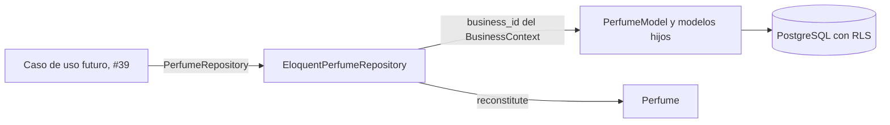

# Persistencia del catálogo con Eloquent (#38)

Este documento explica qué archivos se crearon para guardar y rearmar el agregado `Perfume` desde PostgreSQL, por qué existe cada uno y cómo encajan en el flujo de trabajo. Complementa [catalog-domain.md](catalog-domain.md), que describe el diseño del dominio, y [data-model.md](data-model.md), que describe las tablas (#37).

## Alcance y reglas de la entrega

- **Se crearon archivos y se modificó uno existente:** `bootstrap/providers.php`, donde se registra `PerfumesServiceProvider`, como pidió la revisión del PR. Ningún otro archivo existente del proyecto cambió.
- #36 quedó como documento (`catalog-domain.md`), y el repositorio no puede existir sin el agregado y el puerto que implementa. Por eso esta entrega incluye el **dominio mínimo** que #38 necesita. Es la parte de #36 que el repositorio exige, no su cierre: faltan, por ejemplo, la prueba de cada objeto de valor y las decisiones de negocio pendientes.
- Los límites de negocio sin decidir (rango de precio, tope de ml, si vale ₡0) **no se imponen**. El dominio solo rechaza lo que ya respalda la especificación o la base: ml positivos que caben en el `smallint`, y precios enteros no negativos.

## Flujo

1. Un caso de uso pide el puerto `PerfumeRepository`. El contenedor entrega `EloquentPerfumeRepository` por el `PerfumesServiceProvider`.
2. El repositorio recibe el puerto `BusinessContext` y filtra **toda lectura** por el `BusinessId` que este indica: es la primera barrera del aislamiento (CLAUDE.md, regla 2).
3. La segunda barrera es la seguridad a nivel de fila de #37: aunque una consulta olvidara el filtro, PostgreSQL solo devuelve las filas de la tienda de la transacción.
4. El repositorio es un Data Mapper: traduce entre el agregado y los modelos. Eloquent no sale de `Infrastructure`; el dominio sigue probándose sin base de datos.

## Archivos creados

Todas las rutas son relativas a `archivum-api-hexagonal/`.

### Dominio (`src/Catalog/Perfumes/Domain`)

| Archivo | Por qué existe |
| --- | --- |
| `Entities/Perfume.php` | Raíz del agregado. Constructor privado, `create()` y `reconstitute()`. Guarda notas, etiquetas y presentaciones **en orden fijo** (notas por capa y texto, etiquetas por tipo y valor, presentaciones por ml), para que un perfume guardado y leído sea igual al original sin depender del orden de las filas |
| `Entities/PerfumeVariant.php` | La presentación: ml, precio de venta, precio manual opcional y estado. Se desactiva y reactiva; no se elimina |
| `ValueObjects/PerfumeId.php`, `PerfumeVariantId.php` | Identidades UUID v7, sobre el `Identifier` de `Shared` |
| `ValueObjects/Brand.php`, `PerfumeName.php` | Marca y nombre: recortados, no vacíos, hasta 120 caracteres (el `varchar` de la tabla) |
| `ValueObjects/PerfumeDetails.php` | Concentración, género, familia y descripción, todos opcionales; un texto en blanco cuenta como ausente |
| `ValueObjects/SizeMl.php` | Mililitros enteros, de 1 al tope del `smallint` (32 767). El tope de negocio sigue pendiente |
| `ValueObjects/NoteLayer.php`, `PerfumeNote.php` | Capa de la nota (`top`, `heart`, `base`) y la nota |
| `ValueObjects/TimeOfDay.php`, `Climate.php`, `TagKind.php`, `PerfumeTag.php` | Etiquetas de momento del día, clima y ocasión, con los mismos valores que el `CHECK` de `perfume_tags` |
| `Exceptions/InvalidPerfumeException.php`, `DuplicateVariantSizeException.php` | Violaciones del agregado, con clave de traducción: notas, etiquetas y presentaciones repetidas (por id y por ml) |
| `Exceptions/PerfumeNotFoundException.php` | 404 `no-encontrado`: el repositorio rechaza con ella guardar un perfume de otra tienda |
| `Contracts/PerfumeRepository.php` | El puerto: `nextId`, `nextVariantId`, `save`, `find`, `findForUpdate` |

### Compartido (`src/Shared`)

| Archivo | Por qué existe |
| --- | --- |
| `Domain/ValueObjects/Colones.php` | Monto entero no negativo; lo reutilizarán pedidos y pagos. Su clave de traducción vive en `lang/es/money.php`, porque `lang/es/shared.php` no se tocó |

### Infraestructura (`src/Catalog/Perfumes/Infrastructure`)

| Archivo | Por qué existe |
| --- | --- |
| `Persistence/Models/PerfumeModel.php` | Modelo de `perfumes`, con las relaciones `notes`, `tags` y `variants` para cargarlas por adelantado |
| `Persistence/Models/PerfumeNoteModel.php`, `PerfumeTagModel.php`, `PerfumeVariantModel.php` | Un modelo por tabla hija, con los tipos de columna convertidos a nativos |
| `Persistence/Repositories/EloquentPerfumeRepository.php` | Implementa el puerto como Data Mapper. Ver «Cómo guarda y cómo lee» |
| `PerfumesServiceProvider.php` | Enlaza `PerfumeRepository` con su adaptador, como los demás módulos |

### Fábrica, textos y apoyo de pruebas

| Archivo | Por qué existe |
| --- | --- |
| `database/factories/PerfumeFactory.php` | Fábrica del modelo, que fija la tienda antes de insertar, como las demás |
| `lang/es/catalog.php` | Mensajes de las excepciones del catálogo |
| `lang/es/money.php` | Mensaje de `Colones` |
| `tests/Support/Catalog/FixedBusinessContext.php` | Un `BusinessContext` que responde la tienda que la prueba elija |

### Pruebas

| Archivo | Qué cubre |
| --- | --- |
| `tests/Unit/Catalog/Perfumes/Domain/PerfumeTest.php` | Sin framework: creación, presentaciones duplicadas, desactivar y reactivar, notas y etiquetas repetidas y los datos que los objetos de valor rechazan |
| `tests/Feature/Catalog/Perfumes/EloquentPerfumeRepositoryTest.php` | Contra PostgreSQL con el rol de la aplicación y las políticas activas. Ver la tabla de abajo |

## Cómo guarda y cómo lee

**`save()`** corre en **una transacción** (un savepoint si ya hay una abierta): escribe el perfume, y luego sus notas, etiquetas y presentaciones. Si algo falla, no queda nada a medias.

**Primera barrera en las escrituras.** Antes de escribir nada, `save()` comprueba que el perfume pertenece a la tienda de `BusinessContext`; si es de otra, lanza `PerfumeNotFoundException` (404 `no-encontrado`), igual que para un perfume inexistente. Todas las consultas y filas del perfume y de sus notas, etiquetas y presentaciones usan el identificador **del contexto**, no el del agregado. No depende de que la conexión esté bien fijada: la política de fila de PostgreSQL es la segunda barrera, independiente de esta. Una prueba lo demuestra con una conexión fijada a la tienda de la víctima y un repositorio con el contexto de otra: el guardado se rechaza y la víctima queda intacta.

| Dato | Estrategia | Por qué |
| --- | --- | --- |
| Perfume | `updateOrCreate` por `id` y por el `business_id` del contexto | El agregado trae su identidad desde que nace |
| Notas y etiquetas | Se comparan con lo guardado: se insertan las nuevas y se **borran las que el agregado quitó** | Son valores sin identidad propia; la llave única de la tabla evita repetidos |
| Presentaciones | `updateOrCreate` **por su id**; nunca se borran ni se recrean | Las botellas (#71) y las líneas de pedido (#78) las referencian. El agregado tampoco puede quitarlas: solo desactivarlas. Como la llave es el id, el agregado **no admite dos presentaciones con el mismo id** (`InvalidPerfumeException`, clave `catalog.duplicate_variant_id`): de lo contrario los dos `updateOrCreate` caerían en la misma fila y el segundo estado pisaría al primero |

Una llave única violada al guardar (dos presentaciones con los mismos ml) se traduce a `DuplicateVariantSizeException`.

**`find()` y `findForUpdate()`** filtran por `business_id = BusinessContext::current()` y cargan notas, etiquetas y presentaciones con `with()`: **cuatro consultas** sin importar cuántas filas hay, en vez de una más por cada hija (N+1, #141). `findForUpdate()` bloquea la fila del perfume hasta que termine la transacción. Buscar un perfume de otra tienda devuelve `null`, igual que uno inexistente.

## Qué verifican las pruebas

| Criterio de #38 | Prueba |
| --- | --- |
| Un perfume guardado y leído es igual al original, con presentaciones y precio manual | «saves a perfume and rebuilds an equal one…» |
| Una nota o etiqueta quitada se borra | «deletes the note and the tag that the aggregate dropped…» |
| Las presentaciones se actualizan por su id | «updates a presentation by its id…» (la fila conserva `id` y `created_at`) |
| Otra tienda devuelve vacío | «finds nothing of another business…» (con la base fijada a la otra tienda, para probar que el filtro es del repositorio y no solo de la política) |
| No se escribe en la tienda de otro | «refuses to write a perfume of another business and leaves it intact…» (contextos discordantes, con la base fijada a la víctima y también a la tienda del contexto; la víctima queda intacta) |
| Dos presentaciones con el mismo id | «refuses a presentation with an identity the perfume already has…» (dominio) y «keeps the presentations and rebuilds an equal perfume after refusing a repeated identity» (guardar y volver a leer); los ml repetidos siguen cubiertos aparte |
| Una sola transacción | «keeps every write or none…» (un precio fuera del `integer` hace fallar las presentaciones después de escribir el perfume y sus notas) |
| Sin consultas N+1 | «loads the notes, tags and presentations up front…» |
| Puerto enlazado en el arranque real | «resolves the port to the Eloquent adapter from the normal boot of the application…» (la prueba no registra nada: depende de `bootstrap/providers.php`) |

Las pruebas de feature usan `RefreshDatabaseAsOwner`: migran con el rol dueño y corren con el rol de la aplicación, sin `BYPASSRLS`.

## Pendiente de hacer a mano

1. **Mover las tablas del catálogo** a `protectedTables()` y `protectedModels()` de `RowLevelSecurityTest` y quitar su excepción, ahora que existen los modelos (lo anotó #37). Es una modificación de un archivo existente, por eso no se hizo aquí.
2. **No se nombró R5 en ninguna prueba.** `BusinessRulesTest` falla si una regla nombrada sigue en `pending-rules.php`, y ese archivo no se tocó. Cuando se cierre #36 se nombra la regla y se quita de la lista.
3. **Las decisiones de negocio** de [catalog-domain.md](catalog-domain.md) (rango de precio, tope de ml, obligatorios del panel) siguen pendientes.

## Verificación

| Comprobación | Resultado |
| --- | --- |
| Pint | Sin diferencias |
| Larastan, nivel 8 | Sin errores |
| Pest, suite completa | 665 pruebas en verde. Hay que correrlo con más memoria (`php -d memory_limit=1G vendor/bin/pest`); con el límite por defecto de PHP la suite se agota |
