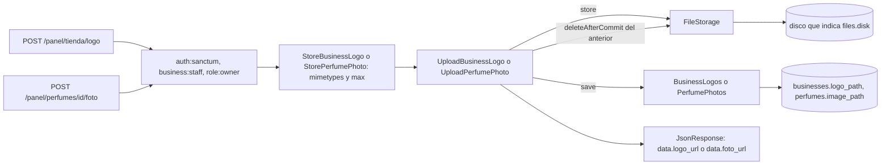

# Subir el logo de la tienda y la foto de un perfume (#44)

El dueño sube el logo de su tienda (`POST /api/v1/panel/tienda/logo`) y la foto de cada perfume (`POST /api/v1/panel/perfumes/{perfume}/foto`, ruta propuesta) para que la vitrina muestre su marca y sus productos sin imágenes externas. Se apoya en [PerfumeVariantsAndDemoSeeder.md](PerfumeVariantsAndDemoSeeder.md) y [SalePriceCalculation.md](SalePriceCalculation.md) para la forma de los módulos y las rutas.

## Reglas de la subida

| Regla | Cómo se cumple |
| --- | --- |
| PNG, JPG o WEBP de hasta 2 MB | `mimetypes:image/png,image/jpeg,image/webp` y `max:2048` |
| El tipo se valida **por el contenido, no por la extensión** | `mimetypes` lee el contenido del archivo. Un PDF o un GIF con nombre `.png` responden 422 |
| Mensaje en español | 422 `datos-invalidos` con `errores.logo` o `errores.foto`: «El logo debe ser una imagen PNG, JPG o WEBP de hasta 2 MB.» |
| Nombre generado, nunca el del navegador | El almacenamiento genera un UUID v7 y la extensión sale del tipo real: `logos/<uuid>.png`, `perfumes/<uuid>.jpg` |
| Reemplazar borra el archivo anterior, **después de confirmar** | `FileStorage::deleteAfterCommit` usa `DB::afterCommit`: si la transacción falla, el archivo vigente sigue ahí |
| El archivo nuevo no queda huérfano si falla el guardado | El caso de uso lo descarta con `FileStorage::discard` antes de relanzar |
| Solo el dueño; la tienda sale de la sesión | `role:owner` y `BusinessContext`. Colaborador y cliente: 403; sin token: 401 |
| Un perfume de otra tienda o inexistente: 404 | El repositorio filtrado por la tienda de la sesión; se trata igual que uno inexistente |

La respuesta es 200 con `data.logo_url` o `data.foto_url`, con la misma envoltura `data` del resto de la API.

## Flujo

El disco se elige por configuración: `config/files.php` (`files.disk`, `public` por defecto) apunta a un disco de `config/filesystems.php`. Cambiar a un disco de la nube no toca el código.

## Archivos creados

Rutas relativas a `archivum-api-hexagonal/`.

| Archivo | Por qué existe |
| --- | --- |
| `src/Shared/Domain/Contracts/FileStorage.php` | Puerto de almacenamiento de `Src\Shared`: guardar, descartar, borrar tras confirmar y dar la dirección |
| `src/Shared/Domain/ValueObjects/ImageType.php` | Los tres tipos aceptados, su extensión y el límite de 2 MB (R53) en un solo lugar |
| `src/Shared/Infrastructure/Storage/LaravelFileStorage.php` | Adaptador con el sistema de archivos de Laravel; el nombre es un UUID v7 |
| `config/files.php` | Disco de los archivos subidos |
| `lang/es/files.php` | Mensajes en español |
| `src/Businesses/Logo/Application/Contracts/BusinessLogos.php`, `DTOs/UploadBusinessLogoCommand.php`, `UseCases/UploadBusinessLogo.php` | El caso de uso del logo, en el módulo `Src\Businesses\Logo` |
| `src/Businesses/Logo/Infrastructure/Persistence/EloquentBusinessLogos.php` | Lee y guarda `businesses.logo_path`, la columna que ya existía |
| `src/Businesses/Logo/Infrastructure/Http/Requests/StoreBusinessLogo.php`, `Controllers/BusinessLogoController.php`, `routes.php` | La capa HTTP del logo; el controlador responde con un `JsonResponse` |
| `src/Businesses/Logo/Infrastructure/LogoServiceProvider.php` | Enlaza `BusinessLogos` y `FileStorage` |
| `src/Catalog/Perfumes/Application/Contracts/PerfumePhotos.php`, `DTOs/UploadPerfumePhotoCommand.php`, `UseCases/UploadPerfumePhoto.php` | El caso de uso de la foto |
| `src/Catalog/Perfumes/Infrastructure/Persistence/Repositories/EloquentPerfumePhotos.php` | Lee y guarda `perfumes.image_path`, filtrado por la tienda de la sesión |
| `src/Catalog/Perfumes/Infrastructure/Http/Requests/StorePerfumePhoto.php`, `Controllers/PerfumePhotoController.php` | La capa HTTP de la foto |
| `tests/Support/Catalog/FakeImages.php` | Archivos subidos con contenido real, para probar la detección por contenido |
| `tests/Support/Shared/InMemoryFileStorage.php` | Almacenamiento en memoria que simula «borrar tras confirmar» |
| `tests/Unit/Shared/Domain/ImageTypeTest.php`, `tests/Unit/Businesses/Logo/Application/UploadBusinessLogoTest.php`, `tests/Unit/Catalog/Perfumes/Application/UploadPerfumePhotoTest.php` | Los tipos y los casos de uso, sin framework |
| `tests/Feature/Businesses/Logo/UploadBusinessLogoTest.php`, `tests/Feature/Catalog/Perfumes/UploadPerfumePhotoTest.php` | Los endpoints con `Storage::fake` y dos tiendas |

Archivos propios de ramas anteriores que se modificaron: `PerfumesServiceProvider.php` (enlaza `PerfumePhotos` y `FileStorage`), `routes.php` de los perfumes (la ruta de la foto) y `ServesCatalog.php` (sirve también el módulo del logo).

## Por qué las pruebas usan archivos reales

`UploadedFile::fake()` adivina el tipo por el **nombre**, justo lo contrario de lo que pide el issue. `FakeImages` escribe archivos temporales con el contenido real (un PNG de un píxel, un PDF, un GIF) y los sube con el nombre que se quiera, así que la prueba demuestra que un PDF llamado `falso.png` se rechaza. No hace falta la extensión GD.

## Decisiones

| Tema | Decisión | Estado |
| --- | --- | --- |
| Ruta de la foto | `POST /panel/perfumes/{perfume}/foto` | **Propuesta** (la sección 8 solo lista la del logo); se confirma antes del contrato (#50) |
| Límites de la foto | PNG, JPG o WEBP de hasta 2 MB, como el logo | **Pendiente**: R53 solo fija los del logo |
| Dimensiones máximas de las imágenes | No se validan | **Pendiente de definir** |
| Respuesta | `data.logo_url` y `data.foto_url` | Sigue la envoltura `data` de la API |
| Elegir el disco con una variable de entorno | No se lee `env()` en `config/files.php` | `EnvironmentConfigurationTest` exige listar en `.env.example` toda variable que lea `config/`, y ese archivo no se modificó; ver «Pendiente» |

`logo_url` en el perfil público y `foto_url` en la vitrina llegan con #47, #48 y #49: este issue deja guardadas las rutas y las direcciones.

## Qué verifican las pruebas

| Criterio | Prueba |
| --- | --- |
| Guarda el archivo con nombre generado y responde con la dirección | «keeps the logo…» y «keeps the photo…» |
| Reemplazar borra el anterior; borrar tras confirmar | «deletes the previous…» y las unitarias con `InMemoryFileStorage` |
| Rechaza un PDF y un GIF disfrazados de PNG y uno de más de 2 MB, con el mensaje en español, sin tocar lo vigente | «refuses the files that are not an image…» |
| 403 y 401 | «answers 403…» y «answers 401…» |
| Perfume ajeno o inexistente: 404 y nada guardado | «answers 404 for a perfume of the other business…» |
| El logo de la otra tienda no se toca | «leaves the logo of the other business alone» |
| El archivo nuevo se descarta si falla el guardado | `UploadBusinessLogoTest` unitaria |

## Integración y verificación

No queda nada manual de integración, salvo `storage:link` y la variable de entorno opcional:

- `LogoServiceProvider` está registrado en `bootstrap/providers.php` y `routes/api.php` carga las rutas del logo; la ruta de la foto sale del `routes.php` del catálogo, que ya se carga. El contrato `openapi/v1.json` incluye `POST /panel/tienda/logo` y `POST /panel/perfumes/{perfume}/foto`.
- Las respuestas de logo y foto son un `JsonResponse` con `data.logo_url` o `data.foto_url`, sin clase de Resource: no hay un modelo que el generador del contrato pueda inferir de una cadena, y la forma de la respuesta queda a la vista en el controlador.
- Las pruebas de la foto arman su escenario con una función (`photoScenario()`) y no guardan datos en propiedades dinámicas de Pest, que Larastan no entiende. Ya no instalan rutas ni providers por su cuenta.
- La matriz compartida de aislamiento del personal no tiene fila para estos endpoints: la de recurso por id arma `{ruta}/{id}` y la de la tienda espera `data.id`. Su aislamiento lo cubren las pruebas propias de cada endpoint (la tienda ajena y el perfume ajeno no se tocan).

**Pendientes:**

1. Ejecutar `php artisan storage:link` para servir el disco `public` desde `/storage`.
2. Si se quiere elegir el disco por variable de entorno: leerla con `env()` en `config/files.php` y añadirla a `.env.example`.

| Comprobación | Resultado |
| --- | --- |
| Pint | Sin diferencias |
| Larastan, nivel 8 | Sin errores (`[OK] No errors`) |
| Pest, suite completa | 841 pruebas en verde, con `php -d memory_limit=1G vendor/bin/pest` |
