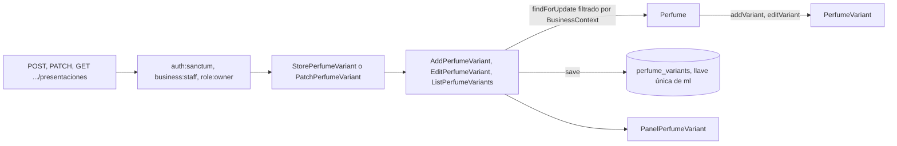

# Presentaciones de un perfume y seeder de demostración (#42)

El dueño define en qué tamaños se vende cada perfume y, si hace falta, su precio manual: `GET`, `POST` y `PATCH` sobre `/api/v1/panel/perfumes/{perfume}/presentaciones`. Además, un seeder crea perfumes de ejemplo en las dos tiendas de demostración. Se apoya en [CatalogEloquent.md](CatalogEloquent.md), [PerfumesNotesAndEtiquetes.md](PerfumesNotesAndEtiquetes.md), [PerfumesEditAndDeactivate.md](PerfumesEditAndDeactivate.md) y [PerfumesListAndSearch.md](PerfumesListAndSearch.md).

## Flujo

La regla de **ml únicos** la guarda el agregado `Perfume` (`DuplicateVariantSizeException`) y la respalda la llave única `(business_id, perfume_id, size_ml)` de #37, que el repositorio traduce a la misma excepción si dos peticiones compiten. El controlador la convierte en 422 `datos-invalidos` con `errores.ml`.

## Endpoints

| Operación | Cuerpo | Respuesta |
| --- | --- | --- |
| `POST .../presentaciones` | `ml` (obligatorio, entero de 1 a 32 767), `precio_manual` (opcional, entero ≥ 0) | 201 con `Location` y la presentación |
| `PATCH .../presentaciones/{presentacion}` | `ml`, `precio_manual` (`null` lo quita) y `activa`, todos opcionales | 200 con la presentación |
| `GET .../presentaciones` | — | 200 con las activas y las inactivas, por ml |

La presentación se expone con `id`, `ml`, `precio_venta`, `precio_manual` y `activa`. Mientras #43 no calcula el precio, `precio_venta` es el precio manual si existe y `null` si no. Una presentación inactiva sigue en el listado del panel; la vitrina no la muestra (#48, #49).

**404 `no-encontrado`:** un perfume de otra tienda, uno inexistente, una identidad que no es un UUID y una presentación que no es de ese perfume. Se distinguen en el dominio: `PerfumeNotFoundException` y `PerfumeVariantNotFoundException`. **403** al colaborador y al cliente, **401** sin token.

## Archivos creados o modificados

Rutas relativas a `archivum-api-hexagonal/`.

| Archivo | Por qué existe |
| --- | --- |
| `src/Catalog/Perfumes/Domain/Exceptions/PerfumeVariantNotFoundException.php` | 404 de una presentación que el perfume no contiene (antes era un 422 genérico) |
| `src/Catalog/Perfumes/Application/DTOs/AddPerfumeVariantCommand.php`, `EditPerfumeVariantCommand.php` | Lo que llega a cada caso de uso; en la edición, una clave ausente no cambia |
| `src/Catalog/Perfumes/Application/UseCases/AddPerfumeVariant.php`, `EditPerfumeVariant.php`, `ListPerfumeVariants.php` | Un caso de uso por operación, sobre el agregado `Perfume` |
| `src/Catalog/Perfumes/Infrastructure/Http/Requests/StorePerfumeVariant.php`, `PatchPerfumeVariant.php` | Validación en español |
| `src/Catalog/Perfumes/Infrastructure/Http/Resources/PanelPerfumeVariant.php` | Lista blanca de la presentación; el detalle del perfume usa los mismos campos |
| `src/Catalog/Perfumes/Infrastructure/Http/Controllers/PerfumeVariantController.php` | Los tres endpoints y la traducción del ml repetido |
| `database/seeders/CatalogDemoSeeder.php` | Perfumes de ejemplo para las dos tiendas de demostración |
| `database/seeders/Concerns/SeededBusinessContext.php` | La tienda que el seeder está llenando, para que los casos de uso funcionen como en una petición |
| `tests/Unit/Catalog/Perfumes/Application/PerfumeVariantsTest.php` | Los casos de uso sin framework |
| `tests/Feature/Catalog/Perfumes/PerfumeVariantsTest.php` | Los endpoints contra PostgreSQL con dos tiendas |
| `tests/Feature/Catalog/Perfumes/CatalogDemoSeederTest.php` | El seeder |

Archivos propios de ramas anteriores que se modificaron: `Perfume.php` (`editVariant` y `variant` públicos), `PerfumeVariant.php` (los ml dejan de ser de solo lectura para poder editarlos), `InvalidPerfumeException.php` (se quita `variantNotFound`, que ahora es 404), `PanelPerfume.php` (usa `PanelPerfumeVariant`), `routes.php`, y `PerfumeTest.php` (la excepción esperada y dos pruebas nuevas).

## El seeder

`CatalogDemoSeeder` reutiliza los casos de uso `CreatePerfume` y `AddPerfumeVariant` con la tienda fijada en la transacción de `BusinessTransaction`, como los seeders de tiendas y personal (#27). Crea **4 perfumes en ArchivumParfums** y **3 en Esencias del Norte**, ficticios, con notas por capa, etiquetas y presentaciones de 50 y 100 ml. Todos llevan **precio manual**, porque en el Avance 1 todavía no hay costo del proveedor. No repite un perfume que ya existe, así que puede correrse más de una vez. Las botellas abiertas de ejemplo llegarán con #71.

La prueba que consulta `GET /api/v1/tiendas/{tienda}/perfumes` de cada tienda necesita la vitrina de #48, así que se escribe en esa rama.

## Decisiones

| Tema | Decisión | Estado |
| --- | --- | --- |
| Cambiar los ml de una presentación con botellas o pedidos | Se permite: todavía no existen botellas ni pedidos | **Pendiente**, se revisa con #71 y #80 porque el precio del decant (R3) depende de esos ml |
| Borrar una presentación | No se implementa: solo se desactiva | **Pendiente de definir** (la sección 8 dice CRUD) |
| Tope de los ml | 32 767, el límite de la columna `smallint` | El tope de negocio sigue **pendiente** |
| Precio manual | Entero no negativo; sin mínimo ni máximo de negocio | **Pendiente** el rango, como en #36 |
| `precio_venta` | Manual si existe; si no, el guardado; `null` si no hay | Provisional hasta #43 |

## Qué verifican las pruebas

| Criterio | Prueba |
| --- | --- |
| Crear con `ml` y `precio_manual` opcional, 201 y `Location` | «creates a presentation…» |
| ml repetidos: 422 sobre `ml` | «answers 422 pointing at ml…» (al crear y al editar) |
| Datos inválidos: 422 con `errores` por campo | «answers 422 with the errors by field…» |
| Editar ml, quitar el precio manual, desactivar y reactivar | «edits the milliliters…» |
| Listar activas e inactivas | «lists the active and the inactive presentations…» |
| 404 por perfume ajeno, presentación de otro perfume o identidad inválida | Cuatro pruebas de 404, una de ellas comprueba que la fila ajena no cambia |
| 403 y 401 | «answers 403…» y «answers 401…» |
| El seeder, por tienda y sin repetir | `CatalogDemoSeederTest` |

## Integración y verificación

No queda nada manual de integración:

- Las rutas de las presentaciones salen del mismo `routes.php` del catálogo, que `routes/api.php` ya carga; el provider ya está registrado; el contrato `openapi/v1.json` se regeneró con las rutas nuevas.
- `DatabaseSeeder` llama ahora a `CatalogDemoSeeder`, de modo que `php artisan db:seed` crea el catálogo de ejemplo en las dos tiendas. Una prueba (`DatabaseSeederCatalogTest`) ejecuta el sembrador por defecto, el mismo que corre `db:seed`, y comprueba los perfumes de cada tienda.
- Las pruebas de las presentaciones arman su escenario con una función (`variantsScenario()`) y no guardan datos en propiedades dinámicas de Pest, que Larastan no entiende. Ya no instalan rutas ni providers por su cuenta.

Las rutas anidadas (`/panel/perfumes/{perfume}/presentaciones/...`) no caben en la matriz compartida de aislamiento del personal, que arma `{ruta}/{id}`; su aislamiento lo cubren las pruebas propias del módulo.

| Comprobación | Resultado |
| --- | --- |
| Pint | Sin diferencias |
| Larastan, nivel 8 | Sin errores (`[OK] No errors`) |
| Pest, suite completa | 773 pruebas en verde, con `php -d memory_limit=1G vendor/bin/pest` |
