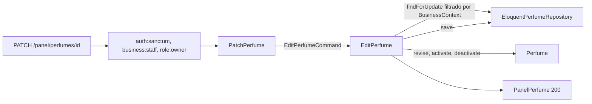

# Editar y desactivar perfumes (#40)

`PATCH /api/v1/panel/perfumes/{perfume}` corrige solo los campos enviados de un perfume de la tienda de la sesión y, con `activo`, lo desactiva o lo reactiva sin borrarlo. Se apoya en la persistencia de [CatalogEloquent.md](CatalogEloquent.md) (#38) y en la creación de [PerfumesNotesAndEtiquetes.md](PerfumesNotesAndEtiquetes.md) (#39), cuyas reglas de validación reutiliza.

## Flujo

1. Los middlewares son los de la creación: 401 sin token, 403 al colaborador y al cliente. La ruta exige un UUID en `{perfume}`; cualquier otra cosa no coincide con la ruta y responde 404.
2. `PatchPerfume` valida con **las mismas reglas** que `StorePerfume`, con todos los campos opcionales, y arma un `EditPerfumeCommand` que contiene solo lo enviado.
3. `EditPerfume` busca el perfume con `findForUpdate`, que filtra por la tienda de `BusinessContext`. Uno de otra tienda no existe para esta consulta y se trata igual que uno inexistente: `PerfumeNotFoundException`, 404 `no-encontrado`.
4. Aplica los cambios al agregado y lo guarda en la misma transacción.

## Qué significa «solo lo enviado»

| Campo del cuerpo | Efecto |
| --- | --- |
| `marca`, `nombre` | Si se envían, deben ser válidos; si no, no cambian |
| `concentracion`, `genero`, `familia`, `descripcion` | Si se envían, reemplazan el valor; `null` lo borra |
| `notas.salida`, `notas.corazon`, `notas.fondo` | La capa enviada **reemplaza** las notas de esa capa (una lista vacía la vacía); las capas no enviadas no cambian |
| `etiquetas.momento`, `etiquetas.clima`, `etiquetas.ocasion` | Igual, por tipo de etiqueta |
| `activo` | `false` desactiva, `true` reactiva |

Desactivar **no borra nada**: el perfume conserva sus notas, etiquetas y presentaciones. Que salga de la vitrina y siga en el listado del panel lo resuelven #48 y #41.

## Archivos creados o modificados

Rutas relativas a `archivum-api-hexagonal/`.

| Archivo | Por qué existe |
| --- | --- |
| `src/Catalog/Perfumes/Application/DTOs/EditPerfumeCommand.php` | Lo que cambia, con las claves del dominio. Una clave ausente significa «no cambia» |
| `src/Catalog/Perfumes/Application/UseCases/EditPerfume.php` | El caso de uso: busca, revisa el agregado, activa o desactiva y guarda. Una identidad que no es un UUID válido también se trata como no encontrada |
| `src/Catalog/Perfumes/Domain/Exceptions/PerfumeNotFoundException.php` | 404 `no-encontrado`; sirve para el perfume ajeno y el inexistente |
| `src/Catalog/Perfumes/Infrastructure/Http/Requests/PatchPerfume.php` | Request de la edición parcial |
| `src/Catalog/Perfumes/Infrastructure/Http/Requests/PerfumeFields.php` | Las reglas, mensajes y nombres de campo que comparten la creación y la edición, para que no se desvíen |
| `tests/Support/Catalog/StoredPerfumes.php` | Guarda un perfume de ejemplo por el repositorio, con la tienda fijada, para las pruebas siguientes |
| `tests/Unit/Catalog/Perfumes/Application/EditPerfumeTest.php` | El caso de uso sin framework |
| `tests/Feature/Catalog/Perfumes/EditPerfumeTest.php` | El endpoint contra PostgreSQL con dos tiendas |

Archivos propios de #39 que se modificaron: `StorePerfume.php` (ahora toma sus reglas de `PerfumeFields`), `PerfumeController.php` (método `update`), `routes.php` (la ruta `PATCH`) y `lang/es/catalog.php` (`perfume_not_found`). El contrato `openapi/v1.json` se regeneró con la ruta nueva.

## Decisiones

| Tema | Decisión | Estado |
| --- | --- | --- |
| Borrar un perfume creado por error | No se implementa: solo se desactiva | **Pendiente de definir** (la sección 8 dice CRUD; el alcance acordado solo desactiva) |
| Efecto de desactivar sobre los decants de botellas abiertas | Ninguno por ahora | **Pendiente**, se decide con #75 |
| Notas y etiquetas | Se reemplazan por capa o tipo, no se mezclan | Decisión del issue |
| Perfume repetido al editar | No se detecta: igual que al crear, qué hace repetido a un perfume está **pendiente de decisión** (ver [PerfumesNotesAndEtiquetes.md](PerfumesNotesAndEtiquetes.md)) | Bloqueado por esa decisión; el criterio de #40 sobre el repetido no se cumple todavía |

## Qué verifican las pruebas

| Criterio | Prueba |
| --- | --- |
| Cambia solo lo enviado y responde 200 | «changes only the fields sent…» |
| Reemplazo de notas por capa y etiquetas por tipo | «replaces the notes of a layer and the tags of a kind…» |
| `null` borra un texto opcional | «clears a text that may be missing…» |
| Desactivar sin borrar y reactivar | «deactivates the perfume without deleting it and reactivates it» (cuenta notas, etiquetas y presentaciones) |
| 422 con las reglas de la creación | «answers 422 with the same rules…» (el repetido está pendiente de decisión) |
| 404 del ajeno igual que el inexistente | «answers 404 for a perfume of another business…» y «does not touch the perfume of the other business» |
| 403 y 401 | «answers 403…» y «answers 401…» |

## Integración y verificación

No queda nada manual de integración: las rutas del catálogo, el provider y el contrato ya están en el arranque real (vienen de #38 y #39, y el contrato se regeneró aquí). Las pruebas no instalan nada por su cuenta.

Las pruebas de la edición no guardan datos en propiedades dinámicas de Pest (`$this->perfume`), que Larastan no entiende; cada prueba arma su escenario con una función (`editScenario()`) y lo recibe tipado.

| Comprobación | Resultado |
| --- | --- |
| Pint | Sin diferencias |
| Larastan, nivel 8 | Sin errores (`[OK] No errors`) |
| Pest, suite completa | 709 pruebas en verde, con `php -d memory_limit=1G vendor/bin/pest` |
