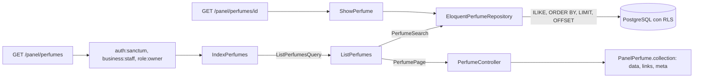

# Listar, buscar y ver los perfumes de la tienda (#41)

`GET /api/v1/panel/perfumes` lista, paginados, los perfumes activos e inactivos de la tienda de la sesión, con búsqueda por texto; `GET /api/v1/panel/perfumes/{perfume}` muestra uno con sus notas, etiquetas y presentaciones. Es la lectura del panel del dueño. Se apoya en [CatalogEloquent.md](CatalogEloquent.md) (#38), [PerfumesNotesAndEtiquetes.md](PerfumesNotesAndEtiquetes.md) (#39) y [PerfumesEditAndDeactivate.md](PerfumesEditAndDeactivate.md) (#40).

## Flujo

La búsqueda, el orden y la paginación **se resuelven en PostgreSQL**, no en PHP: una sola consulta cuenta y otra trae la página, con las notas, etiquetas y presentaciones cargadas por adelantado (`with`). La consulta por tienda sale de `BusinessContext`; la política de fila es la segunda barrera.

## Reglas del listado

| Parámetro | Regla |
| --- | --- |
| `texto` | Busca en marca **o** nombre, sin distinguir mayúsculas (`ILIKE`). Los comodines `%`, `_` y `\` se escapan: `%` se busca como el signo, no como comodín. Un texto en blanco es ninguna búsqueda |
| `pagina` | Entero, mínimo 1; por defecto 1 |
| `por_pagina` | Entero de 1 a 100; por defecto 20 |
| Orden | Marca y nombre sin distinguir mayúsculas; el `id` desempata |

Un valor fuera de rango responde 422 `datos-invalidos` con `errores`. La respuesta trae `data`, `links` y `meta` (`total`, `per_page`, `current_page`, `last_page`…).

## Detalle

`GET /api/v1/panel/perfumes/{perfume}` devuelve los mismos campos que la lista y agrega `presentaciones`, **activas e inactivas**:

| Campo | Significado |
| --- | --- |
| `id` | Identidad de la presentación (la usarán las rutas de #42) |
| `ml` | Mililitros |
| `precio_venta` | El precio manual si existe; si no, el precio de venta guardado; `null` si no hay ninguno |
| `precio_manual` | El precio manual del dueño o `null` |
| `activa` | Si se ofrece |

Un perfume de otra tienda, uno inexistente y una identidad que no es un UUID responden 404 `no-encontrado`. El panel muestra también los perfumes inactivos, como pide el issue #40.

## Archivos creados o modificados

Rutas relativas a `archivum-api-hexagonal/`.

| Archivo | Por qué existe |
| --- | --- |
| `src/Catalog/Perfumes/Application/Contracts/PerfumeSearch.php` | Puerto de lectura del listado, aparte del repositorio de escritura, para que el caso de uso no conozca cómo se busca |
| `src/Catalog/Perfumes/Application/DTOs/ListPerfumesQuery.php`, `PerfumePage.php` | La consulta (texto, página, tamaño) y la página de resultados con su total |
| `src/Catalog/Perfumes/Application/UseCases/ListPerfumes.php`, `ShowPerfume.php` | Un caso de uso por operación |
| `src/Catalog/Perfumes/Infrastructure/Http/Requests/IndexPerfumes.php` | Valida `texto`, `pagina` y `por_pagina` |
| `tests/Unit/Catalog/Perfumes/Application/ListAndShowPerfumesTest.php` | Los casos de uso sin framework |
| `tests/Feature/Catalog/Perfumes/ListAndShowPerfumesTest.php` | Los endpoints contra PostgreSQL con dos tiendas |

Archivos propios de #38 y #39 que se modificaron: `EloquentPerfumeRepository.php` (implementa también `PerfumeSearch` con el método `search`), `PerfumesServiceProvider.php` (enlaza el puerto nuevo), `PanelPerfume.php` (opción `withVariants` para el detalle), `PerfumeController.php` (`index` y `show`), `routes.php` y `tests/Support/Catalog/InMemoryPerfumeRepository.php` (implementa la búsqueda).

## Decisiones

| Tema | Decisión | Estado |
| --- | --- | --- |
| Un puerto de lectura aparte | `PerfumeSearch`, implementado por el mismo repositorio Eloquent | Decisión técnica |
| Consulta de N+1 | Carga anticipada, sin prueba que cuente consultas | La prueba llega con #141, como pide el issue |
| Presentaciones en la lista | No se incluyen; solo el detalle las trae | Decisión del issue |

## Qué verifican las pruebas

| Criterio | Prueba |
| --- | --- |
| Activos e inactivos, con `data`, `links` y `meta` | «lists the active and the inactive perfumes…» |
| Nunca perfumes de otra tienda | «never lists the perfumes of the other business» |
| Búsqueda sin distinguir mayúsculas, por marca o nombre | «searches the brand and the name ignoring case» y «searches a percent sign as text…» |
| Paginación y límites | «pages the list…» y «answers 422 to a page or a size out of range» |
| Detalle con notas, etiquetas y presentaciones | «shows the detail…» |
| 404 del ajeno igual que el inexistente | Dos pruebas de 404 |
| 403 y 401 | «answers 403…» y «answers 401…» |

## Pendiente de hacer a mano

Lo mismo que en las ramas anteriores: registrar `PerfumesServiceProvider`, cargar las rutas del catálogo desde `routes/api.php` y regenerar el contrato con `composer openapi`.
