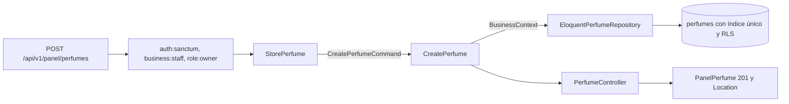

# Crear perfumes con sus notas y etiquetas (#39)

Este documento explica lo que se creó para el issue #39 y por qué. La persistencia sobre la que se apoya (modelos, repositorio y dominio mínimo) está en [CatalogEloquent.md](CatalogEloquent.md) (#38); el diseño del dominio, en [catalog-domain.md](catalog-domain.md).

Sobre esa persistencia, `POST /api/v1/panel/perfumes` registra un perfume con sus notas y etiquetas en la tienda de la sesión. Las presentaciones se agregan después (#42).

## Flujo de una petición



1. Los middlewares autentican con Sanctum (401 sin token), fijan la tienda de la sesión en una transacción y dejan pasar solo al dueño (403 al colaborador y al cliente). La tienda **nunca** sale del cuerpo ni de la URL: el cuerpo puede traer `business_id`, `tienda_id` o `tienda` y se ignoran.
2. `StorePerfume` valida con los nombres de la API y mensajes en español, y traduce las palabras de la API a los valores guardados.
3. `CreatePerfume` toma la tienda de `BusinessContext`, arma el agregado con los objetos de valor y lo guarda dentro de la transacción.
4. `PanelPerfume` es la lista blanca de la respuesta: `id`, `marca`, `nombre`, `concentracion`, `genero`, `familia`, `descripcion`, `notas`, `etiquetas` y `activo`. Nunca expone la tienda.

## Archivos creados en #39

Rutas relativas a `archivum-api-hexagonal/`.

| Archivo | Por qué existe |
| --- | --- |
| `src/Catalog/Perfumes/Application/DTOs/CreatePerfumeCommand.php` | Datos primitivos del caso de uso, con el vocabulario del dominio. No lleva la tienda |
| `src/Catalog/Perfumes/Application/UseCases/CreatePerfume.php` | Un caso de uso, un método. Crea el agregado en la tienda de `BusinessContext`, lo desactiva si `activo` es falso y lo guarda en una transacción |
| `src/Catalog/Perfumes/Domain/Exceptions/DuplicatePerfumeException.php` | Perfume repetido en la tienda. Hereda de `InvalidValueException` |
| `src/Catalog/Perfumes/Infrastructure/Http/PerfumeVocabulary.php` | Las palabras de la API (`dia`, `tarde`, `noche`, `calido`, `templado`, `frio`) emparejadas con lo que guarda la base (`day`, `afternoon`, `night`, `warm`, `temperate`, `cold`), en un solo lugar para la entrada y la salida |
| `src/Catalog/Perfumes/Infrastructure/Http/Requests/StorePerfume.php` | Reglas, mensajes y nombres de campo en español; arma el comando. Solo `marca` y `nombre` son obligatorios |
| `src/Catalog/Perfumes/Infrastructure/Http/Resources/PanelPerfume.php` | La respuesta como lista blanca |
| `src/Catalog/Perfumes/Infrastructure/Http/Controllers/PerfumeController.php` | Llama al caso de uso, responde 201 con `Location` y traduce el perfume repetido a un error de validación sobre `nombre` |
| `src/Catalog/Perfumes/Infrastructure/Http/routes.php` | `POST panel/perfumes` con los mismos middlewares que `panel/tienda` |
| `database/migrations/2026_10_20_000001_make_perfumes_unique_per_business.php` | Índice único `perfumes_business_brand_name_unique` sobre `(business_id, lower(brand), lower(name), lower(coalesce(concentration, '')))`. Reversible |
| `tests/Support/Catalog/InMemoryPerfumeRepository.php` | Repositorio en memoria que repite la regla del repetido, para probar el caso de uso sin base de datos |
| `tests/Support/Catalog/ServesCatalog.php` | Registra el provider y carga las rutas con el prefijo `api/v1` y el grupo `api`, como lo haría el framework una vez registrados a mano |
| `tests/Unit/Catalog/Perfumes/Application/CreatePerfumeTest.php` | El caso de uso sin framework |
| `tests/Feature/Catalog/Perfumes/CreatePerfumeTest.php` | El endpoint contra PostgreSQL con dos tiendas |

## Archivos de la 38 que #39 modificó

Son archivos creados para #38 (todavía sin fusionar), no archivos preexistentes del proyecto:

| Archivo | Cambio |
| --- | --- |
| `EloquentPerfumeRepository.php` | Al violarse una llave única, distingue por el nombre del índice si es el del perfume repetido (`DuplicatePerfumeException`) o el de los ml de una presentación (`DuplicateVariantSizeException`). Antes toda violación se tomaba por la segunda |
| `PerfumeRepository.php` | Documenta la nueva excepción en `save()` |
| `lang/es/catalog.php` | Mensaje `perfume_already_exists` |

## Decisiones

| Tema | Decisión | Estado |
| --- | --- | --- |
| Qué hace repetido a un perfume | Misma marca, mismo nombre y misma concentración en la tienda, sin distinguir mayúsculas; sin concentración cuenta como vacía. Así el EDP y el EDT del mismo nombre son perfumes distintos | **Propuesta sin confirmar**; la llave única de #37 sigue abierta |
| Repetido: 422 y no 409 | 422 `datos-invalidos` con `errores.nombre`, como el nombre de plato repetido del repo guía | Decisión del issue; el equipo puede cambiarla |
| Campos obligatorios | Solo `marca` y `nombre` | **Propuesta sin confirmar** |
| Palabras de la API para momento y clima | `dia`, `tarde`, `noche`; `calido`, `templado`, `frio`. Se guardan en inglés | **Propuesta**: la especificación no fija las palabras de la API |
| Dónde se detecta el repetido | En la base, con el índice único. La fila no se busca antes de insertar: así dos peticiones simultáneas tampoco crean dos perfumes | Decisión técnica |

## Qué verifican las pruebas

| Criterio de #39 | Prueba |
| --- | --- |
| 201 con el perfume y `Location` | «creates the perfume and answers 201…» |
| Solo los campos del Resource | La misma prueba compara las llaves exactas de `data` |
| 422 con `errores` por campo en español | «answers 422… brand and the name are missing» |
| Momento o clima fuera de R5 | «answers 422 on the moment and the climate…» |
| Perfume repetido señala el campo | «answers 422 pointing at the name…», que además comprueba que la transacción sigue sirviendo |
| Tienda de la sesión aunque el cuerpo envíe otra | «assigns the perfume to the business of the session…» |
| 403 al colaborador y al cliente; 401 sin token, en RFC 9457 | «answers 403…» y «answers 401…» |
| Aislamiento con dos tiendas | «lets two businesses register the same perfume…» |

## Pendiente de hacer a mano (se suma a lo de #38)

1. **Cargar las rutas.** `routes/api.php` es un archivo existente y no se modificó. Hay que añadir una línea junto a las demás:

   ```php
   require base_path('src/Catalog/Perfumes/Infrastructure/Http/routes.php');
   ```

   Sin ella, el endpoint no existe en la aplicación; las pruebas lo cargan con `ServesCatalog`.
2. **Registrar el provider** en `bootstrap/providers.php` (ya anotado en #38). El endpoint lo necesita para resolver `PerfumeRepository`.
3. **Regenerar el contrato.** Al registrar las rutas, `OpenApiContractTest` fallará hasta correr `composer openapi` y versionar `openapi/v1.json`. No se hizo aquí porque las rutas aún no están cargadas en la aplicación.
4. **Aplicar la migración** con el rol dueño: `php artisan migrate --database=pgsql_admin`.
5. No se nombró R5 ni R54 en las pruebas, por la misma razón que en #38: `pending-rules.php` no se tocó.

## Verificación de #39

| Comprobación | Resultado |
| --- | --- |
| Pint | Sin diferencias |
| Larastan, nivel 8 | Sin errores |
| Pest, suite completa | 685 pruebas en verde, con `php -d memory_limit=1G vendor/bin/pest` |
