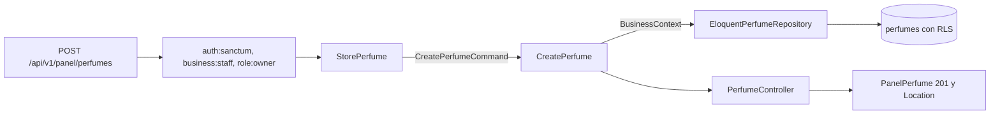

# Crear perfumes con sus notas y etiquetas (#39)

Este documento explica lo que se creó para el issue #39 y por qué. La persistencia sobre la que se apoya (modelos, repositorio y dominio mínimo) está en [CatalogEloquent.md](CatalogEloquent.md) (#38); el diseño del dominio, en [catalog-domain.md](catalog-domain.md).

Sobre esa persistencia, `POST /api/v1/panel/perfumes` registra un perfume con sus notas y etiquetas en la tienda de la sesión. Las presentaciones se agregan después (#42).

## Estado de la integración

El endpoint funciona en la aplicación normal, sin que ninguna prueba lo instale:

| Pieza | Dónde queda |
| --- | --- |
| Rutas | `routes/api.php` carga `src/Catalog/Perfumes/Infrastructure/Http/routes.php` |
| Provider | `bootstrap/providers.php` registra `PerfumesServiceProvider` (viene de la corrección de #38) |
| Contrato | `openapi/v1.json` incluye `POST /panel/perfumes`, con el esquema de seguridad de Sanctum y las respuestas 201, 401, 403 y 422 |
| Aislamiento del personal | La matriz de `StaffIsolationTest` tiene el caso «create a perfume»: el dueño de cada tienda crea con un cuerpo que nombra a la otra y el perfume queda en la suya |

Las pruebas de aceptación usan ese arranque. Antes usaban un ayudante que instalaba rutas y provider por su cuenta (`ServesCatalog`), lo que ocultaba que el endpoint no existía; se eliminó.

## Flujo de una petición

1. Los middlewares autentican con Sanctum (401 sin token), fijan la tienda de la sesión en una transacción y dejan pasar solo al dueño (403 al colaborador y al cliente). La tienda **nunca** sale del cuerpo ni de la URL: el cuerpo puede traer `business_id`, `tienda_id` o `tienda` y se ignoran.
2. `StorePerfume` valida con los nombres de la API y mensajes en español, y traduce las palabras de la API a los valores guardados.
3. `CreatePerfume` toma la tienda de `BusinessContext`, arma el agregado con los objetos de valor y lo guarda dentro de la transacción.
4. `PanelPerfume` es la lista blanca de la respuesta: `id`, `marca`, `nombre`, `concentracion`, `genero`, `familia`, `descripcion`, `notas`, `etiquetas` y `activo`. Nunca expone la tienda.

## Archivos creados en #39

Rutas relativas a `archivum-api-hexagonal/`.

| Archivo | Por qué existe |
| --- | --- |
| `src/Catalog/Perfumes/Application/DTOs/CreatePerfumeCommand.php` | Datos primitivos del caso de uso, con el vocabulario del dominio. No lleva la tienda |
| `src/Catalog/Perfumes/Application/UseCases/CreatePerfume.php` | Un caso de uso, un método. Crea el agregado en la tienda de `BusinessContext`, lo desactiva si `activo` es falso y lo guarda en una transacción |
| `src/Catalog/Perfumes/Infrastructure/Http/PerfumeVocabulary.php` | Las palabras de la API (`dia`, `tarde`, `noche`, `calido`, `templado`, `frio`) emparejadas con lo que guarda la base (`day`, `afternoon`, `night`, `warm`, `temperate`, `cold`), en un solo lugar para la entrada y la salida |
| `src/Catalog/Perfumes/Infrastructure/Http/Requests/StorePerfume.php` | Reglas, mensajes y nombres de campo en español; arma el comando. Solo `marca` y `nombre` son obligatorios |
| `src/Catalog/Perfumes/Infrastructure/Http/Resources/PanelPerfume.php` | La respuesta como lista blanca |
| `src/Catalog/Perfumes/Infrastructure/Http/Controllers/PerfumeController.php` | Llama al caso de uso y responde 201 con `Location` |
| `src/Catalog/Perfumes/Infrastructure/Http/routes.php` | `POST panel/perfumes` con los mismos middlewares que `panel/tienda` |
| `tests/Support/Catalog/InMemoryPerfumeRepository.php` | Repositorio en memoria para probar el caso de uso sin base de datos |
| `tests/Unit/Catalog/Perfumes/Application/CreatePerfumeTest.php` | El caso de uso sin framework |
| `tests/Feature/Catalog/Perfumes/CreatePerfumeTest.php` | El endpoint contra PostgreSQL con dos tiendas, sobre el arranque normal |

Archivos existentes que #39 modificó, con el motivo de la revisión del PR: `routes/api.php` (carga las rutas), `openapi/v1.json` (regenerado con `composer openapi`) y `tests/Feature/Tenancy/StaffIsolationTest.php` (el caso de creación en la matriz compartida; agrega la función `panelCreations()`).

## Perfume repetido: pendiente de decisión

El issue pide que un perfume repetido en la misma tienda responda 422 señalando el campo, pero deja **pendiente de definir qué hace repetido a un perfume** (la llave única de #37). Una primera versión de este PR imponía una definición propia con un índice único; la revisión señaló que eso convierte una propuesta sin confirmar en una restricción ejecutable que puede impedir migrar datos válidos. **Se retiró** la migración, la excepción, la detección y su 422.

| Aspecto | Estado |
| --- | --- |
| Definición de «repetido» (¿marca y nombre? ¿con concentración? ¿cómo se comparan?) | **Pendiente.** No hay una decisión aprobada que enlazar |
| Criterio de aceptación «un perfume repetido responde 422 señalando el campo» | **Bloqueado** por esa decisión; no se cumple en este PR |
| Qué falta cuando se decida | Una migración con la llave acordada y su enlace a la decisión, `docs/data-model.md` con esa llave, y la detección con su 422 sobre el campo que se acuerde |

Mientras tanto la API acepta dos perfumes con la misma marca y nombre en una tienda.

## Decisiones

| Tema | Decisión | Estado |
| --- | --- | --- |
| Repetido: 422 y no 409 | 422 `datos-invalidos` con el campo señalado, como el nombre de plato repetido del repo guía | Decisión del issue; se aplicará cuando se decida qué es un repetido |
| Campos obligatorios | Solo `marca` y `nombre` | **Propuesta sin confirmar** |
| Palabras de la API para momento y clima | `dia`, `tarde`, `noche`; `calido`, `templado`, `frio`. Se guardan en inglés | **Propuesta**: la especificación no fija las palabras de la API |

## Qué verifican las pruebas

| Criterio de #39 | Prueba |
| --- | --- |
| 201 con el perfume y `Location`, en la aplicación normal | «creates the perfume and answers 201…» |
| Solo los campos del Resource | La misma prueba compara las llaves exactas de `data` |
| 422 con `errores` por campo en español | «answers 422… brand and the name are missing» |
| Momento o clima fuera de R5 | «answers 422 on the moment and the climate…» |
| Tienda de la sesión aunque el cuerpo envíe otra | «assigns the perfume to the business of the session…» y el caso de la matriz de aislamiento |
| 403 al colaborador y al cliente; 401 sin token, en RFC 9457 | «answers 403…» y «answers 401…» |
| Aislamiento con dos tiendas | «lets two businesses register the same perfume…» y la matriz |
| El contrato publicado incluye el endpoint | `OpenApiContractTest` |

## Pendiente de hacer a mano

Nada de la integración: rutas, provider y contrato están en el PR. Siguen pendientes, como en #38, nombrar R5 y R54 en una prueba (`pending-rules.php` no se tocó) y la decisión de «perfume repetido».

## Verificación de #39

| Comprobación | Resultado |
| --- | --- |
| Pint | Sin diferencias |
| Larastan, nivel 8 | Sin errores |
| Pest, suite completa | 688 pruebas en verde, con `php -d memory_limit=1G vendor/bin/pest` |
