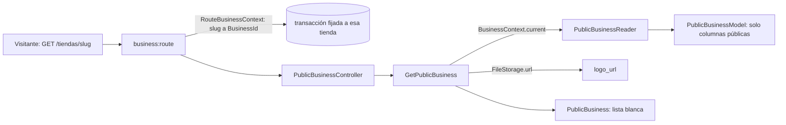

# Perfil público de una tienda (#47)

`GET /api/v1/tiendas/{tienda}` responde, sin autenticación, el nombre, el logo y el lugar de las citas de una tienda, buscada por su `slug`. Es el primer módulo de **solo lectura** del proyecto: `Src\Businesses\PublicProfile`, sin capa `Domain`. Usa el `logo_path` que guarda [LogoAndPerfumePhotoUpload.md](LogoAndPerfumePhotoUpload.md) (#44) y la configuración del perfil de #33.

## Respuesta

```json
{ "data": { "nombre": "ArchivumParfums", "slug": "archivumparfums", "logo_url": null,
            "lugar_cita": "Escazú, San Rafael…", "zona_horaria": "America/Costa_Rica" } }
```

`logo_url` es `null` mientras la tienda no tenga logo. La respuesta **no expone ajustes, personal ni identificadores internos**: el Resource `PublicBusiness` es una lista blanca y una prueba compara las llaves exactas, así que falla si aparece otro campo. Una tienda inexistente, o un `slug` que no puede serlo (mayúsculas, espacios), responde 404 `no-encontrado` en formato RFC 9457.

## Flujo



**El resolvedor de `{tienda}` por `slug`** es el middleware `business:route` que el proyecto ya tenía: `RouteBusinessContext` busca la tienda por su slug, fija la transacción a ella (para las políticas de fila) y deja el `BusinessContext` listo. Esta ruta es la primera que lo usa, y las demás rutas públicas —la vitrina (#48), los servicios (#54) y la disponibilidad (#61)— solo tienen que declarar `{tienda}` y el mismo middleware.

El modelo de lectura `PublicBusinessModel` mapea la tabla `businesses` pero **solo selecciona** `id`, `name`, `slug`, `logo_path`, `location_text` y `timezone`: las demás columnas, como los ajustes, ni siquiera salen de la base.

## Archivos creados

Rutas relativas a `archivum-api-hexagonal/`.

| Archivo | Por qué existe |
| --- | --- |
| `src/Businesses/PublicProfile/Application/Contracts/PublicBusinessReader.php` | Puerto de lectura del perfil público |
| `src/Businesses/PublicProfile/Application/DTOs/PublicBusinessRecord.php`, `PublicBusinessView.php` | Lo que lee la base (con la ruta del logo) y lo que ve el visitante (con la dirección del logo) |
| `src/Businesses/PublicProfile/Application/Exceptions/PublicBusinessNotFoundException.php` | 404 `no-encontrado`, con el mensaje `businesses.business_not_found` que ya existía |
| `src/Businesses/PublicProfile/Application/UseCases/GetPublicBusiness.php` | El caso de uso; convierte la ruta del logo en una dirección con `FileStorage` |
| `src/Businesses/PublicProfile/Infrastructure/Persistence/Models/PublicBusinessModel.php` | Modelo de lectura propio, con las columnas públicas |
| `src/Businesses/PublicProfile/Infrastructure/Persistence/EloquentPublicBusinessReader.php` | Adaptador del puerto |
| `src/Businesses/PublicProfile/Infrastructure/Http/Resources/PublicBusiness.php` | La lista blanca de la respuesta |
| `src/Businesses/PublicProfile/Infrastructure/Http/Controllers/PublicBusinessController.php`, `routes.php` | El endpoint, sin `auth:sanctum` |
| `src/Businesses/PublicProfile/Infrastructure/PublicProfileServiceProvider.php` | Enlaza el lector y el almacenamiento |
| `tests/Unit/Businesses/PublicProfile/Application/GetPublicBusinessTest.php` | El caso de uso sin framework |
| `tests/Feature/Businesses/PublicProfile/PublicBusinessProfileTest.php` | El endpoint contra PostgreSQL con dos tiendas |

Solo se modificó un archivo de apoyo de ramas anteriores: `tests/Support/Catalog/ServesCatalog.php`, que ahora sirve también este módulo.

## Decisiones

| Tema | Decisión | Estado |
| --- | --- | --- |
| Un módulo sin `Domain` | Es una lectura sin reglas que proteger | Decisión del issue |
| Resolver la tienda | Reutilizar `business:route` en vez de crear otro resolvedor | Decisión técnica |
| Respuesta con `data` | Igual que el resto de la API | Sigue la convención |

## Qué verifican las pruebas

| Criterio | Prueba |
| --- | --- |
| 200 sin autenticación por `slug`, con los cinco campos | «shows the public profile of a business by its slug…» (`assertExactJson`) |
| Sin logo, `logo_url` es `null` | «answers null for the logo and the place…» |
| Solo los campos del Resource | «exposes only the fields of the resource…» |
| Dos tiendas, cada `slug` con sus datos | «gives each slug only the data of its own business» |
| 404 `no-encontrado` | «answers 404 in the format of RFC 9457…» |

## Pendiente de hacer a mano

Registrar `PublicProfileServiceProvider` en `bootstrap/providers.php`, cargar `src/Businesses/PublicProfile/Infrastructure/Http/routes.php` desde `routes/api.php` y regenerar el contrato con `composer openapi`, además de lo de las ramas anteriores.
