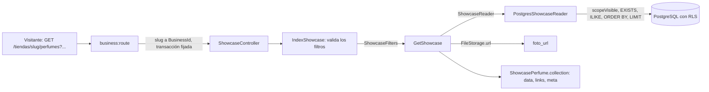

# Vitrina pública de perfumes de una tienda (#48)

`GET /api/v1/tiendas/{tienda}/perfumes` publica, sin autenticación, los perfumes de una tienda, paginados y filtrables por texto, familia, nota, momento, clima, ocasión y precio máximo. Es el segundo módulo de **solo lectura**: `Src\Catalog\Showcase`, sin capa `Domain`. Usa el perfil público y el resolvedor de `{tienda}` de [PublicBusinessProfile.md](PublicBusinessProfile.md) (#47), el precio de venta de [SalePriceCalculation.md](SalePriceCalculation.md) (#43) y las fotos de [LogoAndPerfumePhotoUpload.md](LogoAndPerfumePhotoUpload.md) (#44).

## Qué se muestra

Una sola regla de visibilidad, que el detalle de #49 reutilizará:

| Regla | Dónde vive |
| --- | --- |
| El perfume está **activo** | `ShowcasePerfumeModel::scopeVisible` |
| Tiene al menos una presentación **activa con precio de venta** | La misma `scopeVisible` (un `EXISTS`) |
| Solo se listan las presentaciones **activas con precio de venta** | La relación `sellableVariants` |

Cada perfume trae `id`, `marca`, `nombre`, `concentracion`, `familia`, `foto_url`, `etiquetas` (`momento`, `clima`, `ocasion`) y `presentaciones` con `ml` y `precio_venta` en colones enteros. No trae la tienda, el estado, la descripción ni el costo.

## Filtros

Todos se combinan, y todos se resuelven **en PostgreSQL**, junto con el orden (marca y nombre) y la paginación, con las etiquetas y presentaciones cargadas por adelantado.

| Parámetro | Efecto |
| --- | --- |
| `texto` | Marca o nombre contiene el texto, sin distinguir mayúsculas (`ILIKE`, con los comodines escapados) |
| `familia` | Igual a la familia, sin distinguir mayúsculas; se compara como texto mientras #36 no defina su lista |
| `nota` | Alguna nota contiene el texto, de cualquier capa |
| `momento` | `dia`, `tarde` o `noche` |
| `clima` | `calido`, `templado` o `frio` |
| `ocasion` | Igual a la ocasión, sin distinguir mayúsculas; texto libre |
| `precio_maximo` | Entero ≥ 0: el perfume tiene **alguna presentación vendible** de ese precio o menos |
| `pagina`, `por_pagina` | Mínimo 1; hasta 100 por página, 20 por defecto |

Un filtro inválido (`momento=madrugada`, `clima=hirviendo`, `precio_maximo=-1`, `por_pagina=101`) responde 422 `datos-invalidos` con `errores`. Una tienda inexistente responde 404 `no-encontrado`.

## Flujo

**Aislamiento de la tienda.** La tienda de la URL solo sirve para leer su propia vitrina: el middleware `business:route` la resuelve por el slug y fija la transacción a ella; el lector filtra además por `business_id` del `BusinessContext`, y la política de fila es la segunda barrera. Nunca hay una consulta sin tienda.

**Para la caché futura (#188):** `GetShowcase` depende del puerto `ShowcaseReader`, de modo que una caché lo decore sin tocar el caso de uso.

## Archivos creados

Rutas relativas a `archivum-api-hexagonal/`.

| Archivo | Por qué existe |
| --- | --- |
| `src/Catalog/Showcase/Application/Contracts/ShowcaseReader.php` | Puerto de lectura de la vitrina |
| `src/Catalog/Showcase/Application/DTOs/ShowcaseFilters.php`, `ShowcaseItem.php`, `ShowcaseVariant.php`, `ShowcasePage.php` | Los filtros, un perfume, una presentación vendible y una página |
| `src/Catalog/Showcase/Application/UseCases/GetShowcase.php` | El caso de uso; convierte la ruta de cada foto en una dirección |
| `src/Catalog/Showcase/Infrastructure/Persistence/Models/ShowcasePerfumeModel.php`, `ShowcaseVariantModel.php`, `ShowcaseTagModel.php` | Modelos de lectura propios, con la regla de visibilidad |
| `src/Catalog/Showcase/Infrastructure/Persistence/PostgresShowcaseReader.php` | Filtros, orden y paginación en SQL |
| `src/Catalog/Showcase/Infrastructure/Http/Requests/IndexShowcase.php` | Valida los filtros y cambia las palabras de la API por los valores guardados |
| `src/Catalog/Showcase/Infrastructure/Http/Resources/ShowcasePerfume.php` | La lista blanca de la respuesta |
| `src/Catalog/Showcase/Infrastructure/Http/Controllers/ShowcaseController.php`, `routes.php` | El endpoint, sin `auth:sanctum` |
| `src/Catalog/Showcase/Infrastructure/ShowcaseServiceProvider.php` | Enlaza el lector y el almacenamiento |
| `tests/Unit/Catalog/Showcase/Application/GetShowcaseTest.php` | El caso de uso sin framework |
| `tests/Feature/Catalog/Showcase/ShowcaseTest.php` | El endpoint contra PostgreSQL con dos tiendas |
| `tests/Feature/Catalog/Showcase/ShowcaseDemoSeederTest.php` | El seeder de demostración visto por la vitrina de cada tienda |

Para integrarla se modificaron `bootstrap/providers.php`, `routes/api.php` y `openapi/v1.json`. De apoyo de pruebas se modificó: `StoredPerfumes.php` (acepta notas, etiquetas, presentaciones inactivas y foto).

La palabras de `momento` y `clima` se toman de `PerfumeVocabulary`, del mismo contexto `Catalog`, para que la entrada del panel y la lectura de la vitrina no se desvíen.

## Decisiones

| Tema | Decisión | Estado |
| --- | --- | --- |
| `precio_maximo` y los decants | Solo cuenta el precio de las presentaciones vendibles; los decants de las botellas abiertas no existen aún | **Pendiente**, se decide con #75 |
| Comparar familia y ocasión | Como texto, sin distinguir mayúsculas | Hasta que #36 defina sus listas |
| `nota` | Contiene el texto, en cualquier capa | **Propuesta** |
| Consultas N+1 | Carga anticipada; la prueba que cuenta consultas llega con #141 | Como pide el issue |

## Qué verifican las pruebas

| Criterio | Prueba |
| --- | --- |
| 200 sin autenticación, solo perfumes activos con presentación vendible | «lists, without authentication, only the active perfumes…» |
| Se ocultan inactivos, sin presentaciones, sin precio y con todas inactivas | La misma, con cuatro perfumes ocultos |
| Solo las presentaciones vendibles, y los campos exactos | «shows each perfume with its public fields…» |
| Cada filtro, y la combinación | Cuatro pruebas de filtros |
| `precio_maximo` no cuenta lo que no se vende | «does not count the price of a presentation that cannot be sold» |
| Paginación | «pages the showcase» |
| Filtros inválidos: 422; tienda inexistente: 404 | «answers 422…» y «answers 404…» |
| Aislamiento con dos tiendas | «never includes the perfumes of another store…» |
| Los seeders de #42 en la vitrina de cada tienda | `ShowcaseDemoSeederTest` |

## Integración y verificación

No queda nada manual de integración: `ShowcaseServiceProvider` está registrado en `bootstrap/providers.php`, `routes/api.php` carga las rutas de la vitrina y `openapi/v1.json` incluye `GET /tiendas/{tienda}/perfumes`. Las pruebas ejercen ese arranque; ya no instalan nada por su cuenta.

`ShowcaseDemoSeederTest` corre `seed()`, el sembrador por defecto que ejecuta `db:seed` (que ya llama a `CatalogDemoSeeder`), y consulta la vitrina de cada tienda de demostración: cada una muestra sus perfumes y ninguno de la otra. Es la prueba que pedía #42.

Larastan detectó tres cosas que el arreglo corrigió: las etiquetas del lector se arman en tres listas con la forma que el DTO declara, la prueba de la vitrina no usa `collect()` (cuyos tipos no se pueden inferir) y el lector de ejemplo de la prueba unitaria es una clase con nombre (`RecordingShowcaseReader`), porque una clase anónima oculta su propiedad `received` tras el tipo de la interfaz.

| Comprobación | Resultado |
| --- | --- |
| Pint | Sin diferencias |
| Larastan, nivel 8 | Sin errores (`[OK] No errors`) |
| Pest, suite completa | 888 pruebas en verde, con `php -d memory_limit=1G vendor/bin/pest` |
