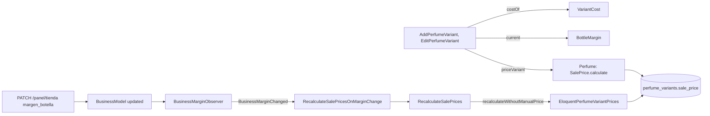

# Cálculo del precio de venta de cada presentación (#43)

El precio de venta de una presentación sale solo del costo del proveedor, el margen de la tienda y, si existe, el precio manual del dueño. Cuando la tienda cambia su margen, los precios que dependen de él se recalculan en la misma transacción. Se apoya en [PerfumeVariantsAndDemoSeeder.md](PerfumeVariantsAndDemoSeeder.md) (#42) y en el perfil de la tienda (#33).

## La regla

| Situación | `precio_venta` |
| --- | --- |
| Hay precio manual | El precio manual. Quitarlo vuelve al cálculo |
| No hay precio manual y hay costo | Costo del proveedor + margen de la tienda |
| No hay costo ni precio manual | `null`: la presentación no se puede vender y la vitrina (#48) no la muestra |

El margen es `ajustes.margen_botella` de la tienda (₡5.000 por defecto). Todo el cálculo es de **colones enteros**: `SalePrice` suma enteros de `Colones`, sin flotantes ni redondeos.

## Flujo

**Al crear o editar una presentación**, el caso de uso pide el costo al puerto `VariantCost` y el margen a `BottleMargin`, y el agregado `Perfume` aplica el cálculo con `priceVariant`.

**Al cambiar el margen**, el módulo `Businesses` no conoce al catálogo. Anuncia el hecho con un evento (`BusinessMarginChanged`) y el catálogo lo escucha:

1. `EloquentBusinessRepository::save` actualiza la fila de la tienda dentro de la transacción de la petición.
2. El observador `BusinessMarginObserver` compara el margen de los ajustes antes y después. Si cambió, despacha el evento; si se envía el mismo valor, o cambia otro ajuste, no pasa nada.
3. `RecalculateSalePricesOnMarginChange` llama a `RecalculateSalePrices`, que actualiza el `sale_price` de las presentaciones **sin precio manual de esa tienda**, por bloques. Las de otra tienda nunca se leen: el adaptador filtra por `business_id` y la política de fila es la segunda barrera.
4. Como todo ocurre en la transacción de la petición, **si el recálculo falla, el cambio de margen se deshace**.

## Archivos creados o modificados

Rutas relativas a `archivum-api-hexagonal/`.

| Archivo | Por qué existe |
| --- | --- |
| `src/Catalog/Perfumes/Domain/ValueObjects/SalePrice.php` | La regla del cálculo, en el dominio |
| `src/Catalog/Perfumes/Domain/Contracts/VariantCost.php` | Puerto del costo base de una presentación |
| `src/Catalog/Perfumes/Application/Contracts/BottleMargin.php` | Puerto del margen de la tienda de la sesión |
| `src/Catalog/Perfumes/Application/Contracts/PerfumeVariantPrices.php` | Puerto que actualiza en bloque los precios sin precio manual |
| `src/Catalog/Perfumes/Application/UseCases/RecalculateSalePrices.php` | Caso de uso del recálculo por cambio de margen |
| `src/Catalog/Perfumes/Infrastructure/Pricing/NoSupplierCost.php` | Adaptador de `VariantCost` que no devuelve costo: hasta la importación (#174) y el costo más barato (#175), el Avance 1 vende con precio manual |
| `src/Catalog/Perfumes/Infrastructure/Pricing/BusinessSettingsBottleMargin.php` | Lee el margen por el puerto `BusinessRepository` del módulo `Businesses` |
| `src/Catalog/Perfumes/Infrastructure/Persistence/Repositories/EloquentPerfumeVariantPrices.php` | Actualiza solo las filas que cambian de precio |
| `src/Catalog/Perfumes/Infrastructure/Listeners/RecalculateSalePricesOnMarginChange.php` | El oyente del evento |
| `src/Businesses/Profile/Domain/Events/BusinessMarginChanged.php` | El evento; vive en `Businesses`, que no depende del catálogo |
| `src/Businesses/Profile/Infrastructure/Persistence/Observers/BusinessMarginObserver.php` | Detecta el cambio de margen sin tocar `UpdateBusinessProfile` |
| `src/Businesses/Profile/Infrastructure/ProfileEventsServiceProvider.php` | Registra el observador |
| `tests/Support/Catalog/FixedVariantCost.php`, `FixedBottleMargin.php` | Costo y margen que elige la prueba |
| `tests/Unit/Catalog/Perfumes/Domain/SalePriceTest.php`, `tests/Unit/Catalog/Perfumes/Application/SalePriceOfVariantsTest.php` | El cálculo y los casos de uso, sin framework |
| `tests/Feature/Catalog/Perfumes/SalePriceRecalculationTest.php` | El recálculo al cambiar el margen, con dos tiendas |

Archivos propios de ramas anteriores que se modificaron: `Perfume.php` (`priceVariant`), `AddPerfumeVariant.php` y `EditPerfumeVariant.php` (reciben costo y margen), `PerfumesServiceProvider.php` (enlaces y oyente), `CatalogDemoSeeder.php`, `ServesCatalog.php` y la prueba unitaria de las presentaciones.

**Por qué un observador y no un cambio en `UpdateBusinessProfile`:** el caso de uso existente no se modifica. El observador del modelo Eloquent se ejecuta en la misma transacción y alcanza el mismo resultado: el evento sale de `Businesses` y el catálogo lo escucha.

## Decisiones

| Tema | Decisión | Estado |
| --- | --- | --- |
| `sale_price` se guarda y se recalcula | Excepción a la tercera forma normal: se guarda porque la vitrina lo filtra y ordena en SQL, y se mantiene al crear, al editar y al cambiar el margen. Con precio manual vale el precio manual | **Justificación para `docs/data-model.md`**: ese archivo no se modificó aquí y la excepción debe sumarse a mano (#35) |
| Costo del proveedor | El adaptador no devuelve costo | Provisional hasta #174 y #175 |
| Margen por presentación | Un solo margen por tienda | Decisión del issue |
| Redondeo | Ninguno: costo + margen exactos | **Pendiente**; el redondeo configurado de `ajustes` es de los decants (R3) |

## Qué verifican las pruebas

| Criterio | Prueba |
| --- | --- |
| Sin precio manual, costo + margen; con él, el manual; sin costo ni manual, nulo; con otro margen | `SalePriceTest` y `SalePriceOfVariantsTest` |
| Todo en colones enteros | «keeps everything in whole colones…» |
| Quitar el precio manual vuelve al cálculo | «goes back to the calculation…» y la prueba por la API |
| Cambiar el margen recalcula las presentaciones sin precio manual de esa tienda | «recalculates the sale price… when the margin changes» |
| Las de otra tienda no cambian | «does not change the prices of the other business» |
| Cambios que no son del margen no recalculan | Dos pruebas |
| Misma transacción | «undoes the change of the margin when the recalculation fails…» |

## Integración y verificación

No queda nada manual de integración, salvo la excepción de `docs/data-model.md` indicada abajo:

- `ProfileEventsServiceProvider`, que registra el observador del margen, está en `bootstrap/providers.php` junto a `PerfumesServiceProvider`; sin él el evento no se despacharía. La prueba del recálculo corre sobre ese arranque, sin instalar nada por su cuenta.
- El contrato `openapi/v1.json` se regeneró.
- La prueba del recálculo arma su escenario con una función (`priceScenario()`) y no guarda datos en propiedades dinámicas de Pest, que Larastan no entiende.

**Pendiente (documentación):** la excepción de `sale_price` a la tercera forma normal, justificada en la tabla de decisiones de este documento, debe sumarse a `docs/data-model.md` (#35). Ese archivo no se modificó en este PR.

| Comprobación | Resultado |
| --- | --- |
| Pint | Sin diferencias |
| Larastan, nivel 8 | Sin errores (`[OK] No errors`) |
| Pest, suite completa | 794 pruebas en verde, con `php -d memory_limit=1G vendor/bin/pest` |
