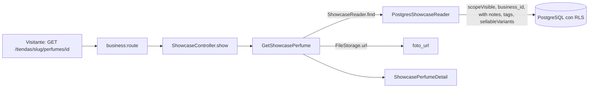

# Detalle público de un perfume (#49)

`GET /api/v1/tiendas/{tienda}/perfumes/{perfume}` muestra a un visitante, sin autenticación, las notas, las etiquetas y el precio de cada presentación de un perfume. Es la segunda lectura del módulo `Src\Catalog\Showcase` de [PublicShowcase.md](PublicShowcase.md) (#48), con el mismo puerto `ShowcaseReader` y la **misma regla de visibilidad** que la lista.

## Respuesta

`data` trae `id`, `marca`, `nombre`, `concentracion`, `genero`, `familia`, `descripcion`, `foto_url`, `notas` por capa (`salida`, `corazon`, `fondo`), `etiquetas` por tipo (`momento`, `clima`, `ocasion`) y `presentaciones` con `ml` y `precio_venta`. Solo trae las presentaciones **activas con precio de venta**, en colones enteros. No trae la tienda, el estado ni el costo.

## Una sola regla de visibilidad

| Lo que se ve en la lista | Lo que se ve en el detalle |
| --- | --- |
| Perfume activo con al menos una presentación activa y con precio | El mismo |
| Solo esas presentaciones | Solo esas presentaciones |

Las dos lecturas parten de `ShowcasePerfumeModel::scopeVisible` y de la relación `sellableVariants`; la regla no se escribe dos veces, así que no pueden contradecirse. Un perfume que la lista no muestra responde en el detalle **404 `no-encontrado`**, y es el mismo 404 para:

| Caso | Respuesta |
| --- | --- |
| Perfume inactivo | 404 |
| Perfume sin presentaciones, sin precio de venta o con todas inactivas | 404 |
| Perfume inexistente | 404 |
| Identidad que no es un UUID | 404 (lo resuelve la ruta con `whereUuid`) |
| Perfume de otra tienda pedido con el `slug` de esta | 404, igual que uno inexistente |
| Tienda inexistente | 404 |

Una prueba recorre cinco perfumes (uno visible y cuatro ocultos por razones distintas) y comprueba que el detalle responde 200 **si y solo si** la lista los incluye.

## Flujo

Los decants disponibles de las botellas abiertas se agregarán a este detalle con #75.

## Archivos creados o modificados

Rutas relativas a `archivum-api-hexagonal/`.

| Archivo | Por qué existe |
| --- | --- |
| `src/Catalog/Showcase/Application/DTOs/ShowcaseDetail.php` | El perfume con todo lo que el visitante puede saber |
| `src/Catalog/Showcase/Application/Exceptions/ShowcasePerfumeNotFoundException.php` | 404 `no-encontrado` con el mensaje `catalog.perfume_not_found` que ya existía |
| `src/Catalog/Showcase/Application/UseCases/GetShowcasePerfume.php` | El caso de uso; convierte la ruta de la foto en una dirección |
| `src/Catalog/Showcase/Infrastructure/Persistence/Models/ShowcaseNoteModel.php` | Modelo de lectura de las notas |
| `src/Catalog/Showcase/Infrastructure/Http/Resources/ShowcasePerfumeDetail.php` | La lista blanca del detalle |
| `tests/Unit/Catalog/Showcase/Application/GetShowcasePerfumeTest.php` | El caso de uso sin framework |
| `tests/Feature/Catalog/Showcase/ShowcaseDetailTest.php` | El endpoint contra PostgreSQL con dos tiendas |

Archivos propios de #48 que se modificaron: `ShowcaseReader.php` (método `find`), `PostgresShowcaseReader.php` (lo implementa), `ShowcasePerfumeModel.php` (relación `notes`), `ShowcaseController.php` (método `show`), `routes.php` y la prueba unitaria de la lista (su lector de ejemplo implementa el método nuevo).

## Un detalle de Laravel que importa

La ruta tiene dos parámetros, `{tienda}` y `{perfume}`, y Laravel entrega los parámetros de una ruta a un método **por posición**, no por nombre: `show(string $perfume)` habría recibido el `slug` de la tienda. El controlador lee `perfume` de la ruta por su nombre. Las rutas de #47 y #48 no tenían este problema porque solo tienen `{tienda}`.

## Qué verifican las pruebas

| Criterio | Prueba |
| --- | --- |
| 200 sin autenticación con todos los campos, las notas por capa y las etiquetas por tipo | «shows, without authentication, the detail of a perfume…» |
| Solo presentaciones activas con precio de venta | «shows only the presentations that are active and have a sale price…» |
| 404 de un perfume inactivo, sin nada que vender o inexistente, en formato RFC 9457 | Tres pruebas de 404 |
| Un perfume de otra tienda pedido con este `slug` responde 404 | «answers 404 to the perfume of another store…» |
| Lista y detalle coinciden | «follows the same rule of visibility as the list…» |

## Integración y verificación

No queda nada manual de integración: el provider y las rutas de la vitrina ya están en el arranque real (vienen de #48), y el contrato `openapi/v1.json` se regeneró con `GET /tiendas/{tienda}/perfumes/{perfume}`. Las pruebas ejercen ese arranque; ya no instalan nada por su cuenta, y arman su escenario con una función (`detailScenario()`) en vez de propiedades dinámicas de Pest, que Larastan no entiende.

Larastan detectó además que `find` armaba las notas por capa de una manera que no cumplía la forma que declara el DTO; ahora las tres listas se llenan por separado, como las etiquetas de #48. El lector de ejemplo de las pruebas unitarias (`RecordingShowcaseReader`) responde también el método nuevo.

| Comprobación | Resultado |
| --- | --- |
| Pint | Sin diferencias |
| Larastan, nivel 8 | Sin errores (`[OK] No errors`) |
| Pest, suite completa | 903 pruebas en verde, con `php -d memory_limit=1G vendor/bin/pest` |
