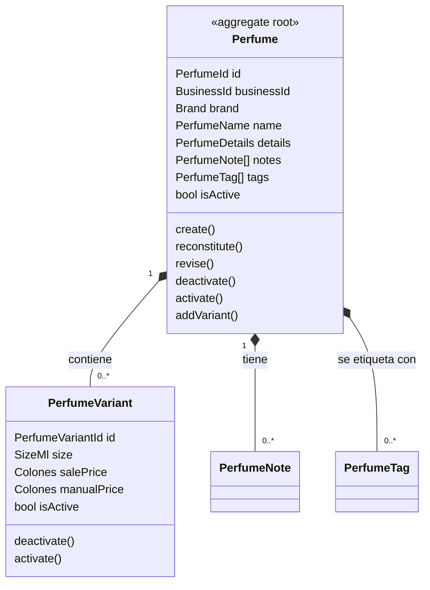

# Dominio del catálogo de perfumes

Este documento fija las reglas del catálogo que viven en el dominio (`Src\Catalog\Perfumes\Domain`), para que ningún camino de entrada, ni el panel ni la importación de R6, pueda crear un perfume o una presentación inválidos. Cubre el issue #36 (M06 · Catálogo de perfumes, R5, núcleo 1). La implementación del puerto con Eloquent llega con #38 y el cálculo del precio de venta con #43.

Las convenciones de capas están en [architecture.md](architecture.md), las de nombres en [ubiquitous-language.md](ubiquitous-language.md) y las tablas en las que se guarda este agregado en [data-model.md](data-model.md) y [database.md](database.md).

> **Valores de prueba.** Todo lo que el issue dejó «pendiente de definir» (largos, rangos, listas y campos obligatorios) se resuelve aquí con **valores de prueba**: son decisiones provisionales para poder construir y probar el dominio, no reglas confirmadas con la perfumería. Cada uno está marcado con 🧪 y reunido en la sección [Valores de prueba](#valores-de-prueba). Cambiar uno es cambiar una constante y su prueba.

## Diagrama

`Perfume` es la raíz del agregado. Las presentaciones, las notas y las etiquetas no existen fuera de él: se leen y se guardan siempre a través del perfume, y la tienda se referencia por `BusinessId`.

## Agregado

### Perfume

| Dato | Tipo | Obligatorio | Regla |
| --- | --- | --- | --- |
| `id` | `PerfumeId` | Sí | UUID v7; la aplicación lo genera con `PerfumeRepository::nextId()` |
| `businessId` | `BusinessId` | Sí | Tienda dueña del perfume; no cambia |
| `brand` | `Brand` | Sí | No vacía, hasta 120 caracteres 🧪 |
| `name` | `PerfumeName` | Sí | No vacío, hasta 120 caracteres 🧪 |
| `details` | `PerfumeDetails` | No | Concentración, género, familia olfativa y descripción; cada uno puede faltar |
| `notes` | lista de `PerfumeNote` | No | Notas de salida, corazón y fondo |
| `tags` | lista de `PerfumeTag` | No | Momento del día, clima y ocasión |
| `isActive` | `bool` | Sí | `true` al crear |
| `variants` | lista de `PerfumeVariant` | No | Sin dos presentaciones con los mismos ml |

Un perfume nace **activo y sin presentaciones**. Las presentaciones se agregan después con `addVariant()`, porque la importación de R6 crea el perfume y su presentación en dos pasos y el panel permite crear un perfume antes de decidir sus tamaños.

### PerfumeVariant

| Dato | Tipo | Obligatorio | Regla |
| --- | --- | --- | --- |
| `id` | `PerfumeVariantId` | Sí | UUID v7 |
| `size` | `SizeMl` | Sí | Entero de 1 a 1000 ml 🧪; no cambia |
| `salePrice` | `Colones` | No | Precio calculado (#43); puede faltar mientras no haya costo ni precio manual |
| `manualPrice` | `Colones` | No | Precio fijado por el dueño (R1); si existe, manda sobre el calculado |
| `isActive` | `bool` | Sí | `true` al crear |

Cuando existe, el precio —calculado o manual— debe estar entre ₡1 000 y ₡5 000 000 🧪. Un precio fuera de ese rango se rechaza aunque sea un entero no negativo.

## Ciclo de vida

| Operación | Quién | Efecto |
| --- | --- | --- |
| `Perfume::create()` | Panel, importación | Perfume activo, sin presentaciones |
| `Perfume::reconstitute()` | Repositorio | Rearma el agregado desde la base, sin aplicar valores por defecto |
| `revise()` | Panel | Cambia marca, nombre, detalles, notas y etiquetas |
| `addVariant()` | Panel, importación | Agrega una presentación activa; lanza `DuplicateVariantSizeException` si ya hay una con esos ml |
| `deactivate()` / `activate()` | Panel | Oculta o vuelve a mostrar el perfume. **No elimina**: conserva sus presentaciones y su historia |
| `deactivateVariant()` / `activateVariant()` | Panel | Igual, para una presentación |

`Perfume` tiene constructor privado, como `Business` y `Member`. Desactivar un perfume no desactiva sus presentaciones: cada una conserva su estado, y la vitrina (#48) muestra una presentación solo si ella y su perfume están activos.

## Objetos de valor

Todos son inmutables y rechazan los datos inválidos al construirse, con `InvalidValueException` y una clave de `lang/es`. Los textos se recortan antes de validar.

| Objeto | Qué guarda | Rechaza | Clave |
| --- | --- | --- | --- |
| `PerfumeId`, `PerfumeVariantId` | UUID v7 | Cualquier otro formato | `shared.invalid_identifier` |
| `Brand` | Marca | Vacía o de más de 120 caracteres 🧪 | `catalog.brand_invalid` |
| `PerfumeName` | Nombre | Vacío o de más de 120 caracteres 🧪 | `catalog.name_invalid` |
| `PerfumeDetails` | Concentración (60), género (30), familia olfativa (60) y descripción (1000) 🧪 | Un texto más largo que su máximo; un texto en blanco se guarda como ausente | `catalog.concentration_too_long`, `catalog.gender_too_long`, `catalog.family_too_long`, `catalog.description_too_long` |
| `SizeMl` | Mililitros enteros | Menos de 1 o más de 1000; fracciones como 7,5 ml 🧪 | `catalog.size_ml_invalid` |
| `PerfumeNote` | Capa (`top`, `heart`, `base`) y texto | Texto vacío o de más de 80 caracteres 🧪; capa inexistente | `catalog.note_invalid`, `catalog.note_layer_invalid` |
| `PerfumeTag` | Tipo y valor | Ver la tabla siguiente | `catalog.time_of_day_invalid`, `catalog.climate_invalid`, `catalog.occasion_invalid`, `catalog.tag_kind_invalid` |
| `Colones` (`Src\Shared`) | Monto entero | Negativo o con fracción | `shared.colones_negative`, `shared.colones_not_integer` |

### Etiquetas

| Tipo (`kind`) | Valores válidos | Texto libre |
| --- | --- | --- |
| `time_of_day` | `day` (día), `afternoon` (tarde), `night` (noche) | No |
| `climate` | `warm` (cálido), `temperate` (templado), `cold` (frío) | No |
| `occasion` | Cualquier texto no vacío de hasta 60 caracteres 🧪 | Sí |

Los valores se guardan en inglés, igual que en el `CHECK` de `perfume_tags` (#37); la API los traduce. «Tarde» es `afternoon` y «noche» es `night`, nunca `evening`.

### Colones

`Colones` vive en `Src\Shared\Domain\ValueObjects` porque lo reutilizan pedidos y pagos. Guarda un entero no negativo; `Colones::fromNumber()` acepta un entero, un decimal sin fracción (`45000.0`) o una cadena numérica (`"45000"`), y rechaza `45000.5` y `"abc"`. Nunca hay punto flotante en el dominio.

## Invariantes del agregado

| # | Invariante | Dónde se verifica | Excepción |
| --- | --- | --- | --- |
| 1 | Marca y nombre no están vacíos | `Brand`, `PerfumeName` | `InvalidValueException` |
| 2 | Los ml son enteros positivos | `SizeMl` | `InvalidValueException` |
| 3 | Los precios son colones enteros no negativos y están en el rango permitido | `Colones`, `PerfumeVariant` | `InvalidValueException` |
| 4 | El momento del día es día, tarde o noche; el clima es cálido, templado o frío | `PerfumeTag` | `InvalidValueException` |
| 5 | No hay dos presentaciones con los mismos ml | `Perfume::addVariant()` | `DuplicateVariantSizeException` |
| 6 | No hay dos notas iguales en la misma capa ni dos etiquetas iguales del mismo tipo | `Perfume::create()`, `revise()` | `InvalidPerfumeException` |
| 7 | Solo se cambia o desactiva una presentación que el perfume contiene | `Perfume::deactivateVariant()` y afines | `InvalidPerfumeException` |
| 8 | Desactivar no elimina | `Perfume`, `PerfumeVariant` | — |

La base repite las invariantes 2, 3, 4, 5 y 6 con `CHECK` y llaves únicas (#37): el dominio da el mensaje claro y la base garantiza el dato aunque entre por SQL directo.

## Excepciones

Las violaciones lanzan excepciones de dominio con una clave de traducción; el texto sale de `lang/es/catalog.php`. El dominio no conoce el idioma ni el framework.

| Excepción | Cuándo | Clave |
| --- | --- | --- |
| `InvalidPerfumeException` | Nota o etiqueta repetida; presentación que el perfume no contiene | `catalog.duplicate_note`, `catalog.duplicate_tag`, `catalog.variant_not_found` |
| `DuplicateVariantSizeException` | Dos presentaciones con los mismos ml | `catalog.duplicate_variant_size` |
| `PerfumeNotFoundException` | El perfume no existe en la tienda | `catalog.perfume_not_found` |
| `InvalidValueException` (compartida) | Un objeto de valor rechaza su dato | Las de la tabla de objetos de valor |

## Puerto

`PerfumeRepository`, en `Domain/Contracts`, igual que `BusinessRepository`:

| Método | Qué hace |
| --- | --- |
| `nextId(): PerfumeId` | Genera la identidad de un perfume nuevo |
| `nextVariantId(): PerfumeVariantId` | Genera la identidad de una presentación nueva |
| `save(Perfume): void` | Guarda el perfume completo con sus presentaciones, notas y etiquetas |
| `find(PerfumeId): ?Perfume` | Busca un perfume de la tienda en curso |
| `findForUpdate(PerfumeId): ?Perfume` | Lo busca y lo bloquea hasta que termine la transacción |

El repositorio filtra por la tienda que indica `BusinessContext`: el puerto no recibe `BusinessId`. La implementación con Eloquent es el issue #38.

## Valores de prueba

Los siete puntos que el issue dejó pendientes quedan resueltos con valores de prueba. Ninguno está confirmado con la perfumería; se revisan antes de `v-avance1`.

| Pendiente del issue | Valor de prueba 🧪 | Por qué este valor |
| --- | --- | --- |
| Largos máximos | Marca 120, nombre 120, concentración 60, género 30, familia 60, descripción 1000, nota 80, ocasión 60 | Son los `varchar` de las tablas de #37; el dominio no admite lo que la base no guarda |
| Precio mínimo y máximo | ₡1 000 a ₡5 000 000; **₡0 no se admite** | El `CHECK` de la base solo prohíbe negativos; el dominio es más estricto para atrapar precios en cero por error |
| ml permitidos | Rango de 1 a 1000, sin lista cerrada; **sin fracciones** (7,5 ml no vale) | `size_ml` es `smallint`; un rango deja crear presentaciones como 2, 5, 10 (R4) o 100 ml sin tocar el código |
| Concentración y género | Texto libre. Ejemplos de concentración: `EDP`, `EDT`, `Extrait`; de género: `masculino`, `femenino`, `unisex` | La especificación no cierra la lista y la importación puede traer otros valores |
| Familia y ocasión | Texto libre | Igual: una lista cerrada rechazaría perfumes legítimos de una perfumería de nicho |
| Obligatorios al crear desde el panel | **Solo marca y nombre** | Es lo mínimo que también trae la importación de R6; el resto se completa después |
| Obligatorios de una presentación | Solo los ml; ambos precios pueden faltar | El precio calculado depende de #43 |

Cada valor es una constante de su objeto de valor (`Brand::MAX_LENGTH`, `SizeMl::MAX`…), así que ajustarlo toca una línea y su prueba.

## Pruebas

Pruebas unitarias de Pest en `tests/Unit/Catalog/Perfumes/Domain` y `tests/Unit/Shared/Domain`. No arrancan el framework. La primera prueba que nombra la regla se titula `R5: …` y quita a R5 de `tests/Architecture/pending-rules.php`.

| Prueba | Qué verifica |
| --- | --- |
| Objetos de valor | Recortan; rechazan vacíos, largos, ml no positivos, momentos y climas fuera de lista |
| `Colones` | Rechaza negativos y fracciones; acepta cadenas numéricas enteras |
| `Perfume` | `create()` y `reconstitute()`; dos presentaciones con los mismos ml; notas y etiquetas repetidas |
| Estado | Desactivar y reactivar un perfume y una presentación sin perder las presentaciones |
| Precio | Rango permitido y ausencia de precio |

Los casos críticos de PostgreSQL (llaves únicas, `CHECK`, aislamiento por tienda) los cubren las pruebas de la base de #37, no estas.

## Lo que este issue no incluye

- La persistencia con Eloquent, los repositorios y las fábricas: #38.
- Los casos de uso y la API del panel: #39.
- El cálculo del precio de venta a partir del costo, el margen y el redondeo: #43. Aquí `salePrice` solo se guarda y se valida.
- La importación del proveedor: #173 y #174.
- La llave única del perfume dentro de la tienda (`brand`, `name` y quizá `concentration`): se decide en #39 y #174.
