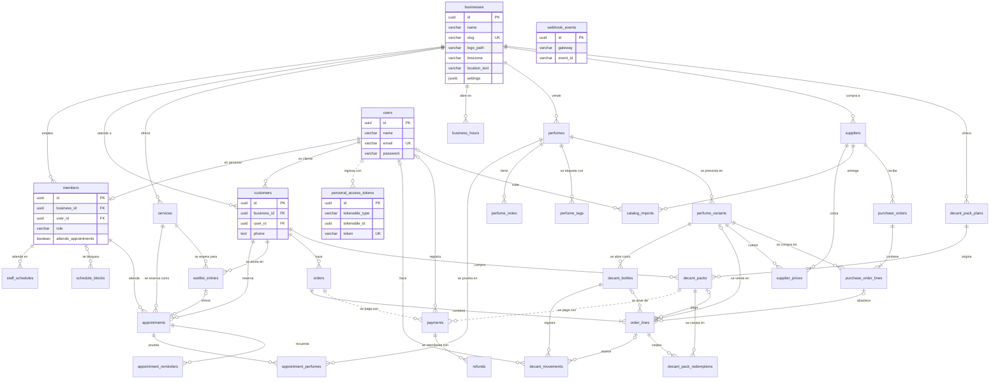

# Modelo de datos

El esquema está en tercera forma normal (3FN). Este documento describe con todo su detalle las tablas que ya existen y a nivel de relación las que están previstas; cada módulo completa las suyas en el pull request que agrega su migración (ver [Regla para cada migración nueva](#regla-para-cada-migración-nueva)).

Las convenciones de nombres, llaves, fechas, dinero, roles y migraciones están en [database.md](database.md) y no se repiten aquí. Las tablas previstas salen de la sección 7 de [la especificación](especificacion.md#7-modelo-de-datos-inicial) y sus nombres, del [lenguaje ubicuo](ubiquitous-language.md).

## Diagrama

Toda tabla de una tienda lleva además `business_id` y su relación con `businesses`; el diagrama dibuja esa relación solo en las tablas de primer nivel para no saturarse. Las líneas punteadas son relaciones polimórficas, sin llave foránea.

Las tablas sin columnas en el diagrama están previstas y todavía no existen. `webhook_events` aparece sin relaciones porque no pertenece a ninguna tienda (ver [excepciones](#excepciones-deliberadas)). Además hay tablas del framework (caché y colas de Laravel) que no pertenecen al negocio y no se documentan aquí.

## Tablas creadas

Todas las llaves primarias son `id uuid DEFAULT uuidv7()`. Las columnas `created_at` y `updated_at` son `timestamptz` y las llena Eloquent (Laravel las declara opcionales). El nombre de las llaves que no se listan con nombre propio es el que da Laravel: `<tabla>_<columna>_foreign` y `<tabla>_<columna>_unique`.

### businesses

Cada fila es una tienda. Es la raíz del aislamiento: no lleva `business_id`.

| Columna | Tipo | Regla |
|---|---|---|
| `id` | `uuid` | Llave primaria |
| `name` | `varchar(100)` | Obligatoria; `businesses_name_check`: no vacía |
| `slug` | `varchar(100)` | Única (`businesses_slug_unique`); `businesses_slug_check`: solo `a-z`, `0-9` y `-` |
| `logo_path` | `varchar(255)` | Opcional |
| `timezone` | `varchar(64)` | Por defecto `America/Costa_Rica` |
| `location_text` | `varchar(255)` | Opcional; el lugar de la cita (R18) |
| `settings` | `jsonb` | Por defecto `{}`; `businesses_settings_check`: debe ser un objeto |
| `created_at`, `updated_at` | `timestamptz` | |

Llaves candidatas: `id` y `slug`. Sin política de fila: las rutas públicas buscan la tienda por su slug antes de saber a cuál pertenecen.

### users

Cada fila es una cuenta de acceso: una persona del personal o un cliente. Una cuenta no pertenece a una tienda: el mismo cliente puede operar en varias, y la tienda de una persona del personal vive en `members`.

| Columna | Tipo | Regla |
|---|---|---|
| `id` | `uuid` | Llave primaria |
| `name` | `varchar(120)` | Obligatoria; `users_name_check`: no vacía |
| `email` | `varchar(255)` | Única en todo el sistema (`users_email_unique`) |
| `password` | `varchar(255)` | Hash de la contraseña, nunca la contraseña |
| `created_at`, `updated_at` | `timestamptz` | |

Llaves candidatas: `id` y `email`. Sin política de fila: no tiene `business_id` y el ingreso busca la cuenta por su correo antes de saber la tienda.

### members

Cada fila es una persona del personal de una tienda, como dueño o colaborador (R54 y sección 3 de la especificación).

| Columna | Tipo | Regla |
|---|---|---|
| `id` | `uuid` | Llave primaria |
| `business_id` | `uuid` | Llave foránea a `businesses` (`members_business_id_foreign`), borrado en cascada |
| `user_id` | `uuid` | Llave foránea a `users` (`members_user_id_foreign`), borrado en cascada; única (`members_user_id_unique`) |
| `role` | `varchar(20)` | `members_role_check`: `owner` o `staff` |
| `attends_appointments` | `boolean` | Por defecto `false`; quien atiende citas, sea dueño o colaborador |
| `created_at`, `updated_at` | `timestamptz` | |

- Llaves candidatas: `id`, `user_id` y `(id, business_id)`. La última (`members_id_business_id_unique`) existe para que las tablas hijas, como `appointments`, referencien al miembro junto con su tienda.
- `members_user_id_unique` y `members_user_id_foreign` no incluyen `business_id` y están en la [lista blanca](#lista-blanca-de-businesskeystest).
- Política de fila: `members_business_isolation` (`USING` y `WITH CHECK` con `business_id` igual a la tienda de la transacción), más `members_definer_read` (solo lectura para `archivum_owner`, que usan las funciones `fn_member_business` y las demás de [database.md](database.md#funciones-que-leen-sin-tienda)). La seguridad está habilitada y forzada.

### customers

Cada fila es la ficha que una cuenta recibe en cada tienda donde opera.

| Columna | Tipo | Regla |
|---|---|---|
| `id` | `uuid` | Llave primaria |
| `business_id` | `uuid` | Llave foránea a `businesses` (`customers_business_id_foreign`), borrado en cascada |
| `user_id` | `uuid` | Llave foránea a `users` (`customers_user_id_foreign`), borrado en cascada |
| `phone` | `text` | Opcional; es `text` porque se guarda cifrado (#110) |
| `created_at`, `updated_at` | `timestamptz` | |

- Llaves candidatas: `id`, `(business_id, user_id)` (`customers_business_id_user_id_unique`, una ficha por cuenta y tienda) y `(id, business_id)` (`customers_id_business_id_unique`, para las llaves foráneas compuestas de `appointments`, `orders` y las demás).
- `customers_user_id_foreign` no incluye `business_id` y está en la [lista blanca](#lista-blanca-de-businesskeystest).
- Política de fila: `customers_business_isolation` y `customers_definer_read`, igual que `members`.

### personal_access_tokens

La crea Laravel Sanctum. Cada fila es un token de acceso emitido para una cuenta.

| Columna | Tipo | Regla |
|---|---|---|
| `id` | `uuid` | Llave primaria; es `uuid` y no `bigint` para seguir la convención del proyecto |
| `tokenable_type`, `tokenable_id` | `varchar`, `uuid` | Dueño del token (relación polimórfica); índice sobre ambas |
| `name` | `text` | Nombre del dispositivo |
| `token` | `varchar(64)` | Único; hash del token, nunca el token |
| `abilities` | `text` | Opcional |
| `last_used_at` | `timestamptz` | Opcional |
| `expires_at` | `timestamptz` | Opcional, con índice |
| `created_at`, `updated_at` | `timestamptz` | |

Sin `business_id` ni política de fila: el token pertenece a la cuenta. Sin llave foránea hacia `users`, por ser polimórfica.

## Tablas previstas

Existen en el diagrama, pero su detalle llega en el pull request de la migración que las crea (sección 7 de la especificación).

| Grupo | Tablas | Llega con |
|---|---|---|
| Catálogo | `perfumes`, `perfume_notes`, `perfume_tags`, `perfume_variants` | #37 (M06) |
| Horarios y servicios | `services`, `business_hours`, `staff_schedules`, `schedule_blocks` | #52 (M08) |
| Citas | `appointments`, `appointment_perfumes`, `appointment_reminders` | #59 (M09) |
| Lista de espera | `waitlist_entries` | M19 |
| Botellas | `decant_bottles`, `decant_movements` | M10 |
| Pedidos | `orders`, `order_lines` | #78 (M11) |
| Pagos | `payments`, `refunds`, `webhook_events` | #89 (M12) |
| Paquetes | `decant_pack_plans`, `decant_packs`, `decant_pack_redemptions` | M18 |
| Proveedores | `suppliers`, `supplier_prices`, `catalog_imports`, `purchase_orders`, `purchase_order_lines` | M23 |

## Verificación de las formas normales

Se revisa tabla por tabla. Una dependencia funcional `A → B` significa que A determina a B.

| Tabla | 1FN: valores atómicos, sin grupos repetidos | 2FN: nada depende de parte de la llave | 3FN: nada depende de un atributo que no es llave |
|---|---|---|---|
| `businesses` | Una columna por dato. `settings` es la excepción justificada abajo | Llave de una sola columna (`id`) | Todo describe a la tienda; la zona horaria y el lugar son atributos de la tienda, no de otra entidad |
| `users` | Una cuenta por fila; sin listas | Llave de una sola columna | Nombre, correo y hash dependen de la cuenta. El rol y la tienda no están aquí: viven en `members` y `customers` |
| `members` | Un rol por fila; no hay lista de tiendas | Llave de una sola columna. La llave candidata `(id, business_id)` no introduce dependencias parciales: `id` ya determina `business_id` | `role` y `attends_appointments` dependen del miembro. Nada del usuario ni de la tienda se copia aquí |
| `customers` | Un teléfono por ficha | Llave de una sola columna; `(business_id, user_id)` es una llave candidata y `phone` depende de ambos, no de uno solo | `phone` es un dato de la relación cuenta-tienda: `users` no lo tiene, por lo que no hay un dato que dependa de otro que no sea llave |
| `personal_access_tokens` | Un token por fila; `abilities` es el texto de Sanctum | Llave de una sola columna | Todo describe al token |

Las tablas previstas se revisan contra esta misma tabla cuando se crean.

## Excepciones deliberadas

Cada una se aparta de la 3FN o de la regla de llaves con una razón. Las cuatro primeras son las que pide el issue #35.

| Excepción | Por qué es correcta |
|---|---|
| `perfume_variants.sale_price` se guarda y se recalcula | Es calculable (costo del proveedor más el margen, o el precio manual; R1 a R3), pero la vitrina y los pedidos lo leen en cada petición y no deben recalcularlo con los costos de todos los proveedores. Lo recalculan #43 al fijar o cambiar el precio y la importación del catálogo (#174). `sale_price_override` guarda la decisión del dueño, que no se puede derivar |
| `order_lines.unit_price` congela el precio | No es un dato derivado: es el hecho histórico de a cuánto se vendió. Cambiar el precio de la presentación no debe alterar pedidos pasados (sección 7: «precio congelado al crear») |
| `webhook_events` no tiene `business_id` | El evento de la pasarela llega antes de saber a qué tienda pertenece, y se identifica por `(gateway, event_id)` para procesarse una sola vez (R38). La tienda se obtiene después, por el pago que el evento menciona. No tiene política de fila porque no tiene `business_id` |
| `business_id` se repite en las tablas hijas | Una tabla hija como `appointments` lleva `business_id` aunque su padre ya lo implique. Es lo que permite las llaves foráneas compuestas `(parent_id, business_id)` hacia la llave `(id, business_id)` del padre, que impiden que una fila apunte al recurso de otra tienda (R56), y la política de fila directa. Los dos valores no pueden discrepar: lo garantiza la llave compuesta |
| `businesses.settings` es un `jsonb` | Guarda los ajustes por tienda (sección 10 de la especificación). Cada ajuste se lee y se escribe entero y ninguno se consulta ni se une con otras tablas; un `CHECK` exige que sea un objeto. Si un ajuste necesitara consultarse o validarse por columna, se promueve a columna |
| `personal_access_tokens` no tiene llave foránea a `users` | Sanctum define la relación polimórfica `tokenable_type`/`tokenable_id`. Un token cuya cuenta ya no existe no autentica a nadie |

### Excepciones previstas por la especificación

Las columnas de la sección 7 que guardan un valor calculable se justifican, o se rechazan, en el pull request que crea su tabla:

| Columna | Por qué se prevé guardarla |
|---|---|
| `appointments.blocked_until` | Fin de la cita más su margen; la restricción de exclusión (R14) la necesita como columna |
| `decant_bottles.remaining_ml`, `reserved_ml` | R9 exige un `UPDATE` condicional y un `CHECK` sobre la fila; no se puede hacer sobre la suma del historial `decant_movements` |
| `decant_packs.remaining_decants` | Igual, para el saldo de R34 |
| `orders.subtotal`, `due_now`, `paid`, `balance` | Resumen del pedido para listarlo sin recorrer sus líneas y pagos; el precio de cada línea se congela al crear |
| `payments.charged_amount`, `exchange_rate` | Registro del cobro real en USD con PayPal (R37), con el tipo de cambio vigente al cobrar |
| `payments.payable_type`, `payable_id` | Relación polimórfica con un pedido o un paquete, sin llave foránea |

## Lista blanca de `BusinessKeysTest`

`BusinessKeysTest` lee `pg_constraint` y `pg_index` y falla si una llave única, de exclusión o foránea de una tabla con `business_id` no incluye `business_id`, salvo las de `KEYS_WITHOUT_BUSINESS`. PostgreSQL revisa esas llaves sin aplicar las políticas de fila, por lo que cada excepción es deliberada.

| Llave | Tabla | Por qué no incluye `business_id` |
|---|---|---|
| `members_user_id_unique` | `members` | Cada persona del personal pertenece a una sola tienda: la llave debe ser global, porque una por tienda permitiría que la misma cuenta fuera personal de dos |
| `members_user_id_foreign` | `members` | `users` no pertenece a ninguna tienda: una llave compuesta con `business_id` no tendría a qué apuntar |
| `customers_user_id_foreign` | `customers` | Igual: la cuenta no pertenece a una tienda; el mismo cliente tiene una ficha en cada tienda donde opera |

Las siguientes entran a la lista cuando se crea su tabla, con el mismo motivo: `users` no pertenece a ninguna tienda.

| Llave | Llega con |
|---|---|
| `decant_movements.user_id` | M10 |
| `payments.recorded_by` | #89 |
| `catalog_imports.created_by` | M23 |

## Excepciones de la seguridad a nivel de fila

Tres tablas no tienen política porque no tienen `business_id`: `businesses` (cada fila es una tienda), `users` (una cuenta puede ser cliente de varias tiendas) y `personal_access_tokens` (el token pertenece a la cuenta). `webhook_events` se suma por la razón de la sección anterior. La razón y el mecanismo completos están en [database.md](database.md#excepciones).

## Regla para cada migración nueva

Un pull request que agrega una migración con una tabla:

1. Agrega en este documento el detalle de la tabla: columnas, tipos, llaves primarias, únicas y foráneas, `CHECK` y política de fila.
2. Verifica su 1FN, 2FN y 3FN en la tabla de [verificación](#verificación-de-las-formas-normales).
3. Si se aparta de la 3FN (un valor calculable guardado, una columna repetida), justifica la excepción en [Excepciones deliberadas](#excepciones-deliberadas).
4. Si una llave única o foránea de una tabla con `business_id` no incluye `business_id`, la agrega a `KEYS_WITHOUT_BUSINESS` y su justificación a la [lista blanca](#lista-blanca-de-businesskeystest).
5. Si la tabla lleva `business_id`, cumple los pasos de [Cómo agregar una tabla de una tienda](database.md#cómo-agregar-una-tabla-de-una-tienda).
6. Si la tabla era una de las previstas, quita su fila de [Tablas previstas](#tablas-previstas) y le da su detalle.
7. Un término o un estado nuevo se agrega a [ubiquitous-language.md](ubiquitous-language.md).
