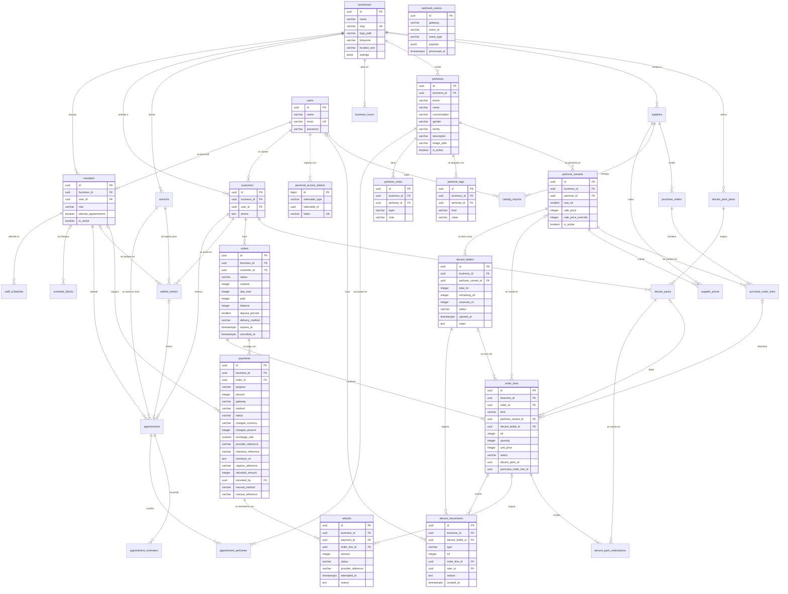

# Modelo de datos

El esquema está en tercera forma normal (3FN). Este documento describe con todo su detalle las tablas que ya existen y a nivel de relación las que están previstas; cada módulo completa las suyas en el pull request que agrega su migración (ver [Regla para cada migración nueva](#regla-para-cada-migración-nueva)).

Las convenciones de nombres, llaves, fechas, dinero, roles y migraciones están en [database.md](database.md) y no se repiten aquí. Las tablas previstas salen de la sección 7 de [la especificación](especificacion.md#7-modelo-de-datos-inicial) y sus nombres, del [lenguaje ubicuo](ubiquitous-language.md).

## Diagrama

Toda tabla de una tienda lleva además `business_id` y su relación con `businesses`; el diagrama dibuja esa relación solo en las tablas de primer nivel para no saturarse. Las líneas punteadas no tienen llave foránea. Las relaciones con tablas todavía previstas describen el diseño de esos módulos y no una restricción ya instalada.

Las tablas sin columnas en el diagrama están previstas y todavía no existen. `webhook_events` ya tiene esquema, pero su procesamiento llega con los webhooks del Avance 2; aparece sin relaciones porque no pertenece a ninguna tienda (ver [excepciones](#excepciones-deliberadas)). Los pagos actuales pertenecen a pedidos mediante `payments.order_id`; el soporte a paquetes se incorpora en #143 con una relación que conserve la integridad por tienda, sin una relación polimórfica sin llave foránea. Además hay tablas del framework (caché y colas de Laravel) que no pertenecen al negocio y no se documentan aquí.

## Tablas creadas

Todas las llaves primarias son `id uuid DEFAULT uuidv7()`, salvo la de `personal_access_tokens`, que es un `bigint` autoincremental porque así la define Sanctum (ver [Excepciones deliberadas](#excepciones-deliberadas)). Las columnas `created_at` y `updated_at` son `timestamptz`; `decant_movements` tiene solo `created_at`, obligatorio y con valor por defecto de la base, porque el historial no se modifica. El nombre de las llaves que no se listan con nombre propio es el que da Laravel: `<tabla>_<columna>_foreign` y `<tabla>_<columna>_unique`.

### businesses

Cada fila es una tienda. Es la raíz del aislamiento: no lleva `business_id`.

| Columna | Tipo | Regla |
|---|---|---|
| `id` | `uuid` | Llave primaria |
| `name` | `varchar(100)` | Obligatoria; `businesses_name_check`: no vacía |
| `slug` | `varchar(100)` | Única (`businesses_slug_unique`); `businesses_slug_check`: solo `a-z`, `0-9` y `-` |
| `logo_path` | `varchar(255)` | Opcional |
| `timezone` | `varchar(64)` | Por defecto `America/Costa_Rica` |
| `location_text` | `varchar(255)` | Opcional; el lugar de la cita (R18) |
| `settings` | `jsonb` | Por defecto `{}`; `businesses_settings_check`: debe ser un objeto |
| `created_at`, `updated_at` | `timestamptz` | |

Llaves candidatas: `id` y `slug`. Sin política de fila: las rutas públicas buscan la tienda por su slug antes de saber a cuál pertenecen.

### users

Cada fila es una cuenta de acceso: una persona del personal o un cliente. Una cuenta no pertenece a una tienda: el mismo cliente puede operar en varias, y la tienda de una persona del personal vive en `members`.

| Columna | Tipo | Regla |
|---|---|---|
| `id` | `uuid` | Llave primaria |
| `name` | `varchar(120)` | Obligatoria; `users_name_check`: no vacía |
| `email` | `varchar(255)` | Única en todo el sistema (`users_email_unique`) |
| `password` | `varchar(255)` | Hash de la contraseña, nunca la contraseña |
| `created_at`, `updated_at` | `timestamptz` | |

Llaves candidatas: `id` y `email`. Sin política de fila: no tiene `business_id` y el ingreso busca la cuenta por su correo antes de saber la tienda.

### members

Cada fila es una persona del personal de una tienda, como dueño o colaborador (R54 y sección 3 de la especificación).

| Columna | Tipo | Regla |
|---|---|---|
| `id` | `uuid` | Llave primaria |
| `business_id` | `uuid` | Llave foránea a `businesses` (`members_business_id_foreign`), borrado en cascada |
| `user_id` | `uuid` | Llave foránea a `users` (`members_user_id_foreign`), borrado en cascada; única (`members_user_id_unique`) |
| `role` | `varchar(20)` | `members_role_check`: `owner` o `staff` |
| `attends_appointments` | `boolean` | Por defecto `false`; quien atiende citas, sea dueño o colaborador |
| `created_at`, `updated_at` | `timestamptz` | |

- Llaves candidatas: `id`, `user_id` y `(id, business_id)`. La última (`members_id_business_id_unique`) existe para que las tablas hijas, como `appointments`, referencien al miembro junto con su tienda.
- `members_user_id_unique` y `members_user_id_foreign` no incluyen `business_id` y están en la [lista blanca](#lista-blanca-de-businesskeystest).
- Política de fila: `members_business_isolation` (`USING` y `WITH CHECK` con `business_id` igual a la tienda de la transacción), más `members_definer_read` (solo lectura para `archivum_owner`, que usan las funciones `fn_member_business` y las demás de [database.md](database.md#funciones-que-leen-sin-tienda)). La seguridad está habilitada y forzada.

### customers

Cada fila es la ficha que una cuenta recibe en cada tienda donde opera.

| Columna | Tipo | Regla |
|---|---|---|
| `id` | `uuid` | Llave primaria |
| `business_id` | `uuid` | Llave foránea a `businesses` (`customers_business_id_foreign`), borrado en cascada |
| `user_id` | `uuid` | Llave foránea a `users` (`customers_user_id_foreign`), borrado en cascada |
| `phone` | `text` | Opcional; es `text` porque se guarda cifrado (#110) |
| `created_at`, `updated_at` | `timestamptz` | |

- Llaves candidatas: `id`, `(business_id, user_id)` (`customers_business_id_user_id_unique`, una ficha por cuenta y tienda) y `(id, business_id)` (`customers_id_business_id_unique`, para las llaves foráneas compuestas de `appointments`, `orders` y las demás).
- `customers_user_id_foreign` no incluye `business_id` y está en la [lista blanca](#lista-blanca-de-businesskeystest).
- Política de fila: `customers_business_isolation` y `customers_definer_read`, igual que `members`.

### personal_access_tokens

La crea Laravel Sanctum. Cada fila es un token de acceso emitido para una cuenta.

| Columna | Tipo | Regla |
|---|---|---|
| `id` | `bigint` | Llave primaria autoincremental. Es la excepción a la llave `uuid` del proyecto: el token que recibe el cliente tiene la forma `<id>\|<secreto>` y Sanctum busca la fila por ese número |
| `tokenable_type`, `tokenable_id` | `varchar`, `uuid` | Dueño del token (relación polimórfica); `tokenable_id` es `uuid` porque las cuentas tienen llave `uuid`; índice sobre ambas |
| `name` | `text` | Nombre del dispositivo |
| `token` | `varchar(64)` | Único; hash del token, nunca el token |
| `abilities` | `text` | Opcional |
| `last_used_at` | `timestamptz` | Opcional |
| `expires_at` | `timestamptz` | Opcional, con índice |
| `created_at`, `updated_at` | `timestamptz` | |

Sin `business_id` ni política de fila: el token pertenece a la cuenta. Sin llave foránea hacia `users`, por ser polimórfica.

### perfumes

Cada fila es un perfume del catálogo de una tienda: lo que el dueño carga y la vitrina muestra (R5). Las notas, las etiquetas y las presentaciones viven en sus propias tablas.

| Columna | Tipo | Regla |
|---|---|---|
| `id` | `uuid` | Llave primaria |
| `business_id` | `uuid` | Llave foránea a `businesses` (`perfumes_business_id_foreign`), borrado en cascada |
| `brand` | `varchar(120)` | Obligatoria |
| `name` | `varchar(120)` | Obligatoria |
| `concentration` | `varchar(60)` | Opcional |
| `gender` | `varchar(30)` | Opcional |
| `family` | `varchar(60)` | Opcional; la familia olfativa |
| `description` | `varchar(1000)` | Opcional |
| `image_path` | `varchar(255)` | Opcional |
| `is_active` | `boolean` | Por defecto `true`; la vitrina muestra solo los activos |
| `created_at`, `updated_at` | `timestamptz` | |

- Llaves candidatas: `id` y `(id, business_id)` (`perfumes_id_business_id_unique`), que las notas, las etiquetas y las presentaciones usan en sus llaves foráneas compuestas.
- Índice `perfumes_business_id_is_active_index` sobre `(business_id, is_active)`: la vitrina lista los perfumes activos de una tienda.
- Sin `CHECK`. No hay una llave única por marca, nombre y concentración: es una decisión de negocio que sigue abierta en #37.
- Política de fila: `perfumes_business_isolation`, igual que `members` (`USING` y `WITH CHECK` con `business_id` igual a la tienda de la transacción), habilitada y forzada por la migración `enable_row_level_security_on_catalog_tables`.

### perfume_notes

Cada fila es una nota olfativa de un perfume, en una de sus tres capas (R5).

| Columna | Tipo | Regla |
|---|---|---|
| `id` | `uuid` | Llave primaria |
| `business_id` | `uuid` | Llave foránea a `businesses` (`perfume_notes_business_id_foreign`), borrado en cascada |
| `perfume_id` | `uuid` | Llave foránea compuesta `(perfume_id, business_id)` a `perfumes(id, business_id)` (`perfume_notes_perfume_id_business_id_foreign`), borrado en cascada |
| `layer` | `varchar(10)` | `perfume_notes_layer_check`: `top`, `heart` o `base` |
| `note` | `varchar(80)` | Obligatoria |
| `created_at`, `updated_at` | `timestamptz` | |

- Llaves candidatas: `id` y `(business_id, perfume_id, layer, note)` (`perfume_notes_business_id_perfume_id_layer_note_unique`): una misma nota no se repite en la misma capa de un perfume.
- Política de fila: `perfume_notes_business_isolation`.

### perfume_tags

Cada fila es una etiqueta de un perfume: el momento del día, el clima o la ocasión (R5). La vitrina y el recomendador las usan para filtrar.

| Columna | Tipo | Regla |
|---|---|---|
| `id` | `uuid` | Llave primaria |
| `business_id` | `uuid` | Llave foránea a `businesses` (`perfume_tags_business_id_foreign`), borrado en cascada |
| `perfume_id` | `uuid` | Llave foránea compuesta `(perfume_id, business_id)` a `perfumes(id, business_id)` (`perfume_tags_perfume_id_business_id_foreign`), borrado en cascada |
| `kind` | `varchar(20)` | `perfume_tags_kind_check`: `time_of_day`, `climate` u `occasion` |
| `value` | `varchar(60)` | `perfume_tags_value_check`: con `time_of_day`, solo `day`, `afternoon` o `night`; con `climate`, solo `warm`, `temperate` o `cold`; con `occasion`, texto libre |
| `created_at`, `updated_at` | `timestamptz` | |

- Llaves candidatas: `id` y `(business_id, perfume_id, kind, value)` (`perfume_tags_business_id_perfume_id_kind_value_unique`): un perfume no repite la misma etiqueta.
- Los valores cerrados se guardan en inglés, como el resto de la base (ver [Idioma](ubiquitous-language.md#convención-de-idioma)).
- Política de fila: `perfume_tags_business_isolation`.

### perfume_variants

Cada fila es una presentación de un perfume: un tamaño en ml y su precio de venta (R1). Las botellas para decants y los costos de los proveedores se refieren a la presentación.

| Columna | Tipo | Regla |
|---|---|---|
| `id` | `uuid` | Llave primaria |
| `business_id` | `uuid` | Llave foránea a `businesses` (`perfume_variants_business_id_foreign`), borrado en cascada |
| `perfume_id` | `uuid` | Llave foránea compuesta `(perfume_id, business_id)` a `perfumes(id, business_id)` (`perfume_variants_perfume_id_business_id_foreign`), borrado en cascada |
| `size_ml` | `smallint` | `perfume_variants_size_ml_check`: mayor que 0 |
| `sale_price` | `integer` | Opcional; colones enteros; `perfume_variants_sale_price_check`: no negativo. Nulo mientras la presentación no tiene costo de proveedor ni precio manual (#43) |
| `sale_price_override` | `integer` | Opcional; el precio que el dueño fijó a mano y reemplaza al calculado (R1); `perfume_variants_sale_price_override_check`: no negativo |
| `is_active` | `boolean` | Por defecto `true` |
| `created_at`, `updated_at` | `timestamptz` | |

- Llaves candidatas: `id` y `(business_id, perfume_id, size_ml)` (`perfume_variants_business_id_perfume_id_size_ml_unique`): un perfume no repite un tamaño. La llave única adicional `(id, business_id)` se incorpora con #69 para las referencias compuestas de botellas y líneas de pedido.
- Índice `perfume_variants_business_id_is_active_index` sobre `(business_id, is_active)`.
- Los `CHECK` de precio solo prohíben los montos negativos: el rango del precio sigue abierto en #36, y un valor nulo pasa un `CHECK`.
- `sale_price` guarda un valor calculable; la [excepción](#excepciones-deliberadas) está justificada abajo.
- Política de fila: `perfume_variants_business_isolation`.

### decant_bottles

Cada fila es una botella abierta de una presentación. Los ml son enteros. La capacidad se toma de la presentación al abrirla y el saldo inicial puede ser menor, según la decisión del equipo para #68 y #71.

| Columna | Tipo | Regla |
|---|---|---|
| `id` | `uuid` | Llave primaria |
| `business_id` | `uuid` | Llave foránea a `businesses`; borrado restringido |
| `perfume_variant_id` | `uuid` | Llave foránea compuesta `(perfume_variant_id, business_id)` a `perfume_variants(id, business_id)`; borrado restringido |
| `total_ml` | `integer` | `decant_bottles_total_ml_check`: mayor que 0 |
| `remaining_ml` | `integer` | `decant_bottles_remaining_ml_check`: entre 0 y `total_ml` |
| `reserved_ml` | `integer` | Por defecto 0; `decant_bottles_reserved_ml_check`: entre 0 y `remaining_ml` |
| `status` | `varchar(10)` | Por defecto `open`; `decant_bottles_status_check`: `open` exige saldo positivo y `empty` exige saldo 0 |
| `opened_at` | `timestamptz` | Fecha de apertura obligatoria |
| `notes` | `text` | Opcional; único dato que modifica el `PATCH` ordinario |
| `created_at`, `updated_at` | `timestamptz` | |

- Llaves únicas: `id` y `(id, business_id)`.
- Índice `(business_id, perfume_variant_id, status)` para buscar las botellas de una presentación.
- Política `decant_bottles_business_isolation`, habilitada y forzada, con la expresión habitual de la tienda de la transacción.
- Reservar, liberar, consumir y ajustar usan un `UPDATE` condicional; su movimiento se inserta dentro de la misma transacción. Consumir o ajustar hasta 0 cambia `status` en esa misma sentencia. Una botella vacía no admite ajustes ni reservas.
- La vitrina ofrece los tamaños configurados que caben en `remaining_ml - reserved_ml`; excluye botellas vacías y presentaciones inactivas o sin precio. El cálculo proporcional y el redondeo usan enteros mediante `DecantPrice`.

### decant_movements

Cada fila registra un cambio de ml de una botella (R8). No se borra ni se modifica con el rol de la aplicación.

| Columna | Tipo | Regla |
|---|---|---|
| `id` | `uuid` | Llave primaria |
| `business_id` | `uuid` | Llave foránea a `businesses`; borrado restringido |
| `decant_bottle_id` | `uuid` | Llave foránea compuesta a `decant_bottles(id, business_id)`; borrado restringido |
| `type` | `varchar(20)` | `decant_movements_type_check`: `reservation`, `release`, `consumption` o `adjustment` |
| `ml` | `integer` | `decant_movements_ml_check`: positivo en reserva, liberación y consumo; distinto de 0 y con signo en ajustes |
| `order_line_id` | `uuid` | Opcional; llave foránea compuesta a `order_lines(id, business_id)`, incorporada con #78 |
| `user_id` | `uuid` | Opcional para movimientos automáticos; llave foránea a la cuenta global `users(id)`; borrado restringido |
| `reason` | `text` | Opcional salvo en ajustes: `decant_movements_reason_check` exige texto no vacío |
| `created_at` | `timestamptz` | Obligatoria; por defecto `CURRENT_TIMESTAMP`; no hay `updated_at` |

Índice `(business_id, decant_bottle_id, created_at)` para el historial, que la API ordena por fecha e identificador descendentes. La seguridad de fila está habilitada y forzada con dos políticas: `decant_movements_business_read` solo permite `SELECT` de la tienda actual y `decant_movements_business_insert` solo permite `INSERT` en ella. Se revocan `UPDATE`, `DELETE` y `TRUNCATE` al rol de la aplicación. La llave a `users` está justificada en la [lista blanca](#lista-blanca-de-businesskeystest).

### orders

Cada fila es un pedido de un cliente de una tienda. Los precios, el porcentaje del depósito y el vencimiento se fijan al crear el pedido.

| Columna | Tipo | Regla |
|---|---|---|
| `id` | `uuid` | Llave primaria |
| `business_id` | `uuid` | Llave foránea a `businesses`, borrado en cascada |
| `customer_id` | `uuid` | Llave foránea compuesta a `customers(id, business_id)` |
| `status` | `varchar(30)` | `orders_status_check`: `pending_payment`, `confirmed`, `ordered`, `ready`, `delivered`, `cancelled` o `expired` |
| `subtotal`, `due_now`, `paid`, `balance` | `integer` | Colones enteros; un `CHECK` `<tabla>_<columna>_check` por columna impide negativos |
| `deposit_percent` | `smallint` | Por defecto 50; `orders_deposit_percent_check`: entre 0 y 100; queda congelado aunque cambien los ajustes de la tienda |
| `delivery_method` | `varchar(20)` | Opcional; `orders_delivery_method_check`: `in_person` o `pickup` |
| `expires_at` | `timestamptz` | Obligatoria; plazo fijado al crear, aplicable mientras esté pendiente de pago |
| `cancelled_at` | `timestamptz` | Opcional |
| `created_at`, `updated_at` | `timestamptz` | |

- Llaves únicas: `id` y `(id, business_id)`.
- Índices `(business_id, customer_id, created_at)` y `(business_id, status, expires_at)`.
- Política `orders_business_isolation`, habilitada y forzada. `orders_definer_read` solo da lectura al dueño del esquema para que `fn_customer_resource_business` resuelva la tienda de un pedido cuando su cliente autenticado todavía no tiene contexto.
- `OrderAmounts` calcula los importes desde las líneas y el porcentaje congelado. El dinero confirmado sigue registrado como pagado mientras su reembolso esté pendiente: pedir un reembolso no equivale a ejecutarlo.

### order_lines

Cada fila es una botella bajo pedido o un decant. El precio unitario es un hecho histórico, no una lectura del catálogo cada vez que se consulta el pedido.

| Columna | Tipo | Regla |
|---|---|---|
| `id` | `uuid` | Llave primaria |
| `business_id` | `uuid` | Llave foránea a `businesses`, borrado en cascada |
| `order_id` | `uuid` | Llave foránea compuesta a `orders(id, business_id)`, borrado en cascada |
| `kind` | `varchar(20)` | `bottle` o `decant`, ligado a las demás columnas por `order_lines_kind_check` |
| `perfume_variant_id` | `uuid` | Opcional; llave foránea compuesta a `perfume_variants(id, business_id)`; obligatoria en una línea de botella |
| `decant_bottle_id` | `uuid` | Opcional; llave foránea compuesta a `decant_bottles(id, business_id)`; obligatoria en una línea de decant |
| `ml` | `integer` | Opcional para botellas; positivo y obligatorio para decants; `order_lines_ml_check` |
| `quantity` | `integer` | `order_lines_quantity_check`: mayor que 0; en decants debe ser 1 |
| `unit_price` | `integer` | Precio congelado en colones; `order_lines_unit_price_check`: no negativo |
| `status` | `varchar(20)` | Botellas: `pending`, `ordered`, `received` o `unavailable`; decants: `reserved`, `prepared` o `released` |
| `decant_pack_id`, `purchase_order_line_id` | `uuid` | Opcionales; reservadas para M18 y M23, todavía sin llave foránea |
| `created_at`, `updated_at` | `timestamptz` | |

Llaves únicas: `id` y `(id, business_id)`. `order_lines_kind_check` exige presentación y ausencia de botella de decants, ml y paquete en las líneas de botella; exige identificador de botella, ml positivos y cantidad 1 en las líneas de decant. La apertura y disponibilidad de la botella se validan al reservar con el adaptador, no con ese `CHECK`. Política `order_lines_business_isolation`, habilitada y forzada.

### payments

Cada fila es un intento de cobro de un pedido. La intención se confirma en una transacción antes del HTTP al proveedor; así un timeout no borra el intento ni habilita otro cobro del mismo propósito.

| Columna | Tipo | Regla |
|---|---|---|
| `id` | `uuid` | Llave primaria y clave del intento usada por el adaptador |
| `business_id` | `uuid` | Llave foránea a `businesses` |
| `order_id` | `uuid` | Obligatoria; llave foránea compuesta a `orders(id, business_id)` |
| `purpose` | `varchar(16)` | `payments_purpose_check`: `deposit`, `balance` o `full` |
| `amount` | `integer` | Principal en colones; `payments_amount_check`: mayor que 0 |
| `gateway` | `varchar(16)` | `payments_gateway_check`: `onvo`, `paypal` o `manual`; el flujo manual queda reservado para #98 |
| `method` | `varchar(24)` | Por defecto `card`; `payments_method_check`: `card` o `sinpe_mobile` |
| `status` | `varchar(24)` | Por defecto `pending`; `payments_status_check`: `pending`, `succeeded`, `failed`, `expired`, `refunded` o `partially_refunded` |
| `charged_currency` | `varchar(3)` | Por defecto `CRC`; `payments_charged_currency_check`: `CRC` o `USD` |
| `charged_amount` | `integer` | Por defecto 0 mientras no haya respuesta; `payments_charged_amount_check`: no negativo. En CRC guarda colones enteros; en USD guarda centavos |
| `exchange_rate` | `numeric(18,6)` | Opcional en CRC; `payments_exchange_rate_check` exige valor positivo cuando `charged_currency = 'USD'`; el agregado lo conserva como texto decimal |
| `provider_reference`, `checkout_reference`, `capture_reference` | `varchar(255)` | Opcionales; identidad principal del proveedor, sesión u orden de checkout, e intención de pago de ONVO o captura de PayPal |
| `checkout_url` | `text` | Opcional; dirección de aprobación entregada por el proveedor |
| `refunded_amount` | `integer` | Colones; por defecto 0; `payments_refunded_amount_check`: entre 0 y `amount` |
| `recorded_by` | `uuid` | Opcional; llave foránea compuesta al miembro `members(id, business_id)` para el pago manual |
| `manual_method`, `manual_reference` | `varchar(16)`, `varchar(255)` | Opcionales; `payments_manual_reference_check` exige actor, referencia y medio `sinpe` o `cash` cuando la pasarela es `manual` |
| `created_at`, `updated_at` | `timestamptz` | |

- Llaves únicas: `id`, `(id, business_id)` y `(business_id, gateway, provider_reference)`; las referencias nulas no impiden guardar una intención todavía sin respuesta.
- Índice único parcial `payments_one_pending_purpose` sobre `(business_id, order_id, purpose)` cuando `status = 'pending'`: no puede haber dos intentos pendientes del mismo propósito. Índice adicional `(business_id, status)`.
- Política `payments_business_isolation`, habilitada y forzada, más `payments_definer_read` de solo lectura para el dueño del esquema al resolver recursos del cliente.
- La consulta autenticada al proveedor es la autoridad en Investigación 1. El pago y el efecto sobre el pedido se guardan en la misma transacción. La confirmación por webhook corresponde a #94 y #95 en Avance 2.
- ONVO recibe el principal multiplicado por 100 en su API; ese formato de transporte no cambia que `charged_amount` en CRC guarde colones enteros. PayPal recibe texto decimal USD y la base conserva centavos y el tipo de cambio aplicado. Las conversiones viven en los adaptadores.

### refunds

Cada fila asigna parte de un pago confirmado a una devolución del pedido o de una línea no disponible. La solicitud es durable y no mueve dinero hasta que el proveedor confirma el resultado.

| Columna | Tipo | Regla |
|---|---|---|
| `id` | `uuid` | Llave primaria |
| `business_id` | `uuid` | Llave foránea a `businesses` |
| `payment_id` | `uuid` | Llave foránea compuesta a `payments(id, business_id)` |
| `order_line_id` | `uuid` | Opcional; llave foránea compuesta a `order_lines(id, business_id)` |
| `amount` | `integer` | Colones; `refunds_amount_check`: mayor que 0 |
| `status` | `varchar(16)` | Por defecto `pending`; `refunds_status_check`: `pending`, `succeeded` o `failed` |
| `provider_reference` | `varchar(255)` | Opcional; se confirma antes de aplicar el efecto final sobre pago y pedido |
| `attempted_at` | `timestamptz` | Opcional; marca durable de que se intentó enviar la devolución, confirmada antes del HTTP |
| `reason` | `text` | Opcional |
| `created_at`, `updated_at` | `timestamptz` | |

Llaves únicas: `id` y `(id, business_id)`. Índice `(business_id, status)`. Política `refunds_business_isolation`, habilitada y forzada. `PaymentRefundRequests` asigna pagos bajo bloqueo para que devoluciones pendientes o confirmadas no superen el principal. `ProcessOrderRefunds` persiste `attempted_at`, realiza el HTTP sin la transacción exterior de la petición, conserva la referencia en una transacción propia y aplica la devolución al pago y al pedido en una última transacción. Una respuesta perdida sin referencia queda pendiente para conciliación; repetir la petición no repite ese POST a ciegas. ONVO tiene implementación; PayPal queda documentado para este corte.

### webhook_events

Tabla global preparada para #94 y #95; todavía no hay un endpoint que procese eventos en Investigación 1.

| Columna | Tipo | Regla |
|---|---|---|
| `id` | `uuid` | Llave primaria |
| `gateway` | `varchar(16)` | `webhook_events_gateway_check`: `onvo` o `paypal` |
| `event_id` | `varchar(255)` | Identificador del evento en la pasarela |
| `event_type` | `varchar(255)` | Tipo recibido del proveedor |
| `payload` | `jsonb` | Cuerpo del evento |
| `processed_at` | `timestamptz` | Opcional |
| `created_at`, `updated_at` | `timestamptz` | |

Llaves únicas: `id` y `(gateway, event_id)`. Sin `business_id`, llave al pago ni política de fila: al recibir un evento todavía hay que resolver su pago y tienda desde una referencia verificada. La llave compuesta proporciona el respaldo de idempotencia para el futuro procesador; crear la tabla no implementa ese procesador.

## Tablas previstas

Existen en el diagrama, pero su detalle llega en el pull request de la migración que las crea (sección 7 de la especificación).

| Grupo | Tablas | Llega con |
|---|---|---|
| Horarios y servicios | `services`, `business_hours`, `staff_schedules`, `schedule_blocks` | #52 (M08) |
| Citas | `appointments`, `appointment_perfumes`, `appointment_reminders` | #59 (M09) |
| Lista de espera | `waitlist_entries` | M19 |
| Paquetes | `decant_pack_plans`, `decant_packs`, `decant_pack_redemptions` | M18 |
| Proveedores | `suppliers`, `supplier_prices`, `catalog_imports`, `purchase_orders`, `purchase_order_lines` | M23 |

## Verificación de las formas normales

Se revisa tabla por tabla. Una dependencia funcional `A → B` significa que A determina a B.

| Tabla | 1FN: valores atómicos, sin grupos repetidos | 2FN: nada depende de parte de la llave | 3FN: nada depende de un atributo que no es llave |
|---|---|---|---|
| `businesses` | Una columna por dato. `settings` es la excepción justificada abajo | Llave de una sola columna (`id`) | Todo describe a la tienda; la zona horaria y el lugar son atributos de la tienda, no de otra entidad |
| `users` | Una cuenta por fila; sin listas | Llave de una sola columna | Nombre, correo y hash dependen de la cuenta. El rol y la tienda no están aquí: viven en `members` y `customers` |
| `members` | Un rol por fila; no hay lista de tiendas | Llave de una sola columna. La llave candidata `(id, business_id)` no introduce dependencias parciales: `id` ya determina `business_id` | `role` y `attends_appointments` dependen del miembro. Nada del usuario ni de la tienda se copia aquí |
| `customers` | Un teléfono por ficha | Llave de una sola columna; `(business_id, user_id)` es una llave candidata y `phone` depende de ambos, no de uno solo | `phone` es un dato de la relación cuenta-tienda: `users` no lo tiene, por lo que no hay un dato que dependa de otro que no sea llave |
| `personal_access_tokens` | Un token por fila; `abilities` es el texto de Sanctum | Llave de una sola columna | Todo describe al token |
| `perfumes` | Una columna por dato. Las notas, las etiquetas y las presentaciones no son listas dentro del perfume: tienen sus tablas | Llave de una sola columna; `(id, business_id)` es una llave candidata y `id` ya determina `business_id` | Marca, nombre, concentración, género, familia y descripción describen al perfume. La tienda y los precios no se copian aquí |
| `perfume_notes` | Una nota por fila, no una lista de notas | Llave de una sola columna; `(business_id, perfume_id, layer, note)` es una llave candidata y ninguna columna depende de una parte de ella | La capa y la nota describen la fila. Nada del perfume se copia aquí |
| `perfume_tags` | Una etiqueta por fila, no una lista | Llave de una sola columna; `(business_id, perfume_id, kind, value)` es una llave candidata y ninguna columna depende de una parte de ella | El tipo y el valor describen la etiqueta. Nada del perfume se copia aquí |
| `perfume_variants` | Un tamaño por fila | Llave de una sola columna; `(business_id, perfume_id, size_ml)` es una llave candidata y los precios dependen de los tres, no de uno solo | `size_ml` y los dos precios describen la presentación. El nombre y la marca no se copian aquí. `sale_price` es la excepción justificada abajo |
| `decant_bottles` | Una botella física y sus ml enteros por fila | Llave de una sola columna; `(id, business_id)` permite referencias de la misma tienda | Capacidad, fecha y notas describen la botella; `remaining_ml` y `reserved_ml` son la excepción de concurrencia justificada abajo |
| `decant_movements` | Un movimiento por fila, sin una lista de movimientos en la botella | Llave de una sola columna | Tipo, ml, fecha, motivo y referencias describen ese movimiento; no se copia el nombre del autor |
| `orders` | Un pedido por fila; sus líneas viven aparte | Llave de una sola columna | Estado, fechas y porcentaje congelado pertenecen al pedido; los resúmenes monetarios se justifican abajo |
| `order_lines` | Una línea de botella o decant por fila | Llave de una sola columna | Cantidad, tamaño solicitado, estado y precio congelado describen la venta de esa línea; el precio no depende del catálogo actual |
| `payments` | Un intento de cobro por fila | Llave de una sola columna; el índice parcial limita intentos pendientes del mismo propósito | Proveedor, referencias, principal y conversión describen el intento; `refunded_amount` es un resumen justificado abajo |
| `refunds` | Una asignación de devolución por fila | Llave de una sola columna | Importe, intento, referencia y resultado pertenecen a la devolución; pago y línea se referencian con su tienda |
| `webhook_events` | Un evento por fila; `payload` conserva el documento externo como una unidad | Llave de una sola columna y candidata `(gateway, event_id)` | Tipo, cuerpo y fecha de procesamiento describen el evento; su alcance global se justifica abajo |

Las tablas previstas se revisan contra esta misma tabla cuando se crean.

## Excepciones deliberadas

Cada una se aparta de la 3FN o de la regla de llaves con una razón. Las cuatro primeras son las que pide el issue #35.

| Excepción | Por qué es correcta |
|---|---|
| `perfume_variants.sale_price` se guarda y se recalcula | Es calculable (costo del proveedor más el margen, o el precio manual; R1 a R3), pero la vitrina y los pedidos lo leen en cada petición y no deben recalcularlo con los costos de todos los proveedores. Lo recalculan #43 al fijar o cambiar el precio y la importación del catálogo (#174). `sale_price_override` guarda la decisión del dueño, que no se puede derivar |
| `order_lines.unit_price` congela el precio | No es un dato derivado: es el hecho histórico de a cuánto se vendió. Cambiar el precio de la presentación no debe alterar pedidos pasados (sección 7: «precio congelado al crear») |
| `orders.deposit_percent` congela la condición del pedido | Es el porcentaje aceptado al crear el pedido, no el ajuste vigente de la tienda. Cambiar el ajuste después no recalcula un pedido existente |
| `orders.subtotal`, `due_now`, `paid`, `balance` | Son resúmenes guardados para lectura y bloqueo del pedido. `OrderAmounts` los calcula desde las líneas y el porcentaje congelado; la aplicación actualiza el pago confirmado y su efecto sobre el pedido en una sola transacción |
| `decant_bottles.remaining_ml`, `reserved_ml` | La reserva concurrente de R9 exige decidir con un `UPDATE` condicional y un `CHECK` en la misma fila. La fila conserva el saldo inicial registrado y las operaciones posteriores guardan el cambio y su movimiento de forma atómica |
| `payments.charged_amount`, `exchange_rate` | Conservan el importe real de aquel cobro y su conversión, aunque cambie después el tipo de cambio de la tienda. CRC se guarda en colones enteros y USD en centavos; los montos enviados por HTTP son responsabilidad del adaptador |
| `payments.refunded_amount` | Resume el principal devuelto para impedir un exceso al bloquear el pago. Solo crece con un reembolso confirmado y se actualiza junto con el reembolso y su efecto sobre el pedido |
| `webhook_events` no tiene `business_id` | El evento de la pasarela llega antes de saber a qué tienda pertenece, y se identifica por `(gateway, event_id)` para procesarse una sola vez (R38). La tienda se obtiene después, por el pago que el evento menciona. No tiene política de fila porque no tiene `business_id` |
| `business_id` se repite en las tablas hijas | Una tabla hija como `appointments` lleva `business_id` aunque su padre ya lo implique. Es lo que permite las llaves foráneas compuestas `(parent_id, business_id)` hacia la llave `(id, business_id)` del padre, que impiden que una fila apunte al recurso de otra tienda (R56), y la política de fila directa. Los dos valores no pueden discrepar: lo garantiza la llave compuesta |
| `businesses.settings` es un `jsonb` | Guarda los ajustes por tienda (sección 10 de la especificación). Cada ajuste se lee y se escribe entero y ninguno se consulta ni se une con otras tablas; un `CHECK` exige que sea un objeto. Si un ajuste necesitara consultarse o validarse por columna, se promueve a columna |
| `personal_access_tokens.id` es `bigint` y no `uuid` | La tabla es de Sanctum: el token que recibe el cliente tiene la forma `<id>\|<secreto>` y Sanctum busca la fila por ese número. No es un identificador del negocio. Su dueño sí se identifica con un `uuid` (`tokenable_id`) |
| `personal_access_tokens` no tiene llave foránea a `users` | Sanctum define la relación polimórfica `tokenable_type`/`tokenable_id`. Un token cuya cuenta ya no existe no autentica a nadie |

### Excepciones previstas por la especificación

Las columnas de la sección 7 que guardan un valor calculable se justifican, o se rechazan, en el pull request que crea su tabla:

| Columna | Por qué se prevé guardarla |
|---|---|
| `appointments.blocked_until` | Fin de la cita más su margen; la restricción de exclusión (R14) la necesita como columna |
| `decant_packs.remaining_decants` | Igual, para el saldo de R34 |

`Payable` es el concepto del dominio para lo que se cobra, pero la persistencia actual admite solo `order` y usa `payments.order_id` con llave foránea compuesta. La incorporación de paquetes en #143 debe ampliar ese esquema con integridad referencial explícita, no retirar la llave para guardar un identificador polimórfico sin validar.

## Lista blanca de `BusinessKeysTest`

`BusinessKeysTest` lee `pg_constraint` y `pg_index` y falla si una llave única, de exclusión o foránea de una tabla con `business_id` no incluye `business_id`, salvo las de `KEYS_WITHOUT_BUSINESS`. PostgreSQL revisa esas llaves sin aplicar las políticas de fila, por lo que cada excepción es deliberada.

| Llave | Tabla | Por qué no incluye `business_id` |
|---|---|---|
| `members_user_id_unique` | `members` | Cada persona del personal pertenece a una sola tienda: la llave debe ser global, porque una por tienda permitiría que la misma cuenta fuera personal de dos |
| `members_user_id_foreign` | `members` | `users` no pertenece a ninguna tienda: una llave compuesta con `business_id` no tendría a qué apuntar |
| `customers_user_id_foreign` | `customers` | Igual: la cuenta no pertenece a una tienda; el mismo cliente tiene una ficha en cada tienda donde opera |
| `decant_movements_user_id_foreign` | `decant_movements` | El autor es una cuenta global `users`; la botella y la línea referenciadas sí se protegen por llaves compuestas con `business_id` |

Las siguientes entran a la lista cuando se crea su tabla, con el mismo motivo: `users` no pertenece a ninguna tienda.

| Llave | Llega con |
|---|---|
| `catalog_imports.created_by` | M23 |

`payments.recorded_by` referencia al miembro de la tienda mediante `(recorded_by, business_id)` y no necesita una excepción a esta regla.

## Excepciones de la seguridad a nivel de fila

Cuatro tablas del modelo de negocio no tienen política porque no tienen `business_id`: `businesses` (cada fila es una tienda), `users` (una cuenta puede ser cliente de varias tiendas), `personal_access_tokens` (el token pertenece a la cuenta) y `webhook_events` (recepción global de eventos todavía sin tienda resuelta). La razón y el mecanismo completos están en [database.md](database.md#excepciones).

`decant_movements` sí tiene `business_id` y RLS forzado. Su excepción es de permisos: usa políticas separadas de lectura e inserción para conservar el historial, en lugar de una política `ALL`. `orders` y `payments` agregan una política de lectura para el dueño del esquema; la aplicación sigue sin poder usarla, y las funciones `SECURITY DEFINER` comprueban la propiedad del recurso por la cuenta autenticada antes de devolver su tienda.

## Regla para cada migración nueva

Un pull request que agrega una migración con una tabla:

1. Agrega en este documento el detalle de la tabla: columnas, tipos, llaves primarias, únicas y foráneas, `CHECK` y política de fila.
2. Verifica su 1FN, 2FN y 3FN en la tabla de [verificación](#verificación-de-las-formas-normales).
3. Si se aparta de la 3FN (un valor calculable guardado, una columna repetida), justifica la excepción en [Excepciones deliberadas](#excepciones-deliberadas).
4. Si una llave única o foránea de una tabla con `business_id` no incluye `business_id`, la agrega a `KEYS_WITHOUT_BUSINESS` y su justificación a la [lista blanca](#lista-blanca-de-businesskeystest).
5. Si la tabla lleva `business_id`, cumple los pasos de [Cómo agregar una tabla de una tienda](database.md#cómo-agregar-una-tabla-de-una-tienda).
6. Si la tabla era una de las previstas, quita su fila de [Tablas previstas](#tablas-previstas) y le da su detalle.
7. Un término o un estado nuevo se agrega a [ubiquitous-language.md](ubiquitous-language.md).
