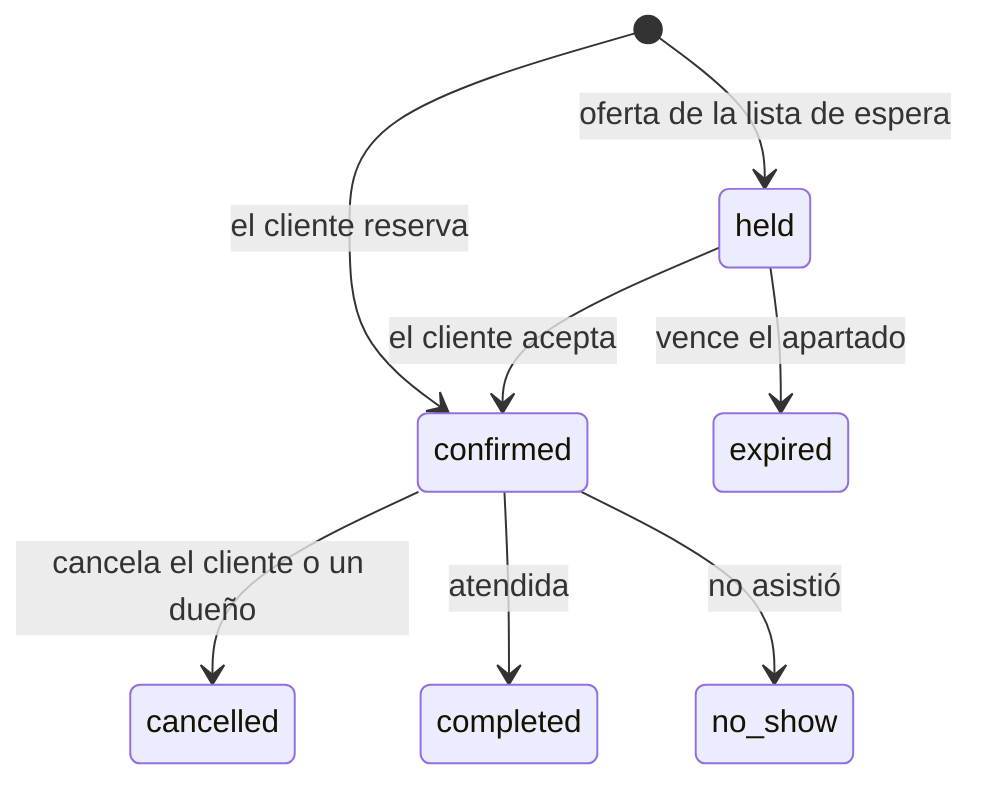
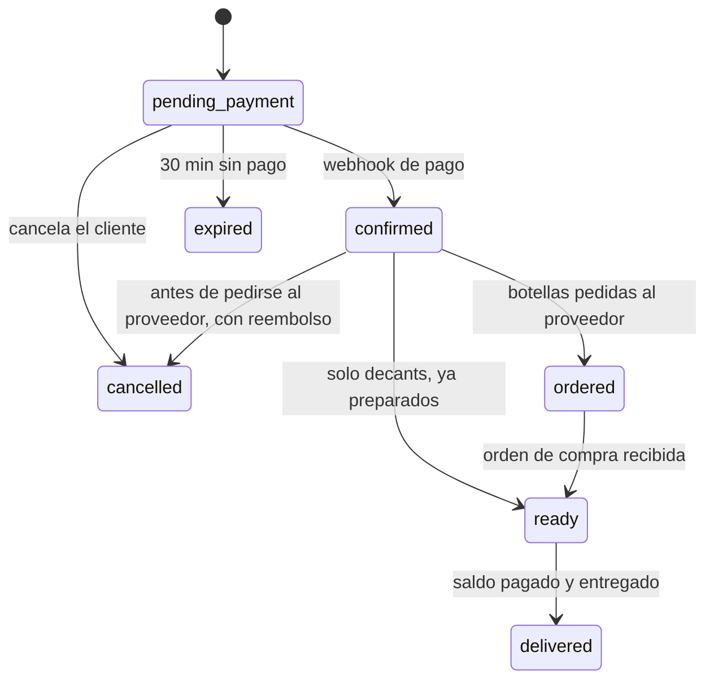

# Especificación · ArchivumParfums

Versión 2 · 7 de octubre de 2026. Fuentes: entrevista al dueño, enunciado de ISW-621 y decisiones del equipo. La arquitectura, las convenciones y la forma de trabajo siguen el repositorio guía SodaYa-Hexagonal (ver `CLAUDE.md`). Los valores marcados como **supuesto** no salieron de la entrevista: están reunidos en la sección 10 y hay que confirmarlos (sección 13).

## 1. El negocio

ArchivumParfums vende perfumes de nicho y decants. Su dueño empezó como coleccionista. Todo se vende **bajo pedido** a su proveedor, Perfumania: no mantiene inventario de botellas selladas, pero sí tiene botellas abiertas de las que saca decants.

Hoy todo pasa por WhatsApp. El catálogo es la hoja de Google Sheets del proveedor, el cliente paga por SINPE al recibir y la entrega es en persona o por retiro. El pedido al proveedor tarda unas 3 semanas y el precio de venta es el costo más ₡5.000.

Recorrido típico del cliente: se interesa, compra un decant y, si le gusta, encarga la botella.

Lo que más le complica: cobrar, agendar las pruebas de olores, mantener el catálogo y encontrar las notas de cada perfume. Sus tres prioridades para el sistema: **pedidos, proveedores y citas de prueba**.

El sistema es multi-inquilino: otras perfumerías pueden usarlo con sus datos separados.

## 2. Cómo se cumple el núcleo del enunciado

| # | Capacidad | En ArchivumParfums |
|---|---|---|
| 1 | Catálogo, horarios y disponibilidad | Servicio "Prueba de olores" con duración y precio; horario de la tienda y de cada persona que atiende; disponibilidad real descontando citas, bloqueos y eventos de Google Calendar |
| 2 | Reserva con control de concurrencia | Citas de prueba sin traslape (restricción de exclusión en PostgreSQL); también los últimos ml de una botella |
| 3 | Multi-inquilino | Varias tiendas con datos separados por dos barreras (R54–R56); la demo usa dos |
| 4 | Tres roles | Dueño, colaborador y cliente, verificados por rol y por propiedad |
| 5 | Cobro total o depósito, ONVO y PayPal, webhook | Botellas: depósito del 50 % y saldo al entregar. Decants y paquetes: pago total. Las citas son gratis |
| 6 | Bonos prepagados | Paquete de decants: N decants prepagados con un saldo que nunca queda negativo |
| 7 | Lista de espera | Fechas sin espacio: al cancelarse una cita, el espacio se aparta 2 h al siguiente de la fila |
| 8 | Recordatorios y expiraciones en cola | Recordatorios 24 h y 2 h antes de la cita; vencen pedidos sin pagar, ofertas de la lista de espera y paquetes sin pagar |
| 9 | Agenda en vivo | La agenda de dueños y colaboradores se actualiza con Reverb sin recargar |
| 10 | IA con datos estructurados | Recomendador: del texto del cliente a perfumes del catálogo, validados y con respaldo sin IA |
| 11 | Operación | URL pública, CI en verde, ruta de salud `/up`, panel Pulse |

Pedidos, botellas para decants y proveedores son el módulo propio del giro: son las prioridades del dueño, pero no suman en la rúbrica.

## 3. Roles

| Rol | Quién | Alcance |
|---|---|---|
| Dueño | El dueño y su mamá, co-dueña | Todo dentro de su tienda |
| Colaborador | Asesor que atiende citas (ficticio en la demo) | Solo su propia agenda; marca sus citas como atendidas o no asistidas |
| Cliente | Comprador con cuenta | Sus citas, su lista de espera, sus pedidos, sus pagos y sus paquetes |
| Visitante | Cualquiera sin sesión | Ver la vitrina, la disponibilidad y pedir recomendaciones |

Quien atiende citas puede ser dueño o colaborador: el horario de atención va por persona del personal. Cada persona del personal pertenece a una sola tienda. La matriz completa está en la sección 9.

## 4. Glosario

Misma forma que `docs/ubiquitous-language.md` del repo guía. Los atributos JSON van en español y `snake_case` (`precio_venta`, `ml_restantes`, `inicia_en`).

| Negocio | Código | Base de datos | API |
|---|---|---|---|
| Tienda | `Business` | `businesses` | `tiendas` |
| Personal | `Member` | `members` | `personal` |
| Dueño | `Owner` | — | — |
| Colaborador | `Staff` | — | — |
| Cliente | `Customer` | `customers` | — |
| Visitante | `Visitor` | — | — |
| Servicio | `Service` | `services` | `servicios` |
| Horario de la tienda | `BusinessHours` | `business_hours` | `horario` |
| Horario de atención | `StaffSchedule` | `staff_schedules` | `horario` (bajo `personal/{persona}`) |
| Bloqueo | `ScheduleBlock` | `schedule_blocks` | `bloqueos` |
| Disponibilidad | `Availability` | — | `disponibilidad` |
| Cita de prueba | `Appointment` | `appointments` | `citas` |
| Lista de espera | `WaitlistEntry` | `waitlist_entries` | `lista-de-espera` |
| Perfume | `Perfume` | `perfumes` | `perfumes` |
| Presentación | `PerfumeVariant` | `perfume_variants` | `presentaciones` |
| Botella para decants | `DecantBottle` | `decant_bottles` | `botellas` |
| Movimiento de botella | `DecantMovement` | `decant_movements` | `movimientos` |
| Pedido | `Order` | `orders` | `pedidos` |
| Línea del pedido | `OrderLine` | `order_lines` | `lineas` |
| Pago | `Payment` | `payments` | `pagos` |
| Reembolso | `Refund` | `refunds` | `reembolsos` |
| Paquete de decants (oferta) | `DecantPackPlan` | `decant_pack_plans` | `paquetes` |
| Paquete comprado | `DecantPack` | `decant_packs` | `paquetes-comprados` |
| Proveedor | `Supplier` | `suppliers` | `proveedores` |
| Costo del proveedor | `SupplierPrice` | `supplier_prices` | `costos` |
| Importación del catálogo | `CatalogImport` | `catalog_imports` | `importaciones` |
| Orden de compra | `PurchaseOrder` | `purchase_orders` | `ordenes-de-compra` |
| Línea de la orden de compra | `PurchaseOrderLine` | `purchase_order_lines` | `lineas` |
| Recomendación | `Recommendation` | — | `recomendaciones` |

Contextos sugeridos para `src/` (se fijan en `docs/architecture.md`): `Shared`, `Businesses` (perfil y personal), `Accounts` (clientes y sesiones), `Catalog` (perfumes, presentaciones y vitrina), `Scheduling` (servicios, horarios, disponibilidad, citas y lista de espera), `Decants` (botellas y paquetes), `Sales` (pedidos), `Payments`, `Purchasing` (proveedores, importaciones y órdenes de compra), `Notifications`, `Recommendations` y `Reporting`.

## 5. Reglas de negocio

Cada regla debería tener al menos una prueba que la nombre, y cada issue cita en "Requisitos:" las reglas que cubre.

### Catálogo y precios

- **R1.** Precio de venta de una presentación = costo del proveedor + margen fijo de la tienda (₡5.000). El dueño puede fijar un precio manual que reemplaza el cálculo.
- **R2.** Con varios proveedores, el costo base es el más barato vigente, y el sistema indica de cuál.
- **R3.** Precio de un decant = precio de venta de la presentación de la botella ÷ ml de esa presentación × ml del decant, redondeado hacia arriba a ₡100. Ejemplo: botella de 100 ml a ₡10.000 → decant de 10 ml a ₡1.000.
- **R4.** Tamaños de decant: 2, 5 y 10 ml (**supuesto**, configurable por tienda).
- **R5.** Cada perfume guarda marca, nombre, concentración, familia olfativa, notas de salida, corazón y fondo, y etiquetas de momento del día (día, tarde, noche), clima (cálido, templado, frío) y ocasión. Las carga el dueño: el sistema no extrae datos de Fragrantica.
- **R6.** El catálogo del proveedor se importa con el archivo exportado de su hoja (CSV o XLSX, máximo 5 MB). El dueño indica qué columna es marca, nombre, ml y costo, revisa una vista previa con errores por fila y confirma. La importación crea o actualiza perfumes, presentaciones y costos; nunca borra.

### Botellas para decants

- **R7.** Una botella guarda ml totales, ml restantes y ml reservados. Disponibles = restantes − reservados.
- **R8.** Todo movimiento queda en el historial con fecha, ml, motivo y quién lo hizo: reserva, liberación, consumo por decant vendido o canjeado, y ajuste manual con motivo obligatorio.
- **R9.** Nunca se reservan ni descuentan más ml de los disponibles, aunque lleguen dos pedidos a la vez: `UPDATE` condicional en la base y `CHECK` que impide restantes o reservados negativos, y reservados mayores que restantes.
- **R10.** Al llegar a 0 ml, la botella pasa a vacía y sus decants dejan de ofrecerse.

### Citas de prueba

- **R11.** Servicio inicial: "Prueba de olores", 45 min, gratis, con 15 min de margen entre citas (**supuesto**, salvo "gratis"). El dueño configura servicios, duración, precio y margen.
- **R12.** Al reservar, el cliente elige hasta 5 perfumes para probar (**supuesto**), solo de botellas con ml disponibles, para que la tienda los lleve.
- **R13.** Disponibilidad = horario de la tienda ∩ horario de quien atiende − citas activas con su margen − bloqueos − eventos ocupados de Google Calendar (extra). Franjas cada 15 min, con al menos 12 h de anticipación y hasta 30 días adelante (**supuesto**).
- **R14.** Dos citas activas de la misma persona nunca se traslapan. Lo garantiza una restricción de exclusión sobre la persona y el rango `[inicio, fin + margen)`; quien llega segundo recibe 409 con un mensaje claro.
- **R15.** Si el cliente no elige quién lo atiende, se asigna la persona disponible con menos citas ese día.
- **R16.** El cliente puede reprogramar o cancelar hasta 2 h antes (**supuesto**). Cancelar libera el espacio y activa la lista de espera.
- **R17.** Quien atendió marca la cita como atendida o no asistió.
- **R18.** El lugar de la cita es un texto configurado por la tienda: dirección o punto de encuentro.

### Lista de espera

- **R19.** Si no hay espacio en la fecha que quiere, el cliente se anota para esa fecha con una franja opcional: mañana, tarde o noche.
- **R20.** Cuando se libera un espacio compatible, se ofrece al primero de la fila y se le aparta 2 h (**supuesto**). La oferta es una cita en estado `held`, que bloquea el espacio igual que una confirmada.
- **R21.** Si confirma, la cita pasa a `confirmed`. Si no, la oferta vence, su entrada sale de la fila y el espacio pasa al siguiente. El apartado nunca dura más allá de 1 h antes del inicio de la cita; si ya no da tiempo, no se ofrece.
- **R22.** Cada persona de la fila recibe aviso cuando le toca la oferta.

### Pedidos

- **R23.** Un pedido puede llevar botellas (bajo pedido) y decants.
- **R24.** Al crear el pedido se cobra el 50 % de las botellas más el 100 % de los decants que no se paguen con paquete; el resto de las botellas se paga al entregar. Si lo que toca cobrar es ₡0, el pedido se confirma sin pasar por la pasarela.
- **R25.** Al crear el pedido se reservan los ml de sus decants. Si no se paga en 30 min (**supuesto**), el pedido vence y los ml se liberan.
- **R26.** Con el pago confirmado, el pedido pasa a `confirmed`: los ml reservados se consumen al preparar los decants y las botellas esperan su orden de compra.
- **R27.** Cuando la orden de compra se recibe, sus pedidos ligados pasan a `ready` y se avisa al cliente.
- **R28.** La entrega es en persona o por retiro y se coordina fuera del sistema (WhatsApp, o el extra de WhatsApp). El dueño marca `delivered` cuando no queda saldo.
- **R29.** El saldo se paga en línea, o el dueño lo registra como pagado en la entrega (SINPE o efectivo, con referencia). Solo un dueño puede hacer ese registro, y queda auditado.
- **R30.** Cancelación por el cliente: sin costo antes de pagar; con reembolso del depósito antes de que la botella se pida al proveedor; sin reembolso después (**supuesto**, basado en que hoy el dueño se queda con el perfume).
- **R31.** Si el proveedor no tiene un perfume, el dueño marca esa línea como no disponible y se reembolsa lo pagado por ella.

### Paquetes de decants (bonos)

- **R32.** El dueño define paquetes: cantidad de decants, ml por decant, precio, vigencia y, opcional, un tope de precio por ml para limitar a qué perfumes aplica. Paquete inicial: 5 decants de 5 ml con vigencia de 180 días (**supuesto**).
- **R33.** El cliente paga el paquete completo, y se activa cuando el webhook confirma el pago. Si no paga en 30 min, vence.
- **R34.** Cada canje descuenta 1 decant del paquete y los ml de la botella en la misma transacción. El saldo nunca baja de 0, aunque entren dos canjes a la vez: `UPDATE` condicional y `CHECK` sobre los decants restantes.
- **R35.** Un paquete vencido o agotado no se puede usar, no se reembolsa ni se cambia por dinero.

### Pagos

- **R36.** Dos pasarelas intercambiables por configuración, detrás de un mismo puerto: ONVO Pay (tarjeta y SINPE Móvil) y PayPal (tarjeta).
- **R37.** Los precios están en colones. La API estándar de PayPal no acepta colones (CRC no está en su lista de monedas), así que con PayPal se cobra en USD con un tipo de cambio configurable y se guardan ambos montos.
- **R38.** Un pago cambia de estado solo con un webhook cuyo origen se verificó (ONVO: encabezado `X-Webhook-Secret`; PayPal: verificación de firma) y que se procesa una sola vez (id de evento único por pasarela). Al volver del pago, el navegador solo muestra "procesando".
- **R39.** Una tarea periódica concilia los pagos pendientes con la API de la pasarela, para que el estado del pedido siempre coincida con el del proveedor.
- **R40.** Los reembolsos se registran ligados al pago original, se piden por la API de la pasarela en sandbox y se confirman por webhook o conciliación.

### Proveedores

- **R41.** Un proveedor tiene nombre, contacto, tiempo de entrega (21 días por defecto) y costos por presentación, que llegan por la importación.
- **R42.** El dueño arma órdenes de compra con líneas de pedidos confirmados. Estados: `draft` → `sent` → `paid` → `received`, o `cancelled`. Fecha esperada = envío + tiempo de entrega.
- **R43.** El sistema muestra las órdenes pendientes de llegar, lo pagado y lo pendiente por proveedor, y el proveedor más barato por presentación.
- **R44.** El pago al proveedor no pasa por el sistema: solo se registra.

### Recordatorios y avisos

- **R45.** Recordatorios de cita 24 h y 2 h antes (**supuesto**), aviso de pedido listo, ofertas de la lista de espera y confirmaciones de pago. Canales: correo y notificación en la app; WhatsApp con el extra.
- **R46.** Todo envío y toda expiración corre en cola. Los trabajos son idempotentes: el mismo recordatorio nunca sale dos veces.

### Agenda en vivo

- **R47.** Al crear, reprogramar o cancelar una cita, la agenda se actualiza sin recargar. Canal privado de la tienda para los dueños, y canal privado de cada colaborador solo con sus citas.

### IA: recomendador de perfumes

- **R48.** El cliente describe en texto libre lo que busca: notas, momento del día, clima, ocasión y presupuesto. La IA devuelve JSON con las preferencias extraídas y hasta 5 perfumes del catálogo de esa tienda, cada uno con una razón corta.
- **R49.** Antes de usarse, la salida se valida: esquema correcto, perfumes que existen en esa tienda y están activos, y dentro del presupuesto. Lo inválido se descarta.
- **R50.** Si el proveedor falla, tarda más de 10 s o su salida no valida, responde un recomendador por reglas (puntaje por etiquetas y notas) y la respuesta lo indica (`origen: "reglas"`). La IA nunca tumba la aplicación.
- **R51.** Al proveedor solo se envían el texto del cliente y datos del catálogo, nunca datos personales.
- **R52.** Opcional: desde la recomendación, el cliente agenda una cita de prueba con esos perfumes, validada contra la disponibilidad real.

### Archivos

- **R53.** Logo de la tienda: PNG, JPG o WEBP de hasta 2 MB. Importación de catálogo: CSV o XLSX de hasta 5 MB. Se valida el tipo real del archivo, no solo la extensión.

### Aislamiento entre tiendas

- **R54.** En el panel, la tienda de cada operación la da el puerto `BusinessContext` a partir de la sesión del personal; nunca sale del cuerpo ni de la URL. Las rutas públicas llevan la tienda en la URL solo para leer su vitrina o para que un cliente opere sobre sus propios recursos en ella.
- **R55.** Toda tabla que pertenece a una tienda lleva `business_id` y una política de seguridad a nivel de fila. La aplicación se conecta con un rol que no es dueño de las tablas ni tiene `BYPASSRLS`.
- **R56.** Toda llave única y foránea de esas tablas incluye `business_id`, para que el aislamiento no dependa del código. Un recurso de otra tienda responde 404.

## 6. Estados

### Cita



Cuentan para la restricción de traslape: `held` y `confirmed`.

### Pedido



Líneas: botella `pending` → `ordered` → `received` o `unavailable`; decant `reserved` → `prepared` o `released`.

### Otros estados

| Entidad | Estados |
|---|---|
| Pago | `pending` → `succeeded`, `failed` o `expired`; `succeeded` → `refunded` o `partially_refunded` |
| Paquete de decants | `pending_payment` → `active` → `exhausted` o `expired` |
| Orden de compra | `draft` → `sent` → `paid` → `received`; `draft` o `sent` → `cancelled` |
| Entrada de lista de espera | `waiting` → `offered` → `accepted` o `expired`; `waiting` → `cancelled` |

Los estados viajan en la API con su nombre en español (por ejemplo `confirmada`), traducidos en los API Resources.

## 7. Modelo de datos inicial

Convenciones del repo guía (`docs/database.md`): llave primaria `id` `uuid` v7 con `DEFAULT uuidv7()`; toda tabla de una tienda lleva `business_id`, incluido en sus llaves únicas y foráneas, y una política de seguridad a nivel de fila; `timestamptz`; colones enteros en `integer`; `CHECK` con nombre `<tabla>_<columna>_check`; tercera forma normal, con cada excepción justificada en `docs/data-model.md`.

| Tabla | Campos clave | Notas |
|---|---|---|
| `businesses` | name, slug único, logo_path, timezone, location_text, settings (jsonb) | Ajustes: sección 10 |
| `users` | name, email, password | Datos ficticios en seeders |
| `members` | business_id, user_id, role (`owner` o `staff`), attends_appointments | Una tienda por persona del personal |
| `customers` | business_id, user_id, phone | Se crea cuando el cliente opera en una tienda |
| `services` | name, duration_minutes, price, buffer_minutes, max_perfumes, is_active | |
| `business_hours` | weekday, opens_at, closes_at | Varios tramos por día |
| `staff_schedules` | member_id, weekday, starts_at, ends_at | |
| `schedule_blocks` | member_id (null = toda la tienda), starts_at, ends_at, reason, source, external_id | source: `manual` o `google` |
| `appointments` | service_id, customer_id, member_id, starts_at, ends_at, blocked_until, status, hold_expires_at, waitlist_entry_id, google_event_id, cancelled_at, cancel_reason | `EXCLUDE USING gist (business_id WITH =, member_id WITH =, tstzrange(starts_at, blocked_until) WITH &&) WHERE (status IN ('held','confirmed'))` |
| `appointment_perfumes` | appointment_id, perfume_id | Perfumes a probar |
| `appointment_reminders` | appointment_id, type, sent_at | Único por (appointment_id, type) |
| `waitlist_entries` | service_id, customer_id, date, time_window, member_id, status, offered_appointment_id, offer_expires_at | |
| `perfumes` | brand, name, concentration, gender, family, description, image_path, is_active | |
| `perfume_notes` | perfume_id, layer (`top`, `heart`, `base`), note | Notas en tercera forma normal |
| `perfume_tags` | perfume_id, kind (`time_of_day`, `climate`, `occasion`), value | Etiquetas para la vitrina y la IA |
| `perfume_variants` | perfume_id, size_ml, sale_price, sale_price_override, is_active | sale_price se recalcula al importar o al cambiar el margen; justificar en data-model.md |
| `suppliers` | name, contact_name, phone, email, lead_time_days, notes, is_active | |
| `supplier_prices` | supplier_id, perfume_variant_id, cost, supplier_sku | Único por (business_id, supplier_id, perfume_variant_id) |
| `catalog_imports` | supplier_id, file_path, status, column_mapping, stats, errors, created_by | |
| `decant_bottles` | perfume_variant_id, total_ml, remaining_ml, reserved_ml, status, opened_at, notes | CHECK de R9 |
| `decant_movements` | decant_bottle_id, type, ml, order_line_id, user_id, reason | Historial; nunca se edita |
| `orders` | customer_id, status, subtotal, due_now, paid, balance, delivery_method, expires_at, cancelled_at | |
| `order_lines` | order_id, kind, perfume_variant_id, decant_bottle_id, ml, quantity, unit_price, status, decant_pack_id, purchase_order_line_id | Precio congelado al crear |
| `payments` | payable_type, payable_id, gateway, purpose, amount, charged_amount, charged_currency, exchange_rate, status, provider_reference, checkout_url, recorded_by, manual_reference, expires_at | gateway: `onvo`, `paypal` o `manual` |
| `refunds` | payment_id, amount, status, provider_reference | |
| `webhook_events` | gateway, event_id, type, payload, status, processed_at, error | Único por (gateway, event_id); sin `business_id` |
| `decant_pack_plans` | name, decants_count, ml_per_decant, price, validity_days, max_price_per_ml, is_active | |
| `decant_packs` | customer_id, decant_pack_plan_id, total_decants, remaining_decants, ml_per_decant, status, expires_at | CHECK de R34 |
| `decant_pack_redemptions` | decant_pack_id, order_line_id | |
| `purchase_orders` | supplier_id, status, total_cost, paid, sent_at, expected_at, received_at, invoice_reference, notes | |
| `purchase_order_lines` | purchase_order_id, perfume_variant_id, quantity, unit_cost, received_quantity | |

La restricción de exclusión necesita `CREATE EXTENSION IF NOT EXISTS btree_gist;` en una migración.

## 8. API inicial

Todo va bajo `/api/v1`, con rutas en español y en plural como el repo guía. Es un punto de partida: se puede ajustar manteniendo el versionado, el formato de errores y las reglas. La ruta de salud es `/up`, fuera del prefijo, como en el repo guía.

### Pública (visitante)

| Método | Ruta | Para qué |
|---|---|---|
| GET | `/tiendas/{tienda}` | Perfil de la tienda |
| GET | `/tiendas/{tienda}/servicios` | Servicios agendables |
| GET | `/tiendas/{tienda}/perfumes` | Vitrina con filtros: texto, familia, nota, momento, clima, ocasión y precio máximo |
| GET | `/tiendas/{tienda}/perfumes/{perfume}` | Detalle con presentaciones y decants disponibles |
| GET | `/tiendas/{tienda}/disponibilidad` | Franjas libres por servicio, fecha y, opcional, persona |
| GET | `/tiendas/{tienda}/paquetes` | Paquetes de decants a la venta |
| POST | `/tiendas/{tienda}/recomendaciones` | Recomendador IA, con límite de peticiones |
| POST | `/webhooks/onvo`, `/webhooks/paypal` | Webhooks de pago |

### Cuenta y sesión

| Método | Ruta | Para qué |
|---|---|---|
| POST | `/cuentas` | Registro de clientes |
| POST | `/sesiones` | Iniciar sesión |
| DELETE | `/sesiones/actual` | Cerrar sesión |
| GET | `/cuenta` | Datos de la cuenta y su rol |

### Cliente (solo sus propios recursos)

| Método | Ruta | Para qué |
|---|---|---|
| POST | `/tiendas/{tienda}/citas` | Reservar una cita |
| GET | `/cuenta/citas` | Mis citas |
| PATCH | `/cuenta/citas/{cita}` | Reprogramar |
| POST | `/cuenta/citas/{cita}/cancelacion` | Cancelar |
| POST | `/tiendas/{tienda}/lista-de-espera` | Anotarse en la lista de espera |
| GET | `/cuenta/lista-de-espera` | Mis entradas y ofertas |
| POST | `/cuenta/lista-de-espera/{entrada}/aceptacion` | Aceptar una oferta |
| DELETE | `/cuenta/lista-de-espera/{entrada}` | Salir de la fila |
| POST | `/tiendas/{tienda}/pedidos` | Crear un pedido |
| GET | `/cuenta/pedidos`, `/cuenta/pedidos/{pedido}` | Mis pedidos |
| POST | `/cuenta/pedidos/{pedido}/cancelacion` | Cancelar un pedido |
| POST | `/cuenta/pedidos/{pedido}/pagos` | Iniciar el pago del depósito, del saldo o del total |
| POST | `/tiendas/{tienda}/paquetes/{paquete}/compra` | Comprar un paquete |
| GET | `/cuenta/paquetes-comprados` | Mis paquetes y su saldo |

### Panel (dueño y colaborador; la tienda sale de la sesión, R54)

| Ruta | Operaciones |
|---|---|
| `/panel/tienda`, `/panel/tienda/logo` | Ver y editar perfil y ajustes; subir el logo |
| `/panel/servicios` | CRUD |
| `/panel/horario` | Ver y reemplazar el horario de la tienda |
| `/panel/personal`, `/panel/personal/{persona}/horario` | CRUD del personal; horario de atención |
| `/panel/bloqueos` | CRUD |
| `/panel/citas` | Listar (el colaborador solo ve las suyas) y crear en nombre de un cliente; `{cita}/asistencia` y `{cita}/cancelacion` |
| `/panel/perfumes`, `/panel/perfumes/{perfume}/presentaciones` | CRUD |
| `/panel/botellas` | CRUD, `{botella}/ajustes` y `{botella}/movimientos` |
| `/panel/proveedores` | CRUD |
| `/panel/importaciones` | Subir, ver la vista previa y `{importacion}/confirmacion` |
| `/panel/ordenes-de-compra` | CRUD, `{orden}/envio`, `{orden}/pago` y `{orden}/recepcion` |
| `/panel/pedidos` | Listar y ver; `{pedido}/lineas/{linea}/no-disponible`, `{pedido}/listo`, `{pedido}/entrega`, `{pedido}/pagos-manuales` y `{pedido}/reembolsos` |
| `/panel/paquetes`, `/panel/paquetes-vendidos` | CRUD de las ofertas; paquetes vendidos |
| `/panel/reportes/ingresos`, `/panel/reportes/mas-vendidos` | Reportes por período |

### Errores (RFC 9457, como el repo guía)

```json
{
  "type": "https://<dominio>/problemas/conflicto",
  "title": "Conflicto",
  "status": 409,
  "detail": "Ese horario ya no está disponible.",
  "instance": "urn:uuid:<X-Request-Id>"
}
```

Los errores de validación usan el tipo `datos-invalidos` (422) y agregan el miembro `errores` con los mensajes por campo. Títulos y detalles salen de `lang/es`.

## 9. Permisos

| Acción | Dueño | Colaborador | Cliente |
|---|---|---|---|
| Configurar tienda, horarios, servicios y personal | Sí | No | No |
| Catálogo, importación, botellas, proveedores y órdenes de compra | Sí | No | No |
| Ver citas | Todas las de la tienda | Solo las suyas | Solo las suyas |
| Marcar atendida o no asistió | Sí | Solo las suyas | No |
| Reservar, reprogramar o cancelar citas | En nombre de un cliente | No | Las propias |
| Pedidos | Todos los de la tienda | No | Los propios |
| Registrar pagos en la entrega y reembolsos | Sí | No | No |
| Paquetes de decants | Definir ofertas y ver todos | No | Comprar, ver y canjear los propios |
| Reportes e ingresos | Sí | No | No |
| Recomendador IA | Sí | Sí | Sí, también el visitante |

Cada fila necesita pruebas del caso permitido y de los prohibidos, incluido el intento desde otra tienda.

## 10. Valores por defecto

Configurables por tienda en `businesses.settings`, salvo los marcados como fijos.

| Ajuste | Valor | Origen |
|---|---|---|
| Zona horaria y moneda | America/Costa_Rica, colones | Entrevista |
| Margen por botella | ₡5.000 | Entrevista |
| Cobro de botellas | Depósito del 50 % y saldo al entregar | Equipo |
| Precio del decant | Proporcional al precio de venta de la botella | Entrevista y equipo |
| Cobro de decants | Pago total al pedir | Supuesto |
| Tamaños de decant | 2, 5 y 10 ml | Supuesto |
| Redondeo de decants | Hacia arriba a ₡100 | Supuesto |
| Cita de prueba | Gratis | Equipo |
| Duración, margen y perfumes por cita | 45 min, 15 min, hasta 5 | Supuesto |
| Reserva de cita | Mínimo 12 h antes, hasta 30 días adelante | Supuesto |
| Reprogramar o cancelar cita | Hasta 2 h antes | Supuesto |
| Apartado de la lista de espera | 2 h | Supuesto |
| Pedido o paquete sin pagar | Vence a los 30 min | Supuesto |
| Recordatorios de cita | 24 h y 2 h antes | Supuesto |
| Paquete inicial | 5 decants de 5 ml, 180 días | Supuesto |
| Tiempo de entrega del proveedor | 21 días | Entrevista |
| Tiempo máximo de la IA | 10 s (fijo) | Supuesto |
| Pasarela por defecto | ONVO | Supuesto |
| Tipo de cambio para PayPal | Configurable; opcional tomarlo del BCCR | Supuesto |
| Horario de ejemplo en seeders | Martes y jueves 17:00–20:00, sábado 9:00–13:00 | Supuesto: hoy no tiene horario fijo |

## 11. Extras

El enunciado permite dos; según el equipo, el profesor aprobó los ocho. Conviene tener esa aprobación por escrito (correo o Campus Virtual). Los extras no suben la nota base: cada uno se trabaja solo con el núcleo completo, en este orden. Como en el repo guía, algunos viven dentro de otro módulo.

| Prioridad | Extra | Milestone | Cómo se adapta |
|---|---|---|---|
| 1 | Google Calendar, dos vías (principal) | M25 | OAuth por persona que atiende. Cada cita crea, mueve o borra un evento en su calendario, y sus eventos ocupados (consulta free/busy) bloquean la disponibilidad. Sincroniza en cola. En un proyecto de Google en modo de prueba, el refresh token vence a los 7 días: reconectar antes de la defensa |
| 2 | WhatsApp Business Cloud | M21 | Confirmaciones y recordatorios con plantillas aprobadas, desde el número de prueba de Meta y solo a números de prueba del equipo. Si falla, se usa correo |
| 3 | Reseñas con resumen IA | M26 | Tras una cita atendida o un pedido entregado, el cliente califica de 1 a 5 con texto. Resumen estructurado por perfume (a favor, en contra, tono), validado y con respaldo sin IA |
| 4 | Servidor MCP propio | M27 | Con `laravel/mcp`. Herramientas de solo lectura: disponibilidad, citas del día y búsqueda en el catálogo. Token por tienda; respeta el aislamiento |
| 5 | Comisiones por colaborador con pago dividido | M12 | Porcentaje de lo que compra un cliente en los 14 días siguientes a una cita que el colaborador atendió. Cada pago se reparte en una liquidación interna; el reparto real en la pasarela depende de lo que encuentre la Investigación 1 |
| 6 | Propinas al pagar | M12 | Monto opcional al pagar el saldo o los decants, asignado a quien atendió la cita ligada |
| 7 | Precios dinámicos | M28 | Como las citas son gratis, aplica a decants: descuento automático en decants pedidos durante citas en franjas de baja ocupación, con tope. Encaje débil: validarlo con el profesor |
| 8 | Factura electrónica | M29 | Según el equipo, Hacienda publica la nueva versión en noviembre de 2026 y aún no está disponible. Hasta entonces solo existe el puerto `InvoiceIssuer`, sin implementación |

## 12. Lo que el sistema NO hará

1. No lleva inventario de botellas selladas: todo se vende bajo pedido. Sí lleva los ml de las botellas abiertas para decants.
2. No vende al por mayor.
3. No ofrece tarjetas de regalo, puntos ni programa de lealtad. El único prepago es el paquete de decants.
4. No gestiona envíos por Correos, encomienda ni mensajería: solo entrega en persona o retiro, coordinados fuera del sistema.
5. No incluye punto de venta, cajeros ni inventario para otras tiendas.
6. No extrae datos de Fragrantica ni de otros sitios.
7. No se sincroniza en vivo con la hoja del proveedor: se importa un archivo exportado.
8. No paga a proveedores: solo registra lo pagado.
9. No gestiona devoluciones ni cambios de producto; solo reembolsos de depósitos según R30 y R31.
10. La IA no conversa: solo devuelve recomendaciones estructuradas.
11. No es una app móvil nativa: la web es responsive.
12. No emite factura electrónica hasta que exista la nueva versión de Hacienda.
13. Exclusiones del curso: no procesa dinero real, no usa datos personales reales y no se publica como servicio comercial mientras dure el curso.

## 13. Pendiente de validar

Con el profesor, en la Revisión 1 (miércoles 14 de octubre):

- Que las citas de prueba sean la "reserva" del núcleo y, al ser gratis, el cobro (capacidad 5) recaiga en pedidos, decants y paquetes.
- Que el paquete de decants cuente como bono prepagado.
- Que la mamá sea co-dueña y el rol colaborador se demuestre con un asesor ficticio.
- La aprobación por escrito de los ocho extras, y la adaptación de precios dinámicos y propinas.
- Que la sección 12 coincida con la lista de exclusiones entregada en la Definición (21/09).

Con el dueño:

- Duración y lugar de la cita de prueba, y en qué días y horas puede atender.
- Tamaños de decant y paquetes que le interesaría ofrecer.
- Política de cancelación y de reembolso de depósitos.
- Encabezados de la hoja de Perfumania, para la importación del catálogo.
